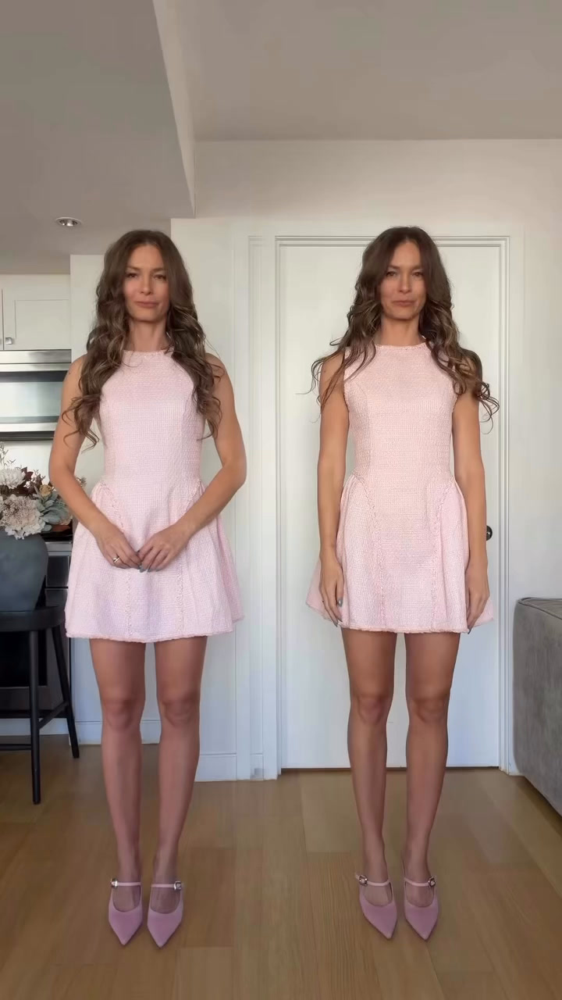
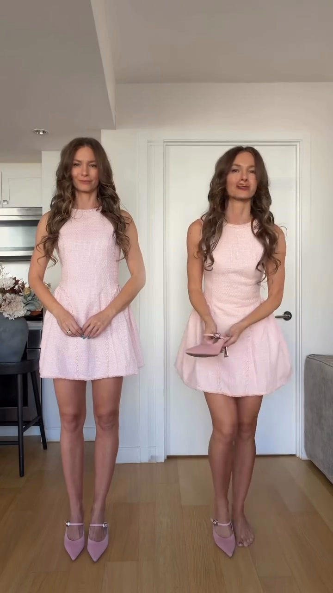
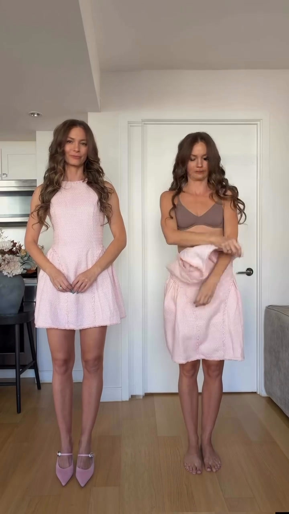
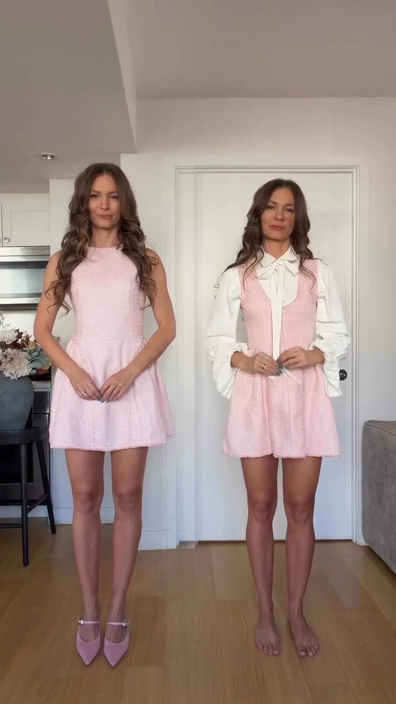
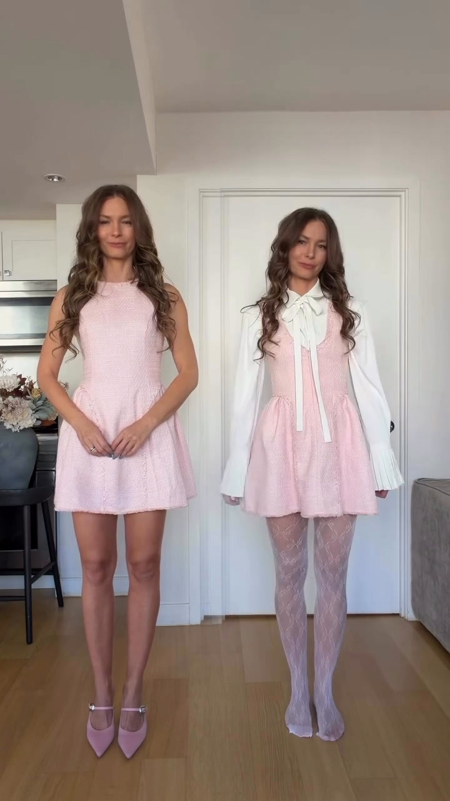
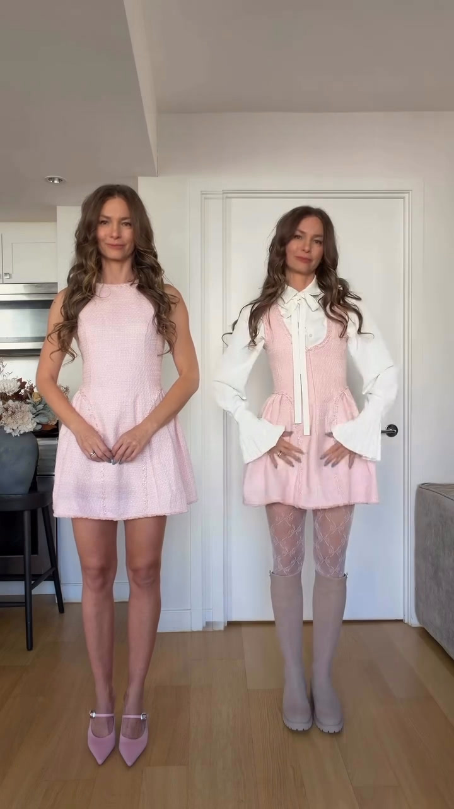
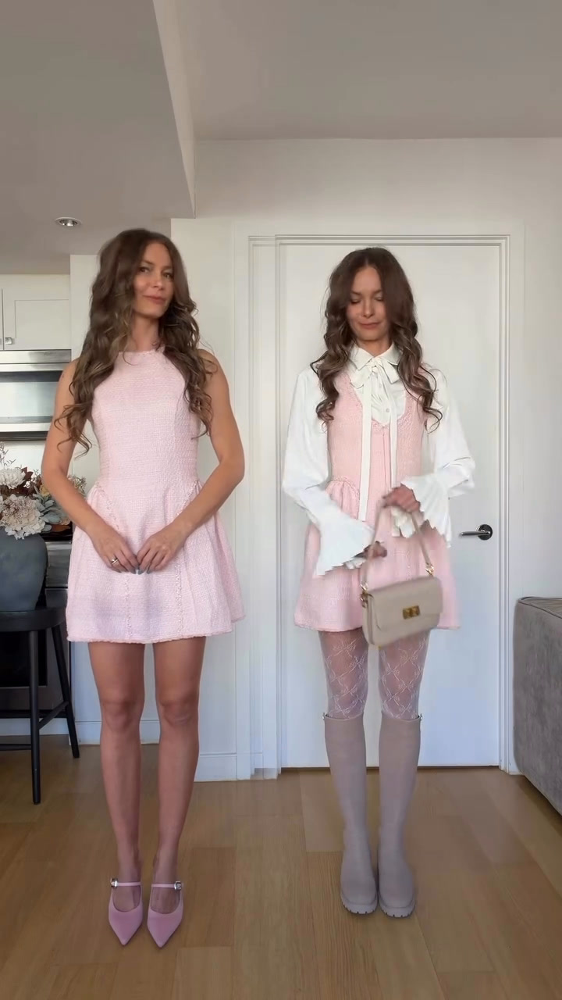
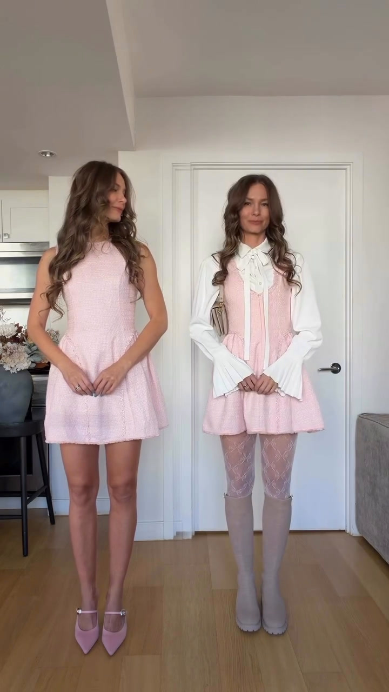

# Wearing vs Styling — 15초 리메이크 · 키프레임 10장

> 같은 핑크 트위드 원피스, 그냥 입기 vs 스타일링하기. 착장은 그대로 두고 모델만 바꿔서 만드는 15초 리메이크 플랜

프롬프트의 모델 문구는 기본값("the model from the attached model reference photo — keep her exact face, hairstyle, hair color, skin tone and body proportions")으로 채워져 있음. 새 모델을 글로 묘사하려면 이 부분만 바꾸면 됨. 페이지에서는 입력칸에 쓰면 전체 프롬프트에 자동 반영.

## 1. 개요

| 항목 | 내용 |
|---|---|
| 리메이크 길이 | 15.0초 · 키프레임 10장 · 비트 10개 (1.2~1.8초) |
| 원본 | 17.7초 = 본편 13.7초 + 인스타 엔드카드 4.0초 → 엔드카드를 빼고 본편을 15초로 재배치 |
| 화면 | 9:16 세로 (원본 720×1280, 업로드는 1080×1920 권장) · 30fps |
| 빠진 것 | IG 아이콘, @아이디, 음원 라벨, 엔드카드. 키프레임 이미지에서도 전부 지움 (타이틀 글자 포함) |
| 유지 | 착장 8종, 공간, 카메라, 동작 순서, 좌우 스플릿 구성 |
| 음악 | 라틴팝/레게톤 계열 약 120BPM, 1초마다 강박 (원본 기준). 음원은 직접 고르기 |

## 2. 15초 타임라인

| 구간 | 파트 | 내용 |
|---|---|---|
| 0.0–1.6s | 훅 + 힐 벗기 | 0.4초 동안 좌우가 똑같이 서 있다가 오른쪽만 힐을 차서 벗고 두 짝을 집어 듦. |
| 1.6–3.0s | 상체 내리기 | 힐을 프레임 밖으로 던지고 팔을 빼서 드레스 상체를 허리까지 내림 (브라렛). |
| 3.0–4.8s | 드레스 뒤집기 | 드레스를 허리에서 180° 돌려 다시 입음 → 등쪽 U라인이 앞으로 와서 피나포어가 됨. 저장 포인트. |
| 4.8–6.2s | 블라우스 | 화이트 보우 블라우스를 털어 펼치고, 점프컷으로 피나포어 안에 입은 상태가 됨. 칼라 정리. |
| 6.2–7.9s | 소매 + 리본 | 팔을 벌려 벨 소매를 털고 목 앞 리본을 묶음. |
| 7.9–9.6s | 레이스 타이츠 | 다리를 들어 화이트 레이스 타이츠를 신고 정자세로 섬. |
| 9.6–11.4s | 니하이 부츠 | 토프 스웨이드 부츠를 들고 들어와 신고 양손 허리 포즈. |
| 11.4–12.6s | 미니백 | 크림 미니백을 집어 들고 내려다봄. |
| 12.6–13.8s | 피날레 | 가방을 오른쪽 어깨에 메고 오프닝과 같은 손 모은 포즈로 섬. 13.2초쯤 왼쪽이 고개를 돌려 오른쪽을 봄. |
| 13.8–15.0s | 홀드 + 리액션 | 둘 다 거의 정지. 오른쪽은 자신감 있는 미소, 왼쪽은 계속 쳐다봄. 마지막 포즈가 첫 포즈와 같아서 루프가 자연스러움. |

### 왜 먹히는가

- 첫 0.4초 동안 좌우가 똑같아서 '뭐가 달라지지?' 궁금증이 생기고, 바로 오른쪽만 움직이며 답을 보여줌.
- 1.5초 안팎마다 아이템이 하나씩 추가됨. 다음 변화가 계속 예고돼서 끝까지 보게 됨.
- 왼쪽은 끝까지 정지 상태라 비포가 화면에 계속 남음. 비교하려고 눈이 계속 왔다 갔다 함.
- 마지막 포즈가 오프닝 포즈와 똑같아서 비포/애프터 대비가 가장 크게 보이고, 왼쪽이 쳐다보는 리액션이 마무리 포인트.
- '드레스를 뒤로 돌려 입으면 피나포어가 된다'는 따라 하기 쉬운 해크가 저장·공유 이유가 됨.
- 엔드카드 없이 15초를 꽉 채우고 끝 포즈가 첫 포즈와 같아서 루프 재생이 자연스러움.

## 3. 의상 아이템 (그대로 유지)

| 아이템 | 한국어 | 프롬프트용 영어 |
|---|---|---|
| dress | 베이비핑크 트위드 부클레 민소매 미니 원피스 (크루넥, 드롭웨이스트, 벌룬 스커트, 프린지 마감) | a baby-pink tweed boucle sleeveless mini dress: high round crew neckline, fitted structured bodice with princess seams, dropped waist, voluminous puffed bubble skirt made of curved gored panels ending mid-thigh, raw frayed self-fringe trim along the seams and hem, fine woven texture with tiny white flecks |
| heels | 더스티핑크 스웨이드 포인티드 메리제인 키튼힐 (크리스탈 버클) | dusty-pink suede pointed-toe Mary Jane kitten heels with a thin strap fastened by a small crystal buckle and a slim clear-silver heel |
| bralette | 모카 토프 심리스 삼각 브라렛 | a mocha-taupe seamless triangle bralette |
| pinafore | 원피스를 뒤로 돌려 입은 상태 = 깊은 U넥 피나포어 | the same pink tweed dress turned around and worn backwards, so its low scooped back now forms a deep U-shaped neckline in front and the dress reads as a pinafore; a faint vertical center seam runs down the front bodice |
| blouse | 아이보리 화이트 블라우스 (작은 칼라, 프릴 자보, 긴 새틴 푸시보우, 플리츠 벨 커프스) | a crisp ivory-white long-sleeve blouse underneath: small pointed collar, a ruffled jabot frill down the placket, an oversized pussy bow at the neck with very long satin ribbon tails, voluminous sleeves ending in dramatic knife-pleated bell cuffs that cover half the hand |
| tights | 화이트 레이스 타이츠 (다이아몬드 격자 + 리본 패턴) | sheer white lace tights with a diamond trellis and tiny bow lace pattern |
| boots | 그레이지 토프 스웨이드 니하이 부츠 (크림 러그솔) | greige-taupe suede pull-on knee-high boots with a chunky cream rubber lug sole and a low block heel |
| bag | 크림 레더 미니 숄더백 (플랩 + 금장 턴락) | a small cream structured leather shoulder bag with a front flap and a gold turn-lock clasp, short shoulder strap |

## 4. 고정 블록

### 모델 기본 착장 (얼굴 기준 이미지)

```text
Full-body photo of the model from the attached model reference photo — keep her exact face, hairstyle, hair color, skin tone and body proportions. She stands facing the camera, feet together, hands loosely clasped in front of her hips, neutral expression, wearing a baby-pink tweed boucle sleeveless mini dress: high round crew neckline, fitted structured bodice with princess seams, dropped waist, voluminous puffed bubble skirt made of curved gored panels ending mid-thigh, raw frayed self-fringe trim along the seams and hem, fine woven texture with tiny white flecks and dusty-pink suede pointed-toe Mary Jane kitten heels with a thin strap fastened by a small crystal buckle and a slim clear-silver heel. Setting: bright minimalist modern apartment. White walls and ceiling with a small recessed round downlight at the upper left. Left side of the room: white shaker kitchen cabinets with a stainless-steel built-in wall oven and microwave stack in the background, and a dark wood stool holding a matte slate-blue ceramic vase with a large dried-flower arrangement (cream hydrangeas, dusty-pink and beige dried blooms). Right side: a white paneled interior door with slim white casing and a matte black lever handle, and the arm of a light-grey boucle sofa peeking in at the far right edge. Light natural-oak wide-plank hardwood floor. Clean and uncluttered. Photorealistic vertical 9:16 smartphone fashion reel still. Shot on a modern iPhone main camera (~26mm equivalent) on a locked-off tripod at chest height, perfectly level horizon, no lens distortion, deep focus with everything sharp. Bright, airy natural daylight: soft diffused window light from camera-left and front, neutral-warm white balance, very soft shadows, gentle reflections on the floor. Soft pastel grade with baby pink as the dominant hue, low contrast, clean unclipped whites, realistic skin texture. Authentic at-home influencer aesthetic, not a studio. Avoid: any text, logos, icons, social-media badges, usernames or watermarks; extra people; deformed hands; cropped head or feet.
```

### 의상 플랫레이 (의상 레퍼런스)

```text
Top-down flat lay product photo on a clean white surface, soft daylight, every item fully visible and evenly spaced: a baby-pink tweed boucle sleeveless mini dress: high round crew neckline, fitted structured bodice with princess seams, dropped waist, voluminous puffed bubble skirt made of curved gored panels ending mid-thigh, raw frayed self-fringe trim along the seams and hem, fine woven texture with tiny white flecks; dusty-pink suede pointed-toe Mary Jane kitten heels with a thin strap fastened by a small crystal buckle and a slim clear-silver heel; a mocha-taupe seamless triangle bralette; a crisp ivory-white long-sleeve blouse underneath: small pointed collar, a ruffled jabot frill down the placket, an oversized pussy bow at the neck with very long satin ribbon tails, voluminous sleeves ending in dramatic knife-pleated bell cuffs that cover half the hand; sheer white lace tights with a diamond trellis and tiny bow lace pattern; greige-taupe suede pull-on knee-high boots with a chunky cream rubber lug sole and a low block heel; a small cream structured leather shoulder bag with a front flap and a gold turn-lock clasp, short shoulder strap. Photorealistic e-commerce styling, true-to-life colors, no text, no props.
```

### 레퍼런스 이미지 안내 블록

```text
Reference images (if attached): [1] model photo = the woman's identity; [2] outfit references = exact garments; [3] key frame = pose, framing and room to copy. Copy the pose, composition and room from [3], but the person must be the model from [1], and the clothes must match [2] exactly.
```

### SET 블록

```text
Setting: bright minimalist modern apartment. White walls and ceiling with a small recessed round downlight at the upper left. Left side of the room: white shaker kitchen cabinets with a stainless-steel built-in wall oven and microwave stack in the background, and a dark wood stool holding a matte slate-blue ceramic vase with a large dried-flower arrangement (cream hydrangeas, dusty-pink and beige dried blooms). Right side: a white paneled interior door with slim white casing and a matte black lever handle, and the arm of a light-grey boucle sofa peeking in at the far right edge. Light natural-oak wide-plank hardwood floor. Clean and uncluttered.
```

### STYLE / CAMERA 블록

```text
Photorealistic vertical 9:16 smartphone fashion reel still. Shot on a modern iPhone main camera (~26mm equivalent) on a locked-off tripod at chest height, perfectly level horizon, no lens distortion, deep focus with everything sharp. Bright, airy natural daylight: soft diffused window light from camera-left and front, neutral-warm white balance, very soft shadows, gentle reflections on the floor. Soft pastel grade with baby pink as the dominant hue, low contrast, clean unclipped whites, realistic skin texture. Authentic at-home influencer aesthetic, not a studio.
```

### SPLIT LAYOUT 블록

```text
Composition: split screen. The 9:16 frame is divided exactly down the vertical center into two equal panels with no visible divider line; the room continues seamlessly across both panels (same room, same locked camera, the kitchen behind the left panel, the white door behind the right panel). The SAME woman appears twice, centered in each panel, both full body head to toe: top of head about 22% from the top of the frame, feet about 8% above the bottom edge. The top 20% of the frame is empty wall.
```

### 타이틀 텍스트 블록 (선택)

```text
Overlay text in the top 16% of the frame: the lowercase word "wearing" in bold white condensed sans-serif centered over the left panel, a large thin white italic serif "VS" centered on the split line, and "styling" in the same bold white condensed sans-serif centered over the right panel; subtle soft drop shadow. No other text or icons.
```

### 네거티브 프롬프트

```text
text, captions, subtitles, watermark, logo, social media icon, username, UI, extra people, third person, extra limbs, extra fingers, fused or deformed hands, duplicated feet, different faces between the two panels, different hair between the two panels, visible split line or border, mismatched backgrounds, motion-blurred face, low resolution, oversaturated, harsh shadows, flash, fisheye, wide-angle distortion, tilted horizon, cropped head, cropped feet, studio backdrop
```

## 5. 키프레임 10장 + 프롬프트

이미지는 `frames/` 폴더 (원본 프레임에서 IG 아이콘·아이디·음원 라벨·타이틀 글자를 지운 버전). 프롬프트 실행할 때 [3] 포즈 레퍼런스로 같이 붙이면 됨.

### F01 · 0.0s — 오프닝 · 양쪽 동일



- **장면:** 훅 프레임. 좌우가 착장·포즈 모두 똑같음. 오른쪽은 팔을 옆으로 곧게 내린 정자세, 왼쪽은 손을 앞으로 모음.
- **오른쪽 착장 단계:** 원피스 + 핑크 힐 (기본)
- **왼쪽:** 정지 · 손 앞으로 모음
- **원본 위치:** 0.00s

**스플릿 프롬프트**

```text
Reference images (if attached): [1] model photo = the woman's identity; [2] outfit references = exact garments; [3] key frame = pose, framing and room to copy. Copy the pose, composition and room from [3], but the person must be the model from [1], and the clothes must match [2] exactly.

Composition: split screen. The 9:16 frame is divided exactly down the vertical center into two equal panels with no visible divider line; the room continues seamlessly across both panels (same room, same locked camera, the kitchen behind the left panel, the white door behind the right panel). The SAME woman appears twice, centered in each panel, both full body head to toe: top of head about 22% from the top of the frame, feet about 8% above the bottom edge. The top 20% of the frame is empty wall.

RIGHT PANEL ('styling'): she is wearing a baby-pink tweed boucle sleeveless mini dress: high round crew neckline, fitted structured bodice with princess seams, dropped waist, voluminous puffed bubble skirt made of curved gored panels ending mid-thigh, raw frayed self-fringe trim along the seams and hem, fine woven texture with tiny white flecks, and dusty-pink suede pointed-toe Mary Jane kitten heels with a thin strap fastened by a small crystal buckle and a slim clear-silver heel. Action and pose: stands still and upright exactly like the left panel, facing the camera, feet together, arms hanging straight at her sides, calm neutral expression; at a glance the two panels look identical.

LEFT PANEL ('wearing'): she stands still and upright facing the camera, feet together in dusty-pink suede pointed-toe Mary Jane kitten heels with a thin strap fastened by a small crystal buckle and a slim clear-silver heel, wearing only the plain pink tweed dress with no styling (a baby-pink tweed boucle sleeveless mini dress: high round crew neckline, fitted structured bodice with princess seams, dropped waist, voluminous puffed bubble skirt made of curved gored panels ending mid-thigh, raw frayed self-fringe trim along the seams and hem, fine woven texture with tiny white flecks), arms relaxed with hands loosely clasped in front of her hips, calm neutral expression with a faint polite smile.

The woman (identical in both panels and in every frame): the model from the attached model reference photo — keep her exact face, hairstyle, hair color, skin tone and body proportions.

Setting: bright minimalist modern apartment. White walls and ceiling with a small recessed round downlight at the upper left. Left side of the room: white shaker kitchen cabinets with a stainless-steel built-in wall oven and microwave stack in the background, and a dark wood stool holding a matte slate-blue ceramic vase with a large dried-flower arrangement (cream hydrangeas, dusty-pink and beige dried blooms). Right side: a white paneled interior door with slim white casing and a matte black lever handle, and the arm of a light-grey boucle sofa peeking in at the far right edge. Light natural-oak wide-plank hardwood floor. Clean and uncluttered.

Photorealistic vertical 9:16 smartphone fashion reel still. Shot on a modern iPhone main camera (~26mm equivalent) on a locked-off tripod at chest height, perfectly level horizon, no lens distortion, deep focus with everything sharp. Bright, airy natural daylight: soft diffused window light from camera-left and front, neutral-warm white balance, very soft shadows, gentle reflections on the floor. Soft pastel grade with baby pink as the dominant hue, low contrast, clean unclipped whites, realistic skin texture. Authentic at-home influencer aesthetic, not a studio.

Avoid: any text, captions, logos, icons, social-media badges, usernames or watermarks; extra people; deformed hands; different faces or hair between the two panels; a visible split line; cropped head or feet.
```

<details><summary>짧은 버전</summary>

```text
Photorealistic vertical 9:16 split-screen fashion reel still: the same woman twice, side by side, full body head to toe, in a bright white minimalist apartment, locked tripod at chest height, soft daylight, airy pastel-pink grade, iPhone look. The woman: the model from the attached model reference photo — keep her exact face, hairstyle, hair color, skin tone and body proportions. LEFT ('wearing'): standing still, hands clasped in front, in the plain baby-pink tweed sleeveless bubble mini dress with frayed trim and dusty-pink suede Mary Jane kitten heels. RIGHT ('styling'): in the baby-pink tweed sleeveless bubble mini dress with frayed trim and dusty-pink suede Mary Jane kitten heels; stands still and upright exactly like the left panel, facing the camera, feet together, arms hanging straight at her sides, calm neutral expression; at a glance the two panels look identical. Background continuous across both halves: white kitchen and dried flowers behind the left, white paneled door with a black handle behind the right, light oak floor. Empty wall at the top. No text, no icons, no watermark, no visible split line.
```
</details>

<details><summary>솔로(오른쪽 인물만)</summary>

```text
Reference images (if attached): [1] model photo = the woman's identity; [2] outfit references = exact garments; [3] key frame = pose, framing and room to copy. Copy the right-hand person's pose from [3], but the person must be the model from [1], and the clothes must match [2] exactly.

Composition: single subject centered, full body head to toe, top of head about 22% from the top of the frame, feet about 8% above the bottom edge, generous empty space on both sides so the frame can be cropped to its central 50% width. Behind her: the white paneled door with a matte black lever handle, the grey boucle sofa arm at the right edge.

Subject: one woman, wearing a baby-pink tweed boucle sleeveless mini dress: high round crew neckline, fitted structured bodice with princess seams, dropped waist, voluminous puffed bubble skirt made of curved gored panels ending mid-thigh, raw frayed self-fringe trim along the seams and hem, fine woven texture with tiny white flecks, and dusty-pink suede pointed-toe Mary Jane kitten heels with a thin strap fastened by a small crystal buckle and a slim clear-silver heel. Action and pose: stands still and upright facing the camera, feet together, arms hanging straight at her sides, calm neutral expression.

The woman: the model from the attached model reference photo — keep her exact face, hairstyle, hair color, skin tone and body proportions.

Photorealistic vertical 9:16 smartphone fashion reel still. Shot on a modern iPhone main camera (~26mm equivalent) on a locked-off tripod at chest height, perfectly level horizon, no lens distortion, deep focus with everything sharp. Bright, airy natural daylight: soft diffused window light from camera-left and front, neutral-warm white balance, very soft shadows, gentle reflections on the floor. Soft pastel grade with baby pink as the dominant hue, low contrast, clean unclipped whites, realistic skin texture. Authentic at-home influencer aesthetic, not a studio.

Avoid: any text, logos, icons, social-media badges, usernames or watermarks; extra people; deformed hands; cropped head or feet.
```
</details>

<details><summary>타이틀 텍스트 포함</summary>

```text
Reference images (if attached): [1] model photo = the woman's identity; [2] outfit references = exact garments; [3] key frame = pose, framing and room to copy. Copy the pose, composition and room from [3], but the person must be the model from [1], and the clothes must match [2] exactly.

Composition: split screen. The 9:16 frame is divided exactly down the vertical center into two equal panels with no visible divider line; the room continues seamlessly across both panels (same room, same locked camera, the kitchen behind the left panel, the white door behind the right panel). The SAME woman appears twice, centered in each panel, both full body head to toe: top of head about 22% from the top of the frame, feet about 8% above the bottom edge. The top 20% of the frame is empty wall.

RIGHT PANEL ('styling'): she is wearing a baby-pink tweed boucle sleeveless mini dress: high round crew neckline, fitted structured bodice with princess seams, dropped waist, voluminous puffed bubble skirt made of curved gored panels ending mid-thigh, raw frayed self-fringe trim along the seams and hem, fine woven texture with tiny white flecks, and dusty-pink suede pointed-toe Mary Jane kitten heels with a thin strap fastened by a small crystal buckle and a slim clear-silver heel. Action and pose: stands still and upright exactly like the left panel, facing the camera, feet together, arms hanging straight at her sides, calm neutral expression; at a glance the two panels look identical.

LEFT PANEL ('wearing'): she stands still and upright facing the camera, feet together in dusty-pink suede pointed-toe Mary Jane kitten heels with a thin strap fastened by a small crystal buckle and a slim clear-silver heel, wearing only the plain pink tweed dress with no styling (a baby-pink tweed boucle sleeveless mini dress: high round crew neckline, fitted structured bodice with princess seams, dropped waist, voluminous puffed bubble skirt made of curved gored panels ending mid-thigh, raw frayed self-fringe trim along the seams and hem, fine woven texture with tiny white flecks), arms relaxed with hands loosely clasped in front of her hips, calm neutral expression with a faint polite smile.

The woman (identical in both panels and in every frame): the model from the attached model reference photo — keep her exact face, hairstyle, hair color, skin tone and body proportions.

Setting: bright minimalist modern apartment. White walls and ceiling with a small recessed round downlight at the upper left. Left side of the room: white shaker kitchen cabinets with a stainless-steel built-in wall oven and microwave stack in the background, and a dark wood stool holding a matte slate-blue ceramic vase with a large dried-flower arrangement (cream hydrangeas, dusty-pink and beige dried blooms). Right side: a white paneled interior door with slim white casing and a matte black lever handle, and the arm of a light-grey boucle sofa peeking in at the far right edge. Light natural-oak wide-plank hardwood floor. Clean and uncluttered.

Photorealistic vertical 9:16 smartphone fashion reel still. Shot on a modern iPhone main camera (~26mm equivalent) on a locked-off tripod at chest height, perfectly level horizon, no lens distortion, deep focus with everything sharp. Bright, airy natural daylight: soft diffused window light from camera-left and front, neutral-warm white balance, very soft shadows, gentle reflections on the floor. Soft pastel grade with baby pink as the dominant hue, low contrast, clean unclipped whites, realistic skin texture. Authentic at-home influencer aesthetic, not a studio.

Overlay text in the top 16% of the frame: the lowercase word "wearing" in bold white condensed sans-serif centered over the left panel, a large thin white italic serif "VS" centered on the split line, and "styling" in the same bold white condensed sans-serif centered over the right panel; subtle soft drop shadow. No other text or icons.

Avoid: any other text, logos, icons, social-media badges, usernames or watermarks; extra people; deformed hands; different faces or hair between the two panels; a visible split line; cropped head or feet.
```
</details>

### F02 · 1.6s — 힐 벗고 들기



- **장면:** 맨발. 차서 벗은 핑크 메리제인 힐 한 켤레를 오른손에 들고 엉덩이 높이에서 내려다봄. 체중은 왼발.
- **오른쪽 착장 단계:** 원피스 · 맨발
- **왼쪽:** 정지 · 손 앞으로 모음
- **원본 위치:** 1.30s

**스플릿 프롬프트**

```text
Reference images (if attached): [1] model photo = the woman's identity; [2] outfit references = exact garments; [3] key frame = pose, framing and room to copy. Copy the pose, composition and room from [3], but the person must be the model from [1], and the clothes must match [2] exactly.

Composition: split screen. The 9:16 frame is divided exactly down the vertical center into two equal panels with no visible divider line; the room continues seamlessly across both panels (same room, same locked camera, the kitchen behind the left panel, the white door behind the right panel). The SAME woman appears twice, centered in each panel, both full body head to toe: top of head about 22% from the top of the frame, feet about 8% above the bottom edge. The top 20% of the frame is empty wall.

RIGHT PANEL ('styling'): she is barefoot, wearing a baby-pink tweed boucle sleeveless mini dress: high round crew neckline, fitted structured bodice with princess seams, dropped waist, voluminous puffed bubble skirt made of curved gored panels ending mid-thigh, raw frayed self-fringe trim along the seams and hem, fine woven texture with tiny white flecks. Action and pose: barefoot, holding the pair of pink Mary Jane kitten heels by their straps in her right hand at hip level, left hand touching one shoe, looking down at them with a small smile, weight on her left leg.

LEFT PANEL ('wearing'): she stands still and upright facing the camera, feet together in dusty-pink suede pointed-toe Mary Jane kitten heels with a thin strap fastened by a small crystal buckle and a slim clear-silver heel, wearing only the plain pink tweed dress with no styling (a baby-pink tweed boucle sleeveless mini dress: high round crew neckline, fitted structured bodice with princess seams, dropped waist, voluminous puffed bubble skirt made of curved gored panels ending mid-thigh, raw frayed self-fringe trim along the seams and hem, fine woven texture with tiny white flecks), arms relaxed with hands loosely clasped in front of her hips, calm neutral expression with a faint polite smile.

The woman (identical in both panels and in every frame): the model from the attached model reference photo — keep her exact face, hairstyle, hair color, skin tone and body proportions.

Setting: bright minimalist modern apartment. White walls and ceiling with a small recessed round downlight at the upper left. Left side of the room: white shaker kitchen cabinets with a stainless-steel built-in wall oven and microwave stack in the background, and a dark wood stool holding a matte slate-blue ceramic vase with a large dried-flower arrangement (cream hydrangeas, dusty-pink and beige dried blooms). Right side: a white paneled interior door with slim white casing and a matte black lever handle, and the arm of a light-grey boucle sofa peeking in at the far right edge. Light natural-oak wide-plank hardwood floor. Clean and uncluttered.

Photorealistic vertical 9:16 smartphone fashion reel still. Shot on a modern iPhone main camera (~26mm equivalent) on a locked-off tripod at chest height, perfectly level horizon, no lens distortion, deep focus with everything sharp. Bright, airy natural daylight: soft diffused window light from camera-left and front, neutral-warm white balance, very soft shadows, gentle reflections on the floor. Soft pastel grade with baby pink as the dominant hue, low contrast, clean unclipped whites, realistic skin texture. Authentic at-home influencer aesthetic, not a studio.

Avoid: any text, captions, logos, icons, social-media badges, usernames or watermarks; extra people; deformed hands; different faces or hair between the two panels; a visible split line; cropped head or feet.
```

<details><summary>짧은 버전</summary>

```text
Photorealistic vertical 9:16 split-screen fashion reel still: the same woman twice, side by side, full body head to toe, in a bright white minimalist apartment, locked tripod at chest height, soft daylight, airy pastel-pink grade, iPhone look. The woman: the model from the attached model reference photo — keep her exact face, hairstyle, hair color, skin tone and body proportions. LEFT ('wearing'): standing still, hands clasped in front, in the plain baby-pink tweed sleeveless bubble mini dress with frayed trim and dusty-pink suede Mary Jane kitten heels. RIGHT ('styling'): barefoot in the baby-pink tweed sleeveless bubble mini dress with frayed trim; barefoot, holding the pair of pink Mary Jane kitten heels by their straps in her right hand at hip level, left hand touching one shoe, looking down at them with a small smile, weight on her left leg. Background continuous across both halves: white kitchen and dried flowers behind the left, white paneled door with a black handle behind the right, light oak floor. Empty wall at the top. No text, no icons, no watermark, no visible split line.
```
</details>

<details><summary>솔로(오른쪽 인물만)</summary>

```text
Reference images (if attached): [1] model photo = the woman's identity; [2] outfit references = exact garments; [3] key frame = pose, framing and room to copy. Copy the right-hand person's pose from [3], but the person must be the model from [1], and the clothes must match [2] exactly.

Composition: single subject centered, full body head to toe, top of head about 22% from the top of the frame, feet about 8% above the bottom edge, generous empty space on both sides so the frame can be cropped to its central 50% width. Behind her: the white paneled door with a matte black lever handle, the grey boucle sofa arm at the right edge.

Subject: one woman, barefoot, wearing a baby-pink tweed boucle sleeveless mini dress: high round crew neckline, fitted structured bodice with princess seams, dropped waist, voluminous puffed bubble skirt made of curved gored panels ending mid-thigh, raw frayed self-fringe trim along the seams and hem, fine woven texture with tiny white flecks. Action and pose: barefoot, holding the pair of pink Mary Jane kitten heels by their straps in her right hand at hip level, left hand touching one shoe, looking down at them with a small smile, weight on her left leg.

The woman: the model from the attached model reference photo — keep her exact face, hairstyle, hair color, skin tone and body proportions.

Photorealistic vertical 9:16 smartphone fashion reel still. Shot on a modern iPhone main camera (~26mm equivalent) on a locked-off tripod at chest height, perfectly level horizon, no lens distortion, deep focus with everything sharp. Bright, airy natural daylight: soft diffused window light from camera-left and front, neutral-warm white balance, very soft shadows, gentle reflections on the floor. Soft pastel grade with baby pink as the dominant hue, low contrast, clean unclipped whites, realistic skin texture. Authentic at-home influencer aesthetic, not a studio.

Avoid: any text, logos, icons, social-media badges, usernames or watermarks; extra people; deformed hands; cropped head or feet.
```
</details>

<details><summary>타이틀 텍스트 포함</summary>

```text
Reference images (if attached): [1] model photo = the woman's identity; [2] outfit references = exact garments; [3] key frame = pose, framing and room to copy. Copy the pose, composition and room from [3], but the person must be the model from [1], and the clothes must match [2] exactly.

Composition: split screen. The 9:16 frame is divided exactly down the vertical center into two equal panels with no visible divider line; the room continues seamlessly across both panels (same room, same locked camera, the kitchen behind the left panel, the white door behind the right panel). The SAME woman appears twice, centered in each panel, both full body head to toe: top of head about 22% from the top of the frame, feet about 8% above the bottom edge. The top 20% of the frame is empty wall.

RIGHT PANEL ('styling'): she is barefoot, wearing a baby-pink tweed boucle sleeveless mini dress: high round crew neckline, fitted structured bodice with princess seams, dropped waist, voluminous puffed bubble skirt made of curved gored panels ending mid-thigh, raw frayed self-fringe trim along the seams and hem, fine woven texture with tiny white flecks. Action and pose: barefoot, holding the pair of pink Mary Jane kitten heels by their straps in her right hand at hip level, left hand touching one shoe, looking down at them with a small smile, weight on her left leg.

LEFT PANEL ('wearing'): she stands still and upright facing the camera, feet together in dusty-pink suede pointed-toe Mary Jane kitten heels with a thin strap fastened by a small crystal buckle and a slim clear-silver heel, wearing only the plain pink tweed dress with no styling (a baby-pink tweed boucle sleeveless mini dress: high round crew neckline, fitted structured bodice with princess seams, dropped waist, voluminous puffed bubble skirt made of curved gored panels ending mid-thigh, raw frayed self-fringe trim along the seams and hem, fine woven texture with tiny white flecks), arms relaxed with hands loosely clasped in front of her hips, calm neutral expression with a faint polite smile.

The woman (identical in both panels and in every frame): the model from the attached model reference photo — keep her exact face, hairstyle, hair color, skin tone and body proportions.

Setting: bright minimalist modern apartment. White walls and ceiling with a small recessed round downlight at the upper left. Left side of the room: white shaker kitchen cabinets with a stainless-steel built-in wall oven and microwave stack in the background, and a dark wood stool holding a matte slate-blue ceramic vase with a large dried-flower arrangement (cream hydrangeas, dusty-pink and beige dried blooms). Right side: a white paneled interior door with slim white casing and a matte black lever handle, and the arm of a light-grey boucle sofa peeking in at the far right edge. Light natural-oak wide-plank hardwood floor. Clean and uncluttered.

Photorealistic vertical 9:16 smartphone fashion reel still. Shot on a modern iPhone main camera (~26mm equivalent) on a locked-off tripod at chest height, perfectly level horizon, no lens distortion, deep focus with everything sharp. Bright, airy natural daylight: soft diffused window light from camera-left and front, neutral-warm white balance, very soft shadows, gentle reflections on the floor. Soft pastel grade with baby pink as the dominant hue, low contrast, clean unclipped whites, realistic skin texture. Authentic at-home influencer aesthetic, not a studio.

Overlay text in the top 16% of the frame: the lowercase word "wearing" in bold white condensed sans-serif centered over the left panel, a large thin white italic serif "VS" centered on the split line, and "styling" in the same bold white condensed sans-serif centered over the right panel; subtle soft drop shadow. No other text or icons.

Avoid: any other text, logos, icons, social-media badges, usernames or watermarks; extra people; deformed hands; different faces or hair between the two panels; a visible split line; cropped head or feet.
```
</details>

### F03 · 3.0s — 상체 허리까지 내림



- **장면:** 힐은 프레임 밖으로 던진 뒤. 드레스 상체를 허리까지 내려 모카 브라렛 노출. 양손으로 허리에 뭉친 원단을 잡고 드레스를 돌리기 직전.
- **오른쪽 착장 단계:** 원피스 상체 내림 · 브라렛
- **왼쪽:** 정지 · 손 앞으로 모음
- **원본 위치:** 2.50s

**스플릿 프롬프트**

```text
Reference images (if attached): [1] model photo = the woman's identity; [2] outfit references = exact garments; [3] key frame = pose, framing and room to copy. Copy the pose, composition and room from [3], but the person must be the model from [1], and the clothes must match [2] exactly.

Composition: split screen. The 9:16 frame is divided exactly down the vertical center into two equal panels with no visible divider line; the room continues seamlessly across both panels (same room, same locked camera, the kitchen behind the left panel, the white door behind the right panel). The SAME woman appears twice, centered in each panel, both full body head to toe: top of head about 22% from the top of the frame, feet about 8% above the bottom edge. The top 20% of the frame is empty wall.

RIGHT PANEL ('styling'): she is barefoot; the pink tweed dress is peeled down so the bodice hangs folded around her waist and hips, revealing a mocha-taupe seamless triangle bralette and a toned midriff. Action and pose: both hands gripping the folded fabric at her waist, elbows bent, looking down at the dress, shoulders relaxed, about to rotate the dress around her body.

LEFT PANEL ('wearing'): she stands still and upright facing the camera, feet together in dusty-pink suede pointed-toe Mary Jane kitten heels with a thin strap fastened by a small crystal buckle and a slim clear-silver heel, wearing only the plain pink tweed dress with no styling (a baby-pink tweed boucle sleeveless mini dress: high round crew neckline, fitted structured bodice with princess seams, dropped waist, voluminous puffed bubble skirt made of curved gored panels ending mid-thigh, raw frayed self-fringe trim along the seams and hem, fine woven texture with tiny white flecks), arms relaxed with hands loosely clasped in front of her hips, calm neutral expression with a faint polite smile.

The woman (identical in both panels and in every frame): the model from the attached model reference photo — keep her exact face, hairstyle, hair color, skin tone and body proportions.

Setting: bright minimalist modern apartment. White walls and ceiling with a small recessed round downlight at the upper left. Left side of the room: white shaker kitchen cabinets with a stainless-steel built-in wall oven and microwave stack in the background, and a dark wood stool holding a matte slate-blue ceramic vase with a large dried-flower arrangement (cream hydrangeas, dusty-pink and beige dried blooms). Right side: a white paneled interior door with slim white casing and a matte black lever handle, and the arm of a light-grey boucle sofa peeking in at the far right edge. Light natural-oak wide-plank hardwood floor. Clean and uncluttered.

Photorealistic vertical 9:16 smartphone fashion reel still. Shot on a modern iPhone main camera (~26mm equivalent) on a locked-off tripod at chest height, perfectly level horizon, no lens distortion, deep focus with everything sharp. Bright, airy natural daylight: soft diffused window light from camera-left and front, neutral-warm white balance, very soft shadows, gentle reflections on the floor. Soft pastel grade with baby pink as the dominant hue, low contrast, clean unclipped whites, realistic skin texture. Authentic at-home influencer aesthetic, not a studio.

Avoid: any text, captions, logos, icons, social-media badges, usernames or watermarks; extra people; deformed hands; different faces or hair between the two panels; a visible split line; cropped head or feet.
```

<details><summary>짧은 버전</summary>

```text
Photorealistic vertical 9:16 split-screen fashion reel still: the same woman twice, side by side, full body head to toe, in a bright white minimalist apartment, locked tripod at chest height, soft daylight, airy pastel-pink grade, iPhone look. The woman: the model from the attached model reference photo — keep her exact face, hairstyle, hair color, skin tone and body proportions. LEFT ('wearing'): standing still, hands clasped in front, in the plain baby-pink tweed sleeveless bubble mini dress with frayed trim and dusty-pink suede Mary Jane kitten heels. RIGHT ('styling'): barefoot, dress bodice peeled down to her waist, mocha seamless bralette; both hands gripping the folded fabric at her waist, elbows bent, looking down at the dress, shoulders relaxed, about to rotate the dress around her body. Background continuous across both halves: white kitchen and dried flowers behind the left, white paneled door with a black handle behind the right, light oak floor. Empty wall at the top. No text, no icons, no watermark, no visible split line.
```
</details>

<details><summary>솔로(오른쪽 인물만)</summary>

```text
Reference images (if attached): [1] model photo = the woman's identity; [2] outfit references = exact garments; [3] key frame = pose, framing and room to copy. Copy the right-hand person's pose from [3], but the person must be the model from [1], and the clothes must match [2] exactly.

Composition: single subject centered, full body head to toe, top of head about 22% from the top of the frame, feet about 8% above the bottom edge, generous empty space on both sides so the frame can be cropped to its central 50% width. Behind her: the white paneled door with a matte black lever handle, the grey boucle sofa arm at the right edge.

Subject: one woman, barefoot; the pink tweed dress is peeled down so the bodice hangs folded around her waist and hips, revealing a mocha-taupe seamless triangle bralette and a toned midriff. Action and pose: both hands gripping the folded fabric at her waist, elbows bent, looking down at the dress, shoulders relaxed, about to rotate the dress around her body.

The woman: the model from the attached model reference photo — keep her exact face, hairstyle, hair color, skin tone and body proportions.

Photorealistic vertical 9:16 smartphone fashion reel still. Shot on a modern iPhone main camera (~26mm equivalent) on a locked-off tripod at chest height, perfectly level horizon, no lens distortion, deep focus with everything sharp. Bright, airy natural daylight: soft diffused window light from camera-left and front, neutral-warm white balance, very soft shadows, gentle reflections on the floor. Soft pastel grade with baby pink as the dominant hue, low contrast, clean unclipped whites, realistic skin texture. Authentic at-home influencer aesthetic, not a studio.

Avoid: any text, logos, icons, social-media badges, usernames or watermarks; extra people; deformed hands; cropped head or feet.
```
</details>

<details><summary>타이틀 텍스트 포함</summary>

```text
Reference images (if attached): [1] model photo = the woman's identity; [2] outfit references = exact garments; [3] key frame = pose, framing and room to copy. Copy the pose, composition and room from [3], but the person must be the model from [1], and the clothes must match [2] exactly.

Composition: split screen. The 9:16 frame is divided exactly down the vertical center into two equal panels with no visible divider line; the room continues seamlessly across both panels (same room, same locked camera, the kitchen behind the left panel, the white door behind the right panel). The SAME woman appears twice, centered in each panel, both full body head to toe: top of head about 22% from the top of the frame, feet about 8% above the bottom edge. The top 20% of the frame is empty wall.

RIGHT PANEL ('styling'): she is barefoot; the pink tweed dress is peeled down so the bodice hangs folded around her waist and hips, revealing a mocha-taupe seamless triangle bralette and a toned midriff. Action and pose: both hands gripping the folded fabric at her waist, elbows bent, looking down at the dress, shoulders relaxed, about to rotate the dress around her body.

LEFT PANEL ('wearing'): she stands still and upright facing the camera, feet together in dusty-pink suede pointed-toe Mary Jane kitten heels with a thin strap fastened by a small crystal buckle and a slim clear-silver heel, wearing only the plain pink tweed dress with no styling (a baby-pink tweed boucle sleeveless mini dress: high round crew neckline, fitted structured bodice with princess seams, dropped waist, voluminous puffed bubble skirt made of curved gored panels ending mid-thigh, raw frayed self-fringe trim along the seams and hem, fine woven texture with tiny white flecks), arms relaxed with hands loosely clasped in front of her hips, calm neutral expression with a faint polite smile.

The woman (identical in both panels and in every frame): the model from the attached model reference photo — keep her exact face, hairstyle, hair color, skin tone and body proportions.

Setting: bright minimalist modern apartment. White walls and ceiling with a small recessed round downlight at the upper left. Left side of the room: white shaker kitchen cabinets with a stainless-steel built-in wall oven and microwave stack in the background, and a dark wood stool holding a matte slate-blue ceramic vase with a large dried-flower arrangement (cream hydrangeas, dusty-pink and beige dried blooms). Right side: a white paneled interior door with slim white casing and a matte black lever handle, and the arm of a light-grey boucle sofa peeking in at the far right edge. Light natural-oak wide-plank hardwood floor. Clean and uncluttered.

Photorealistic vertical 9:16 smartphone fashion reel still. Shot on a modern iPhone main camera (~26mm equivalent) on a locked-off tripod at chest height, perfectly level horizon, no lens distortion, deep focus with everything sharp. Bright, airy natural daylight: soft diffused window light from camera-left and front, neutral-warm white balance, very soft shadows, gentle reflections on the floor. Soft pastel grade with baby pink as the dominant hue, low contrast, clean unclipped whites, realistic skin texture. Authentic at-home influencer aesthetic, not a studio.

Overlay text in the top 16% of the frame: the lowercase word "wearing" in bold white condensed sans-serif centered over the left panel, a large thin white italic serif "VS" centered on the split line, and "styling" in the same bold white condensed sans-serif centered over the right panel; subtle soft drop shadow. No other text or icons.

Avoid: any other text, logos, icons, social-media badges, usernames or watermarks; extra people; deformed hands; different faces or hair between the two panels; a visible split line; cropped head or feet.
```
</details>

### F04 · 4.8s — U넥 피나포어 완성


- **장면:** 드레스를 뒤로 돌려 입어 깊은 U넥 피나포어가 됨 (핵심 해크). 앞 중심에 등 솔기선이 보이고 브라렛이 살짝 드러남. 오른손으로 네크라인 정리.
- **오른쪽 착장 단계:** 원피스 뒤로 돌려 입음 = U넥 피나포어
- **왼쪽:** 정지 · 손 앞으로 모음
- **원본 위치:** 4.40s

**스플릿 프롬프트**

```text
Reference images (if attached): [1] model photo = the woman's identity; [2] outfit references = exact garments; [3] key frame = pose, framing and room to copy. Copy the pose, composition and room from [3], but the person must be the model from [1], and the clothes must match [2] exactly.

Composition: split screen. The 9:16 frame is divided exactly down the vertical center into two equal panels with no visible divider line; the room continues seamlessly across both panels (same room, same locked camera, the kitchen behind the left panel, the white door behind the right panel). The SAME woman appears twice, centered in each panel, both full body head to toe: top of head about 22% from the top of the frame, feet about 8% above the bottom edge. The top 20% of the frame is empty wall.

RIGHT PANEL ('styling'): she is barefoot, in the same pink tweed dress turned around and worn backwards, so its low scooped back now forms a deep U-shaped neckline in front and the dress reads as a pinafore; a faint vertical center seam runs down the front bodice, over a mocha-taupe seamless triangle bralette that peeks out of the neckline. Action and pose: her right hand at the center of the new neckline adjusting the fit, left hand smoothing the skirt at her hip, looking down at the neckline, feet together.

LEFT PANEL ('wearing'): she stands still and upright facing the camera, feet together in dusty-pink suede pointed-toe Mary Jane kitten heels with a thin strap fastened by a small crystal buckle and a slim clear-silver heel, wearing only the plain pink tweed dress with no styling (a baby-pink tweed boucle sleeveless mini dress: high round crew neckline, fitted structured bodice with princess seams, dropped waist, voluminous puffed bubble skirt made of curved gored panels ending mid-thigh, raw frayed self-fringe trim along the seams and hem, fine woven texture with tiny white flecks), arms relaxed with hands loosely clasped in front of her hips, calm neutral expression with a faint polite smile.

The woman (identical in both panels and in every frame): the model from the attached model reference photo — keep her exact face, hairstyle, hair color, skin tone and body proportions.

Setting: bright minimalist modern apartment. White walls and ceiling with a small recessed round downlight at the upper left. Left side of the room: white shaker kitchen cabinets with a stainless-steel built-in wall oven and microwave stack in the background, and a dark wood stool holding a matte slate-blue ceramic vase with a large dried-flower arrangement (cream hydrangeas, dusty-pink and beige dried blooms). Right side: a white paneled interior door with slim white casing and a matte black lever handle, and the arm of a light-grey boucle sofa peeking in at the far right edge. Light natural-oak wide-plank hardwood floor. Clean and uncluttered.

Photorealistic vertical 9:16 smartphone fashion reel still. Shot on a modern iPhone main camera (~26mm equivalent) on a locked-off tripod at chest height, perfectly level horizon, no lens distortion, deep focus with everything sharp. Bright, airy natural daylight: soft diffused window light from camera-left and front, neutral-warm white balance, very soft shadows, gentle reflections on the floor. Soft pastel grade with baby pink as the dominant hue, low contrast, clean unclipped whites, realistic skin texture. Authentic at-home influencer aesthetic, not a studio.

Avoid: any text, captions, logos, icons, social-media badges, usernames or watermarks; extra people; deformed hands; different faces or hair between the two panels; a visible split line; cropped head or feet.
```

<details><summary>짧은 버전</summary>

```text
Photorealistic vertical 9:16 split-screen fashion reel still: the same woman twice, side by side, full body head to toe, in a bright white minimalist apartment, locked tripod at chest height, soft daylight, airy pastel-pink grade, iPhone look. The woman: the model from the attached model reference photo — keep her exact face, hairstyle, hair color, skin tone and body proportions. LEFT ('wearing'): standing still, hands clasped in front, in the plain baby-pink tweed sleeveless bubble mini dress with frayed trim and dusty-pink suede Mary Jane kitten heels. RIGHT ('styling'): barefoot in the pink tweed dress worn backwards as a deep U-neck pinafore over a mocha seamless bralette; her right hand at the center of the new neckline adjusting the fit, left hand smoothing the skirt at her hip, looking down at the neckline, feet together. Background continuous across both halves: white kitchen and dried flowers behind the left, white paneled door with a black handle behind the right, light oak floor. Empty wall at the top. No text, no icons, no watermark, no visible split line.
```
</details>

<details><summary>솔로(오른쪽 인물만)</summary>

```text
Reference images (if attached): [1] model photo = the woman's identity; [2] outfit references = exact garments; [3] key frame = pose, framing and room to copy. Copy the right-hand person's pose from [3], but the person must be the model from [1], and the clothes must match [2] exactly.

Composition: single subject centered, full body head to toe, top of head about 22% from the top of the frame, feet about 8% above the bottom edge, generous empty space on both sides so the frame can be cropped to its central 50% width. Behind her: the white paneled door with a matte black lever handle, the grey boucle sofa arm at the right edge.

Subject: one woman, barefoot, in the same pink tweed dress turned around and worn backwards, so its low scooped back now forms a deep U-shaped neckline in front and the dress reads as a pinafore; a faint vertical center seam runs down the front bodice, over a mocha-taupe seamless triangle bralette that peeks out of the neckline. Action and pose: her right hand at the center of the new neckline adjusting the fit, left hand smoothing the skirt at her hip, looking down at the neckline, feet together.

The woman: the model from the attached model reference photo — keep her exact face, hairstyle, hair color, skin tone and body proportions.

Photorealistic vertical 9:16 smartphone fashion reel still. Shot on a modern iPhone main camera (~26mm equivalent) on a locked-off tripod at chest height, perfectly level horizon, no lens distortion, deep focus with everything sharp. Bright, airy natural daylight: soft diffused window light from camera-left and front, neutral-warm white balance, very soft shadows, gentle reflections on the floor. Soft pastel grade with baby pink as the dominant hue, low contrast, clean unclipped whites, realistic skin texture. Authentic at-home influencer aesthetic, not a studio.

Avoid: any text, logos, icons, social-media badges, usernames or watermarks; extra people; deformed hands; cropped head or feet.
```
</details>

<details><summary>타이틀 텍스트 포함</summary>

```text
Reference images (if attached): [1] model photo = the woman's identity; [2] outfit references = exact garments; [3] key frame = pose, framing and room to copy. Copy the pose, composition and room from [3], but the person must be the model from [1], and the clothes must match [2] exactly.

Composition: split screen. The 9:16 frame is divided exactly down the vertical center into two equal panels with no visible divider line; the room continues seamlessly across both panels (same room, same locked camera, the kitchen behind the left panel, the white door behind the right panel). The SAME woman appears twice, centered in each panel, both full body head to toe: top of head about 22% from the top of the frame, feet about 8% above the bottom edge. The top 20% of the frame is empty wall.

RIGHT PANEL ('styling'): she is barefoot, in the same pink tweed dress turned around and worn backwards, so its low scooped back now forms a deep U-shaped neckline in front and the dress reads as a pinafore; a faint vertical center seam runs down the front bodice, over a mocha-taupe seamless triangle bralette that peeks out of the neckline. Action and pose: her right hand at the center of the new neckline adjusting the fit, left hand smoothing the skirt at her hip, looking down at the neckline, feet together.

LEFT PANEL ('wearing'): she stands still and upright facing the camera, feet together in dusty-pink suede pointed-toe Mary Jane kitten heels with a thin strap fastened by a small crystal buckle and a slim clear-silver heel, wearing only the plain pink tweed dress with no styling (a baby-pink tweed boucle sleeveless mini dress: high round crew neckline, fitted structured bodice with princess seams, dropped waist, voluminous puffed bubble skirt made of curved gored panels ending mid-thigh, raw frayed self-fringe trim along the seams and hem, fine woven texture with tiny white flecks), arms relaxed with hands loosely clasped in front of her hips, calm neutral expression with a faint polite smile.

The woman (identical in both panels and in every frame): the model from the attached model reference photo — keep her exact face, hairstyle, hair color, skin tone and body proportions.

Setting: bright minimalist modern apartment. White walls and ceiling with a small recessed round downlight at the upper left. Left side of the room: white shaker kitchen cabinets with a stainless-steel built-in wall oven and microwave stack in the background, and a dark wood stool holding a matte slate-blue ceramic vase with a large dried-flower arrangement (cream hydrangeas, dusty-pink and beige dried blooms). Right side: a white paneled interior door with slim white casing and a matte black lever handle, and the arm of a light-grey boucle sofa peeking in at the far right edge. Light natural-oak wide-plank hardwood floor. Clean and uncluttered.

Photorealistic vertical 9:16 smartphone fashion reel still. Shot on a modern iPhone main camera (~26mm equivalent) on a locked-off tripod at chest height, perfectly level horizon, no lens distortion, deep focus with everything sharp. Bright, airy natural daylight: soft diffused window light from camera-left and front, neutral-warm white balance, very soft shadows, gentle reflections on the floor. Soft pastel grade with baby pink as the dominant hue, low contrast, clean unclipped whites, realistic skin texture. Authentic at-home influencer aesthetic, not a studio.

Overlay text in the top 16% of the frame: the lowercase word "wearing" in bold white condensed sans-serif centered over the left panel, a large thin white italic serif "VS" centered on the split line, and "styling" in the same bold white condensed sans-serif centered over the right panel; subtle soft drop shadow. No other text or icons.

Avoid: any other text, logos, icons, social-media badges, usernames or watermarks; extra people; deformed hands; different faces or hair between the two panels; a visible split line; cropped head or feet.
```
</details>

### F05 · 6.2s — 블라우스 레이어링


- **장면:** 블라우스를 피나포어 안에 입은 상태. 양손을 목에 대고 칼라를 세워 정리, 팔꿈치 넓게 벌림. 리본은 아직 안 묶고 늘어뜨림.
- **오른쪽 착장 단계:** 피나포어 + 보우 블라우스
- **왼쪽:** 정지 · 손 앞으로 모음
- **원본 위치:** 5.60s

**스플릿 프롬프트**

```text
Reference images (if attached): [1] model photo = the woman's identity; [2] outfit references = exact garments; [3] key frame = pose, framing and room to copy. Copy the pose, composition and room from [3], but the person must be the model from [1], and the clothes must match [2] exactly.

Composition: split screen. The 9:16 frame is divided exactly down the vertical center into two equal panels with no visible divider line; the room continues seamlessly across both panels (same room, same locked camera, the kitchen behind the left panel, the white door behind the right panel). The SAME woman appears twice, centered in each panel, both full body head to toe: top of head about 22% from the top of the frame, feet about 8% above the bottom edge. The top 20% of the frame is empty wall.

RIGHT PANEL ('styling'): she is barefoot, in the same pink tweed dress turned around and worn backwards, so its low scooped back now forms a deep U-shaped neckline in front and the dress reads as a pinafore; a faint vertical center seam runs down the front bodice, layered over a crisp ivory-white long-sleeve blouse underneath: small pointed collar, a ruffled jabot frill down the placket, an oversized pussy bow at the neck with very long satin ribbon tails, voluminous sleeves ending in dramatic knife-pleated bell cuffs that cover half the hand. Action and pose: the bow still untied with both ribbon tails hanging loose; both hands at her neck straightening the pointed collar, elbows out wide, the voluminous sleeves billowing, looking straight at the camera with a relaxed expression.

LEFT PANEL ('wearing'): she stands still and upright facing the camera, feet together in dusty-pink suede pointed-toe Mary Jane kitten heels with a thin strap fastened by a small crystal buckle and a slim clear-silver heel, wearing only the plain pink tweed dress with no styling (a baby-pink tweed boucle sleeveless mini dress: high round crew neckline, fitted structured bodice with princess seams, dropped waist, voluminous puffed bubble skirt made of curved gored panels ending mid-thigh, raw frayed self-fringe trim along the seams and hem, fine woven texture with tiny white flecks), arms relaxed with hands loosely clasped in front of her hips, calm neutral expression with a faint polite smile.

The woman (identical in both panels and in every frame): the model from the attached model reference photo — keep her exact face, hairstyle, hair color, skin tone and body proportions.

Setting: bright minimalist modern apartment. White walls and ceiling with a small recessed round downlight at the upper left. Left side of the room: white shaker kitchen cabinets with a stainless-steel built-in wall oven and microwave stack in the background, and a dark wood stool holding a matte slate-blue ceramic vase with a large dried-flower arrangement (cream hydrangeas, dusty-pink and beige dried blooms). Right side: a white paneled interior door with slim white casing and a matte black lever handle, and the arm of a light-grey boucle sofa peeking in at the far right edge. Light natural-oak wide-plank hardwood floor. Clean and uncluttered.

Photorealistic vertical 9:16 smartphone fashion reel still. Shot on a modern iPhone main camera (~26mm equivalent) on a locked-off tripod at chest height, perfectly level horizon, no lens distortion, deep focus with everything sharp. Bright, airy natural daylight: soft diffused window light from camera-left and front, neutral-warm white balance, very soft shadows, gentle reflections on the floor. Soft pastel grade with baby pink as the dominant hue, low contrast, clean unclipped whites, realistic skin texture. Authentic at-home influencer aesthetic, not a studio.

Avoid: any text, captions, logos, icons, social-media badges, usernames or watermarks; extra people; deformed hands; different faces or hair between the two panels; a visible split line; cropped head or feet.
```

<details><summary>짧은 버전</summary>

```text
Photorealistic vertical 9:16 split-screen fashion reel still: the same woman twice, side by side, full body head to toe, in a bright white minimalist apartment, locked tripod at chest height, soft daylight, airy pastel-pink grade, iPhone look. The woman: the model from the attached model reference photo — keep her exact face, hairstyle, hair color, skin tone and body proportions. LEFT ('wearing'): standing still, hands clasped in front, in the plain baby-pink tweed sleeveless bubble mini dress with frayed trim and dusty-pink suede Mary Jane kitten heels. RIGHT ('styling'): barefoot in the pink tweed dress worn backwards as a deep U-neck pinafore over a white pussy-bow blouse with long ribbon ties and pleated bell sleeves; the bow still untied with both ribbon tails hanging loose; both hands at her neck straightening the pointed collar, elbows out wide, the voluminous sleeves billowing, looking straight at the camera with a relaxed expression. Background continuous across both halves: white kitchen and dried flowers behind the left, white paneled door with a black handle behind the right, light oak floor. Empty wall at the top. No text, no icons, no watermark, no visible split line.
```
</details>

<details><summary>솔로(오른쪽 인물만)</summary>

```text
Reference images (if attached): [1] model photo = the woman's identity; [2] outfit references = exact garments; [3] key frame = pose, framing and room to copy. Copy the right-hand person's pose from [3], but the person must be the model from [1], and the clothes must match [2] exactly.

Composition: single subject centered, full body head to toe, top of head about 22% from the top of the frame, feet about 8% above the bottom edge, generous empty space on both sides so the frame can be cropped to its central 50% width. Behind her: the white paneled door with a matte black lever handle, the grey boucle sofa arm at the right edge.

Subject: one woman, barefoot, in the same pink tweed dress turned around and worn backwards, so its low scooped back now forms a deep U-shaped neckline in front and the dress reads as a pinafore; a faint vertical center seam runs down the front bodice, layered over a crisp ivory-white long-sleeve blouse underneath: small pointed collar, a ruffled jabot frill down the placket, an oversized pussy bow at the neck with very long satin ribbon tails, voluminous sleeves ending in dramatic knife-pleated bell cuffs that cover half the hand. Action and pose: the bow still untied with both ribbon tails hanging loose; both hands at her neck straightening the pointed collar, elbows out wide, the voluminous sleeves billowing, looking straight at the camera with a relaxed expression.

The woman: the model from the attached model reference photo — keep her exact face, hairstyle, hair color, skin tone and body proportions.

Photorealistic vertical 9:16 smartphone fashion reel still. Shot on a modern iPhone main camera (~26mm equivalent) on a locked-off tripod at chest height, perfectly level horizon, no lens distortion, deep focus with everything sharp. Bright, airy natural daylight: soft diffused window light from camera-left and front, neutral-warm white balance, very soft shadows, gentle reflections on the floor. Soft pastel grade with baby pink as the dominant hue, low contrast, clean unclipped whites, realistic skin texture. Authentic at-home influencer aesthetic, not a studio.

Avoid: any text, logos, icons, social-media badges, usernames or watermarks; extra people; deformed hands; cropped head or feet.
```
</details>

<details><summary>타이틀 텍스트 포함</summary>

```text
Reference images (if attached): [1] model photo = the woman's identity; [2] outfit references = exact garments; [3] key frame = pose, framing and room to copy. Copy the pose, composition and room from [3], but the person must be the model from [1], and the clothes must match [2] exactly.

Composition: split screen. The 9:16 frame is divided exactly down the vertical center into two equal panels with no visible divider line; the room continues seamlessly across both panels (same room, same locked camera, the kitchen behind the left panel, the white door behind the right panel). The SAME woman appears twice, centered in each panel, both full body head to toe: top of head about 22% from the top of the frame, feet about 8% above the bottom edge. The top 20% of the frame is empty wall.

RIGHT PANEL ('styling'): she is barefoot, in the same pink tweed dress turned around and worn backwards, so its low scooped back now forms a deep U-shaped neckline in front and the dress reads as a pinafore; a faint vertical center seam runs down the front bodice, layered over a crisp ivory-white long-sleeve blouse underneath: small pointed collar, a ruffled jabot frill down the placket, an oversized pussy bow at the neck with very long satin ribbon tails, voluminous sleeves ending in dramatic knife-pleated bell cuffs that cover half the hand. Action and pose: the bow still untied with both ribbon tails hanging loose; both hands at her neck straightening the pointed collar, elbows out wide, the voluminous sleeves billowing, looking straight at the camera with a relaxed expression.

LEFT PANEL ('wearing'): she stands still and upright facing the camera, feet together in dusty-pink suede pointed-toe Mary Jane kitten heels with a thin strap fastened by a small crystal buckle and a slim clear-silver heel, wearing only the plain pink tweed dress with no styling (a baby-pink tweed boucle sleeveless mini dress: high round crew neckline, fitted structured bodice with princess seams, dropped waist, voluminous puffed bubble skirt made of curved gored panels ending mid-thigh, raw frayed self-fringe trim along the seams and hem, fine woven texture with tiny white flecks), arms relaxed with hands loosely clasped in front of her hips, calm neutral expression with a faint polite smile.

The woman (identical in both panels and in every frame): the model from the attached model reference photo — keep her exact face, hairstyle, hair color, skin tone and body proportions.

Setting: bright minimalist modern apartment. White walls and ceiling with a small recessed round downlight at the upper left. Left side of the room: white shaker kitchen cabinets with a stainless-steel built-in wall oven and microwave stack in the background, and a dark wood stool holding a matte slate-blue ceramic vase with a large dried-flower arrangement (cream hydrangeas, dusty-pink and beige dried blooms). Right side: a white paneled interior door with slim white casing and a matte black lever handle, and the arm of a light-grey boucle sofa peeking in at the far right edge. Light natural-oak wide-plank hardwood floor. Clean and uncluttered.

Photorealistic vertical 9:16 smartphone fashion reel still. Shot on a modern iPhone main camera (~26mm equivalent) on a locked-off tripod at chest height, perfectly level horizon, no lens distortion, deep focus with everything sharp. Bright, airy natural daylight: soft diffused window light from camera-left and front, neutral-warm white balance, very soft shadows, gentle reflections on the floor. Soft pastel grade with baby pink as the dominant hue, low contrast, clean unclipped whites, realistic skin texture. Authentic at-home influencer aesthetic, not a studio.

Overlay text in the top 16% of the frame: the lowercase word "wearing" in bold white condensed sans-serif centered over the left panel, a large thin white italic serif "VS" centered on the split line, and "styling" in the same bold white condensed sans-serif centered over the right panel; subtle soft drop shadow. No other text or icons.

Avoid: any other text, logos, icons, social-media badges, usernames or watermarks; extra people; deformed hands; different faces or hair between the two panels; a visible split line; cropped head or feet.
```
</details>

### F06 · 7.9s — 리본 완성



- **장면:** 푸시보우를 다 묶은 직후. 긴 리본 꼬리가 피나포어 앞 중심으로 떨어지고, 양손은 허리 앞에서 가볍게 모음. 옅은 미소.
- **오른쪽 착장 단계:** 피나포어 + 보우 블라우스
- **왼쪽:** 정지 · 손 앞으로 모음
- **원본 위치:** 7.60s

**스플릿 프롬프트**

```text
Reference images (if attached): [1] model photo = the woman's identity; [2] outfit references = exact garments; [3] key frame = pose, framing and room to copy. Copy the pose, composition and room from [3], but the person must be the model from [1], and the clothes must match [2] exactly.

Composition: split screen. The 9:16 frame is divided exactly down the vertical center into two equal panels with no visible divider line; the room continues seamlessly across both panels (same room, same locked camera, the kitchen behind the left panel, the white door behind the right panel). The SAME woman appears twice, centered in each panel, both full body head to toe: top of head about 22% from the top of the frame, feet about 8% above the bottom edge. The top 20% of the frame is empty wall.

RIGHT PANEL ('styling'): she is barefoot, in the same pink tweed dress turned around and worn backwards, so its low scooped back now forms a deep U-shaped neckline in front and the dress reads as a pinafore; a faint vertical center seam runs down the front bodice, layered over a crisp ivory-white long-sleeve blouse underneath: small pointed collar, a ruffled jabot frill down the placket, an oversized pussy bow at the neck with very long satin ribbon tails, voluminous sleeves ending in dramatic knife-pleated bell cuffs that cover half the hand. Action and pose: the oversized pussy bow now neatly tied at the collar with its long satin tails falling down the center front of the pinafore; both hands lightly together in front of her waist, bell cuffs draping, soft closed-lip smile at the camera.

LEFT PANEL ('wearing'): she stands still and upright facing the camera, feet together in dusty-pink suede pointed-toe Mary Jane kitten heels with a thin strap fastened by a small crystal buckle and a slim clear-silver heel, wearing only the plain pink tweed dress with no styling (a baby-pink tweed boucle sleeveless mini dress: high round crew neckline, fitted structured bodice with princess seams, dropped waist, voluminous puffed bubble skirt made of curved gored panels ending mid-thigh, raw frayed self-fringe trim along the seams and hem, fine woven texture with tiny white flecks), arms relaxed with hands loosely clasped in front of her hips, calm neutral expression with a faint polite smile.

The woman (identical in both panels and in every frame): the model from the attached model reference photo — keep her exact face, hairstyle, hair color, skin tone and body proportions.

Setting: bright minimalist modern apartment. White walls and ceiling with a small recessed round downlight at the upper left. Left side of the room: white shaker kitchen cabinets with a stainless-steel built-in wall oven and microwave stack in the background, and a dark wood stool holding a matte slate-blue ceramic vase with a large dried-flower arrangement (cream hydrangeas, dusty-pink and beige dried blooms). Right side: a white paneled interior door with slim white casing and a matte black lever handle, and the arm of a light-grey boucle sofa peeking in at the far right edge. Light natural-oak wide-plank hardwood floor. Clean and uncluttered.

Photorealistic vertical 9:16 smartphone fashion reel still. Shot on a modern iPhone main camera (~26mm equivalent) on a locked-off tripod at chest height, perfectly level horizon, no lens distortion, deep focus with everything sharp. Bright, airy natural daylight: soft diffused window light from camera-left and front, neutral-warm white balance, very soft shadows, gentle reflections on the floor. Soft pastel grade with baby pink as the dominant hue, low contrast, clean unclipped whites, realistic skin texture. Authentic at-home influencer aesthetic, not a studio.

Avoid: any text, captions, logos, icons, social-media badges, usernames or watermarks; extra people; deformed hands; different faces or hair between the two panels; a visible split line; cropped head or feet.
```

<details><summary>짧은 버전</summary>

```text
Photorealistic vertical 9:16 split-screen fashion reel still: the same woman twice, side by side, full body head to toe, in a bright white minimalist apartment, locked tripod at chest height, soft daylight, airy pastel-pink grade, iPhone look. The woman: the model from the attached model reference photo — keep her exact face, hairstyle, hair color, skin tone and body proportions. LEFT ('wearing'): standing still, hands clasped in front, in the plain baby-pink tweed sleeveless bubble mini dress with frayed trim and dusty-pink suede Mary Jane kitten heels. RIGHT ('styling'): barefoot in the pink tweed dress worn backwards as a deep U-neck pinafore over a white pussy-bow blouse with long ribbon ties and pleated bell sleeves; the oversized pussy bow now neatly tied at the collar with its long satin tails falling down the center front of the pinafore; both hands lightly together in front of her waist, bell cuffs draping, soft closed-lip smile at the camera. Background continuous across both halves: white kitchen and dried flowers behind the left, white paneled door with a black handle behind the right, light oak floor. Empty wall at the top. No text, no icons, no watermark, no visible split line.
```
</details>

<details><summary>솔로(오른쪽 인물만)</summary>

```text
Reference images (if attached): [1] model photo = the woman's identity; [2] outfit references = exact garments; [3] key frame = pose, framing and room to copy. Copy the right-hand person's pose from [3], but the person must be the model from [1], and the clothes must match [2] exactly.

Composition: single subject centered, full body head to toe, top of head about 22% from the top of the frame, feet about 8% above the bottom edge, generous empty space on both sides so the frame can be cropped to its central 50% width. Behind her: the white paneled door with a matte black lever handle, the grey boucle sofa arm at the right edge.

Subject: one woman, barefoot, in the same pink tweed dress turned around and worn backwards, so its low scooped back now forms a deep U-shaped neckline in front and the dress reads as a pinafore; a faint vertical center seam runs down the front bodice, layered over a crisp ivory-white long-sleeve blouse underneath: small pointed collar, a ruffled jabot frill down the placket, an oversized pussy bow at the neck with very long satin ribbon tails, voluminous sleeves ending in dramatic knife-pleated bell cuffs that cover half the hand. Action and pose: the oversized pussy bow now neatly tied at the collar with its long satin tails falling down the center front of the pinafore; both hands lightly together in front of her waist, bell cuffs draping, soft closed-lip smile at the camera.

The woman: the model from the attached model reference photo — keep her exact face, hairstyle, hair color, skin tone and body proportions.

Photorealistic vertical 9:16 smartphone fashion reel still. Shot on a modern iPhone main camera (~26mm equivalent) on a locked-off tripod at chest height, perfectly level horizon, no lens distortion, deep focus with everything sharp. Bright, airy natural daylight: soft diffused window light from camera-left and front, neutral-warm white balance, very soft shadows, gentle reflections on the floor. Soft pastel grade with baby pink as the dominant hue, low contrast, clean unclipped whites, realistic skin texture. Authentic at-home influencer aesthetic, not a studio.

Avoid: any text, logos, icons, social-media badges, usernames or watermarks; extra people; deformed hands; cropped head or feet.
```
</details>

<details><summary>타이틀 텍스트 포함</summary>

```text
Reference images (if attached): [1] model photo = the woman's identity; [2] outfit references = exact garments; [3] key frame = pose, framing and room to copy. Copy the pose, composition and room from [3], but the person must be the model from [1], and the clothes must match [2] exactly.

Composition: split screen. The 9:16 frame is divided exactly down the vertical center into two equal panels with no visible divider line; the room continues seamlessly across both panels (same room, same locked camera, the kitchen behind the left panel, the white door behind the right panel). The SAME woman appears twice, centered in each panel, both full body head to toe: top of head about 22% from the top of the frame, feet about 8% above the bottom edge. The top 20% of the frame is empty wall.

RIGHT PANEL ('styling'): she is barefoot, in the same pink tweed dress turned around and worn backwards, so its low scooped back now forms a deep U-shaped neckline in front and the dress reads as a pinafore; a faint vertical center seam runs down the front bodice, layered over a crisp ivory-white long-sleeve blouse underneath: small pointed collar, a ruffled jabot frill down the placket, an oversized pussy bow at the neck with very long satin ribbon tails, voluminous sleeves ending in dramatic knife-pleated bell cuffs that cover half the hand. Action and pose: the oversized pussy bow now neatly tied at the collar with its long satin tails falling down the center front of the pinafore; both hands lightly together in front of her waist, bell cuffs draping, soft closed-lip smile at the camera.

LEFT PANEL ('wearing'): she stands still and upright facing the camera, feet together in dusty-pink suede pointed-toe Mary Jane kitten heels with a thin strap fastened by a small crystal buckle and a slim clear-silver heel, wearing only the plain pink tweed dress with no styling (a baby-pink tweed boucle sleeveless mini dress: high round crew neckline, fitted structured bodice with princess seams, dropped waist, voluminous puffed bubble skirt made of curved gored panels ending mid-thigh, raw frayed self-fringe trim along the seams and hem, fine woven texture with tiny white flecks), arms relaxed with hands loosely clasped in front of her hips, calm neutral expression with a faint polite smile.

The woman (identical in both panels and in every frame): the model from the attached model reference photo — keep her exact face, hairstyle, hair color, skin tone and body proportions.

Setting: bright minimalist modern apartment. White walls and ceiling with a small recessed round downlight at the upper left. Left side of the room: white shaker kitchen cabinets with a stainless-steel built-in wall oven and microwave stack in the background, and a dark wood stool holding a matte slate-blue ceramic vase with a large dried-flower arrangement (cream hydrangeas, dusty-pink and beige dried blooms). Right side: a white paneled interior door with slim white casing and a matte black lever handle, and the arm of a light-grey boucle sofa peeking in at the far right edge. Light natural-oak wide-plank hardwood floor. Clean and uncluttered.

Photorealistic vertical 9:16 smartphone fashion reel still. Shot on a modern iPhone main camera (~26mm equivalent) on a locked-off tripod at chest height, perfectly level horizon, no lens distortion, deep focus with everything sharp. Bright, airy natural daylight: soft diffused window light from camera-left and front, neutral-warm white balance, very soft shadows, gentle reflections on the floor. Soft pastel grade with baby pink as the dominant hue, low contrast, clean unclipped whites, realistic skin texture. Authentic at-home influencer aesthetic, not a studio.

Overlay text in the top 16% of the frame: the lowercase word "wearing" in bold white condensed sans-serif centered over the left panel, a large thin white italic serif "VS" centered on the split line, and "styling" in the same bold white condensed sans-serif centered over the right panel; subtle soft drop shadow. No other text or icons.

Avoid: any other text, logos, icons, social-media badges, usernames or watermarks; extra people; deformed hands; different faces or hair between the two panels; a visible split line; cropped head or feet.
```
</details>

### F07 · 9.6s — 타이츠 완성 · 정자세



- **장면:** 화이트 레이스 타이츠 착용 완료. 발 모으고 정면 정자세, 팔은 옆으로 내려 벨 커프스가 손을 덮음. 턱 살짝 당기고 입 다문 미소.
- **오른쪽 착장 단계:** + 화이트 레이스 타이츠
- **왼쪽:** 정지 · 손 앞으로 모음
- **원본 위치:** 9.20s

**스플릿 프롬프트**

```text
Reference images (if attached): [1] model photo = the woman's identity; [2] outfit references = exact garments; [3] key frame = pose, framing and room to copy. Copy the pose, composition and room from [3], but the person must be the model from [1], and the clothes must match [2] exactly.

Composition: split screen. The 9:16 frame is divided exactly down the vertical center into two equal panels with no visible divider line; the room continues seamlessly across both panels (same room, same locked camera, the kitchen behind the left panel, the white door behind the right panel). The SAME woman appears twice, centered in each panel, both full body head to toe: top of head about 22% from the top of the frame, feet about 8% above the bottom edge. The top 20% of the frame is empty wall.

RIGHT PANEL ('styling'): she is in the same pink tweed dress turned around and worn backwards, so its low scooped back now forms a deep U-shaped neckline in front and the dress reads as a pinafore; a faint vertical center seam runs down the front bodice, layered over a crisp ivory-white long-sleeve blouse underneath: small pointed collar, a ruffled jabot frill down the placket, an oversized pussy bow at the neck with very long satin ribbon tails, voluminous sleeves ending in dramatic knife-pleated bell cuffs that cover half the hand; legs in sheer white lace tights with a diamond trellis and tiny bow lace pattern, no shoes. Action and pose: standing straight and still, feet together in the lace tights, arms relaxed at her sides with the bell cuffs draping over her hands, chin slightly down, soft closed-lip smile at the camera.

LEFT PANEL ('wearing'): she stands still and upright facing the camera, feet together in dusty-pink suede pointed-toe Mary Jane kitten heels with a thin strap fastened by a small crystal buckle and a slim clear-silver heel, wearing only the plain pink tweed dress with no styling (a baby-pink tweed boucle sleeveless mini dress: high round crew neckline, fitted structured bodice with princess seams, dropped waist, voluminous puffed bubble skirt made of curved gored panels ending mid-thigh, raw frayed self-fringe trim along the seams and hem, fine woven texture with tiny white flecks), arms relaxed with hands loosely clasped in front of her hips, calm neutral expression with a faint polite smile.

The woman (identical in both panels and in every frame): the model from the attached model reference photo — keep her exact face, hairstyle, hair color, skin tone and body proportions.

Setting: bright minimalist modern apartment. White walls and ceiling with a small recessed round downlight at the upper left. Left side of the room: white shaker kitchen cabinets with a stainless-steel built-in wall oven and microwave stack in the background, and a dark wood stool holding a matte slate-blue ceramic vase with a large dried-flower arrangement (cream hydrangeas, dusty-pink and beige dried blooms). Right side: a white paneled interior door with slim white casing and a matte black lever handle, and the arm of a light-grey boucle sofa peeking in at the far right edge. Light natural-oak wide-plank hardwood floor. Clean and uncluttered.

Photorealistic vertical 9:16 smartphone fashion reel still. Shot on a modern iPhone main camera (~26mm equivalent) on a locked-off tripod at chest height, perfectly level horizon, no lens distortion, deep focus with everything sharp. Bright, airy natural daylight: soft diffused window light from camera-left and front, neutral-warm white balance, very soft shadows, gentle reflections on the floor. Soft pastel grade with baby pink as the dominant hue, low contrast, clean unclipped whites, realistic skin texture. Authentic at-home influencer aesthetic, not a studio.

Avoid: any text, captions, logos, icons, social-media badges, usernames or watermarks; extra people; deformed hands; different faces or hair between the two panels; a visible split line; cropped head or feet.
```

<details><summary>짧은 버전</summary>

```text
Photorealistic vertical 9:16 split-screen fashion reel still: the same woman twice, side by side, full body head to toe, in a bright white minimalist apartment, locked tripod at chest height, soft daylight, airy pastel-pink grade, iPhone look. The woman: the model from the attached model reference photo — keep her exact face, hairstyle, hair color, skin tone and body proportions. LEFT ('wearing'): standing still, hands clasped in front, in the plain baby-pink tweed sleeveless bubble mini dress with frayed trim and dusty-pink suede Mary Jane kitten heels. RIGHT ('styling'): in the pink tweed dress worn backwards as a deep U-neck pinafore over a white pussy-bow blouse with long ribbon ties and pleated bell sleeves, white lace tights, no shoes; standing straight and still, feet together in the lace tights, arms relaxed at her sides with the bell cuffs draping over her hands, chin slightly down, soft closed-lip smile at the camera. Background continuous across both halves: white kitchen and dried flowers behind the left, white paneled door with a black handle behind the right, light oak floor. Empty wall at the top. No text, no icons, no watermark, no visible split line.
```
</details>

<details><summary>솔로(오른쪽 인물만)</summary>

```text
Reference images (if attached): [1] model photo = the woman's identity; [2] outfit references = exact garments; [3] key frame = pose, framing and room to copy. Copy the right-hand person's pose from [3], but the person must be the model from [1], and the clothes must match [2] exactly.

Composition: single subject centered, full body head to toe, top of head about 22% from the top of the frame, feet about 8% above the bottom edge, generous empty space on both sides so the frame can be cropped to its central 50% width. Behind her: the white paneled door with a matte black lever handle, the grey boucle sofa arm at the right edge.

Subject: one woman, in the same pink tweed dress turned around and worn backwards, so its low scooped back now forms a deep U-shaped neckline in front and the dress reads as a pinafore; a faint vertical center seam runs down the front bodice, layered over a crisp ivory-white long-sleeve blouse underneath: small pointed collar, a ruffled jabot frill down the placket, an oversized pussy bow at the neck with very long satin ribbon tails, voluminous sleeves ending in dramatic knife-pleated bell cuffs that cover half the hand; legs in sheer white lace tights with a diamond trellis and tiny bow lace pattern, no shoes. Action and pose: standing straight and still, feet together in the lace tights, arms relaxed at her sides with the bell cuffs draping over her hands, chin slightly down, soft closed-lip smile at the camera.

The woman: the model from the attached model reference photo — keep her exact face, hairstyle, hair color, skin tone and body proportions.

Photorealistic vertical 9:16 smartphone fashion reel still. Shot on a modern iPhone main camera (~26mm equivalent) on a locked-off tripod at chest height, perfectly level horizon, no lens distortion, deep focus with everything sharp. Bright, airy natural daylight: soft diffused window light from camera-left and front, neutral-warm white balance, very soft shadows, gentle reflections on the floor. Soft pastel grade with baby pink as the dominant hue, low contrast, clean unclipped whites, realistic skin texture. Authentic at-home influencer aesthetic, not a studio.

Avoid: any text, logos, icons, social-media badges, usernames or watermarks; extra people; deformed hands; cropped head or feet.
```
</details>

<details><summary>타이틀 텍스트 포함</summary>

```text
Reference images (if attached): [1] model photo = the woman's identity; [2] outfit references = exact garments; [3] key frame = pose, framing and room to copy. Copy the pose, composition and room from [3], but the person must be the model from [1], and the clothes must match [2] exactly.

Composition: split screen. The 9:16 frame is divided exactly down the vertical center into two equal panels with no visible divider line; the room continues seamlessly across both panels (same room, same locked camera, the kitchen behind the left panel, the white door behind the right panel). The SAME woman appears twice, centered in each panel, both full body head to toe: top of head about 22% from the top of the frame, feet about 8% above the bottom edge. The top 20% of the frame is empty wall.

RIGHT PANEL ('styling'): she is in the same pink tweed dress turned around and worn backwards, so its low scooped back now forms a deep U-shaped neckline in front and the dress reads as a pinafore; a faint vertical center seam runs down the front bodice, layered over a crisp ivory-white long-sleeve blouse underneath: small pointed collar, a ruffled jabot frill down the placket, an oversized pussy bow at the neck with very long satin ribbon tails, voluminous sleeves ending in dramatic knife-pleated bell cuffs that cover half the hand; legs in sheer white lace tights with a diamond trellis and tiny bow lace pattern, no shoes. Action and pose: standing straight and still, feet together in the lace tights, arms relaxed at her sides with the bell cuffs draping over her hands, chin slightly down, soft closed-lip smile at the camera.

LEFT PANEL ('wearing'): she stands still and upright facing the camera, feet together in dusty-pink suede pointed-toe Mary Jane kitten heels with a thin strap fastened by a small crystal buckle and a slim clear-silver heel, wearing only the plain pink tweed dress with no styling (a baby-pink tweed boucle sleeveless mini dress: high round crew neckline, fitted structured bodice with princess seams, dropped waist, voluminous puffed bubble skirt made of curved gored panels ending mid-thigh, raw frayed self-fringe trim along the seams and hem, fine woven texture with tiny white flecks), arms relaxed with hands loosely clasped in front of her hips, calm neutral expression with a faint polite smile.

The woman (identical in both panels and in every frame): the model from the attached model reference photo — keep her exact face, hairstyle, hair color, skin tone and body proportions.

Setting: bright minimalist modern apartment. White walls and ceiling with a small recessed round downlight at the upper left. Left side of the room: white shaker kitchen cabinets with a stainless-steel built-in wall oven and microwave stack in the background, and a dark wood stool holding a matte slate-blue ceramic vase with a large dried-flower arrangement (cream hydrangeas, dusty-pink and beige dried blooms). Right side: a white paneled interior door with slim white casing and a matte black lever handle, and the arm of a light-grey boucle sofa peeking in at the far right edge. Light natural-oak wide-plank hardwood floor. Clean and uncluttered.

Photorealistic vertical 9:16 smartphone fashion reel still. Shot on a modern iPhone main camera (~26mm equivalent) on a locked-off tripod at chest height, perfectly level horizon, no lens distortion, deep focus with everything sharp. Bright, airy natural daylight: soft diffused window light from camera-left and front, neutral-warm white balance, very soft shadows, gentle reflections on the floor. Soft pastel grade with baby pink as the dominant hue, low contrast, clean unclipped whites, realistic skin texture. Authentic at-home influencer aesthetic, not a studio.

Overlay text in the top 16% of the frame: the lowercase word "wearing" in bold white condensed sans-serif centered over the left panel, a large thin white italic serif "VS" centered on the split line, and "styling" in the same bold white condensed sans-serif centered over the right panel; subtle soft drop shadow. No other text or icons.

Avoid: any other text, logos, icons, social-media badges, usernames or watermarks; extra people; deformed hands; different faces or hair between the two panels; a visible split line; cropped head or feet.
```
</details>

### F08 · 11.4s — 부츠 · 양손 허리 포즈



- **장면:** 토프 스웨이드 니하이 부츠까지 착용. 드롭웨이스트 위치에 양손을 올리고 팔꿈치를 벌린 자신감 포즈. 벨 커프스가 퍼짐.
- **오른쪽 착장 단계:** + 토프 스웨이드 니하이 부츠
- **왼쪽:** 정지 · 손 앞으로 모음
- **원본 위치:** 11.10s

**스플릿 프롬프트**

```text
Reference images (if attached): [1] model photo = the woman's identity; [2] outfit references = exact garments; [3] key frame = pose, framing and room to copy. Copy the pose, composition and room from [3], but the person must be the model from [1], and the clothes must match [2] exactly.

Composition: split screen. The 9:16 frame is divided exactly down the vertical center into two equal panels with no visible divider line; the room continues seamlessly across both panels (same room, same locked camera, the kitchen behind the left panel, the white door behind the right panel). The SAME woman appears twice, centered in each panel, both full body head to toe: top of head about 22% from the top of the frame, feet about 8% above the bottom edge. The top 20% of the frame is empty wall.

RIGHT PANEL ('styling'): she is in the same pink tweed dress turned around and worn backwards, so its low scooped back now forms a deep U-shaped neckline in front and the dress reads as a pinafore; a faint vertical center seam runs down the front bodice, layered over a crisp ivory-white long-sleeve blouse underneath: small pointed collar, a ruffled jabot frill down the placket, an oversized pussy bow at the neck with very long satin ribbon tails, voluminous sleeves ending in dramatic knife-pleated bell cuffs that cover half the hand; sheer white lace tights with a diamond trellis and tiny bow lace pattern; greige-taupe suede pull-on knee-high boots with a chunky cream rubber lug sole and a low block heel. Action and pose: standing tall with both hands on her hips at the dropped waist, elbows out, the pleated bell cuffs flaring, weight slightly on one leg, head tilted a little, confident smile at the camera.

LEFT PANEL ('wearing'): she stands still and upright facing the camera, feet together in dusty-pink suede pointed-toe Mary Jane kitten heels with a thin strap fastened by a small crystal buckle and a slim clear-silver heel, wearing only the plain pink tweed dress with no styling (a baby-pink tweed boucle sleeveless mini dress: high round crew neckline, fitted structured bodice with princess seams, dropped waist, voluminous puffed bubble skirt made of curved gored panels ending mid-thigh, raw frayed self-fringe trim along the seams and hem, fine woven texture with tiny white flecks), arms relaxed with hands loosely clasped in front of her hips, calm neutral expression with a faint polite smile.

The woman (identical in both panels and in every frame): the model from the attached model reference photo — keep her exact face, hairstyle, hair color, skin tone and body proportions.

Setting: bright minimalist modern apartment. White walls and ceiling with a small recessed round downlight at the upper left. Left side of the room: white shaker kitchen cabinets with a stainless-steel built-in wall oven and microwave stack in the background, and a dark wood stool holding a matte slate-blue ceramic vase with a large dried-flower arrangement (cream hydrangeas, dusty-pink and beige dried blooms). Right side: a white paneled interior door with slim white casing and a matte black lever handle, and the arm of a light-grey boucle sofa peeking in at the far right edge. Light natural-oak wide-plank hardwood floor. Clean and uncluttered.

Photorealistic vertical 9:16 smartphone fashion reel still. Shot on a modern iPhone main camera (~26mm equivalent) on a locked-off tripod at chest height, perfectly level horizon, no lens distortion, deep focus with everything sharp. Bright, airy natural daylight: soft diffused window light from camera-left and front, neutral-warm white balance, very soft shadows, gentle reflections on the floor. Soft pastel grade with baby pink as the dominant hue, low contrast, clean unclipped whites, realistic skin texture. Authentic at-home influencer aesthetic, not a studio.

Avoid: any text, captions, logos, icons, social-media badges, usernames or watermarks; extra people; deformed hands; different faces or hair between the two panels; a visible split line; cropped head or feet.
```

<details><summary>짧은 버전</summary>

```text
Photorealistic vertical 9:16 split-screen fashion reel still: the same woman twice, side by side, full body head to toe, in a bright white minimalist apartment, locked tripod at chest height, soft daylight, airy pastel-pink grade, iPhone look. The woman: the model from the attached model reference photo — keep her exact face, hairstyle, hair color, skin tone and body proportions. LEFT ('wearing'): standing still, hands clasped in front, in the plain baby-pink tweed sleeveless bubble mini dress with frayed trim and dusty-pink suede Mary Jane kitten heels. RIGHT ('styling'): in the pink tweed dress worn backwards as a deep U-neck pinafore over a white pussy-bow blouse with long ribbon ties and pleated bell sleeves, white lace tights, taupe suede knee-high lug-sole boots; standing tall with both hands on her hips at the dropped waist, elbows out, the pleated bell cuffs flaring, weight slightly on one leg, head tilted a little, confident smile at the camera. Background continuous across both halves: white kitchen and dried flowers behind the left, white paneled door with a black handle behind the right, light oak floor. Empty wall at the top. No text, no icons, no watermark, no visible split line.
```
</details>

<details><summary>솔로(오른쪽 인물만)</summary>

```text
Reference images (if attached): [1] model photo = the woman's identity; [2] outfit references = exact garments; [3] key frame = pose, framing and room to copy. Copy the right-hand person's pose from [3], but the person must be the model from [1], and the clothes must match [2] exactly.

Composition: single subject centered, full body head to toe, top of head about 22% from the top of the frame, feet about 8% above the bottom edge, generous empty space on both sides so the frame can be cropped to its central 50% width. Behind her: the white paneled door with a matte black lever handle, the grey boucle sofa arm at the right edge.

Subject: one woman, in the same pink tweed dress turned around and worn backwards, so its low scooped back now forms a deep U-shaped neckline in front and the dress reads as a pinafore; a faint vertical center seam runs down the front bodice, layered over a crisp ivory-white long-sleeve blouse underneath: small pointed collar, a ruffled jabot frill down the placket, an oversized pussy bow at the neck with very long satin ribbon tails, voluminous sleeves ending in dramatic knife-pleated bell cuffs that cover half the hand; sheer white lace tights with a diamond trellis and tiny bow lace pattern; greige-taupe suede pull-on knee-high boots with a chunky cream rubber lug sole and a low block heel. Action and pose: standing tall with both hands on her hips at the dropped waist, elbows out, the pleated bell cuffs flaring, weight slightly on one leg, head tilted a little, confident smile at the camera.

The woman: the model from the attached model reference photo — keep her exact face, hairstyle, hair color, skin tone and body proportions.

Photorealistic vertical 9:16 smartphone fashion reel still. Shot on a modern iPhone main camera (~26mm equivalent) on a locked-off tripod at chest height, perfectly level horizon, no lens distortion, deep focus with everything sharp. Bright, airy natural daylight: soft diffused window light from camera-left and front, neutral-warm white balance, very soft shadows, gentle reflections on the floor. Soft pastel grade with baby pink as the dominant hue, low contrast, clean unclipped whites, realistic skin texture. Authentic at-home influencer aesthetic, not a studio.

Avoid: any text, logos, icons, social-media badges, usernames or watermarks; extra people; deformed hands; cropped head or feet.
```
</details>

<details><summary>타이틀 텍스트 포함</summary>

```text
Reference images (if attached): [1] model photo = the woman's identity; [2] outfit references = exact garments; [3] key frame = pose, framing and room to copy. Copy the pose, composition and room from [3], but the person must be the model from [1], and the clothes must match [2] exactly.

Composition: split screen. The 9:16 frame is divided exactly down the vertical center into two equal panels with no visible divider line; the room continues seamlessly across both panels (same room, same locked camera, the kitchen behind the left panel, the white door behind the right panel). The SAME woman appears twice, centered in each panel, both full body head to toe: top of head about 22% from the top of the frame, feet about 8% above the bottom edge. The top 20% of the frame is empty wall.

RIGHT PANEL ('styling'): she is in the same pink tweed dress turned around and worn backwards, so its low scooped back now forms a deep U-shaped neckline in front and the dress reads as a pinafore; a faint vertical center seam runs down the front bodice, layered over a crisp ivory-white long-sleeve blouse underneath: small pointed collar, a ruffled jabot frill down the placket, an oversized pussy bow at the neck with very long satin ribbon tails, voluminous sleeves ending in dramatic knife-pleated bell cuffs that cover half the hand; sheer white lace tights with a diamond trellis and tiny bow lace pattern; greige-taupe suede pull-on knee-high boots with a chunky cream rubber lug sole and a low block heel. Action and pose: standing tall with both hands on her hips at the dropped waist, elbows out, the pleated bell cuffs flaring, weight slightly on one leg, head tilted a little, confident smile at the camera.

LEFT PANEL ('wearing'): she stands still and upright facing the camera, feet together in dusty-pink suede pointed-toe Mary Jane kitten heels with a thin strap fastened by a small crystal buckle and a slim clear-silver heel, wearing only the plain pink tweed dress with no styling (a baby-pink tweed boucle sleeveless mini dress: high round crew neckline, fitted structured bodice with princess seams, dropped waist, voluminous puffed bubble skirt made of curved gored panels ending mid-thigh, raw frayed self-fringe trim along the seams and hem, fine woven texture with tiny white flecks), arms relaxed with hands loosely clasped in front of her hips, calm neutral expression with a faint polite smile.

The woman (identical in both panels and in every frame): the model from the attached model reference photo — keep her exact face, hairstyle, hair color, skin tone and body proportions.

Setting: bright minimalist modern apartment. White walls and ceiling with a small recessed round downlight at the upper left. Left side of the room: white shaker kitchen cabinets with a stainless-steel built-in wall oven and microwave stack in the background, and a dark wood stool holding a matte slate-blue ceramic vase with a large dried-flower arrangement (cream hydrangeas, dusty-pink and beige dried blooms). Right side: a white paneled interior door with slim white casing and a matte black lever handle, and the arm of a light-grey boucle sofa peeking in at the far right edge. Light natural-oak wide-plank hardwood floor. Clean and uncluttered.

Photorealistic vertical 9:16 smartphone fashion reel still. Shot on a modern iPhone main camera (~26mm equivalent) on a locked-off tripod at chest height, perfectly level horizon, no lens distortion, deep focus with everything sharp. Bright, airy natural daylight: soft diffused window light from camera-left and front, neutral-warm white balance, very soft shadows, gentle reflections on the floor. Soft pastel grade with baby pink as the dominant hue, low contrast, clean unclipped whites, realistic skin texture. Authentic at-home influencer aesthetic, not a studio.

Overlay text in the top 16% of the frame: the lowercase word "wearing" in bold white condensed sans-serif centered over the left panel, a large thin white italic serif "VS" centered on the split line, and "styling" in the same bold white condensed sans-serif centered over the right panel; subtle soft drop shadow. No other text or icons.

Avoid: any other text, logos, icons, social-media badges, usernames or watermarks; extra people; deformed hands; different faces or hair between the two panels; a visible split line; cropped head or feet.
```
</details>

### F09 · 12.6s — 미니백 들기



- **장면:** 크림색 구조적 미니 숄더백(금장 턴락)을 오른손으로 짧은 스트랩을 잡아 엉덩이 앞에 들고 내려다보며 미소.
- **오른쪽 착장 단계:** + 토프 스웨이드 니하이 부츠
- **왼쪽:** 정지 · 손 앞으로 모음
- **원본 위치:** 11.80s

**스플릿 프롬프트**

```text
Reference images (if attached): [1] model photo = the woman's identity; [2] outfit references = exact garments; [3] key frame = pose, framing and room to copy. Copy the pose, composition and room from [3], but the person must be the model from [1], and the clothes must match [2] exactly.

Composition: split screen. The 9:16 frame is divided exactly down the vertical center into two equal panels with no visible divider line; the room continues seamlessly across both panels (same room, same locked camera, the kitchen behind the left panel, the white door behind the right panel). The SAME woman appears twice, centered in each panel, both full body head to toe: top of head about 22% from the top of the frame, feet about 8% above the bottom edge. The top 20% of the frame is empty wall.

RIGHT PANEL ('styling'): she is in the same pink tweed dress turned around and worn backwards, so its low scooped back now forms a deep U-shaped neckline in front and the dress reads as a pinafore; a faint vertical center seam runs down the front bodice, layered over a crisp ivory-white long-sleeve blouse underneath: small pointed collar, a ruffled jabot frill down the placket, an oversized pussy bow at the neck with very long satin ribbon tails, voluminous sleeves ending in dramatic knife-pleated bell cuffs that cover half the hand; sheer white lace tights with a diamond trellis and tiny bow lace pattern; greige-taupe suede pull-on knee-high boots with a chunky cream rubber lug sole and a low block heel. Action and pose: holding a small cream structured leather shoulder bag with a front flap and a gold turn-lock clasp, short shoulder strap by its short strap in her right hand in front of her hip, looking down at it with a soft smile.

LEFT PANEL ('wearing'): she stands still and upright facing the camera, feet together in dusty-pink suede pointed-toe Mary Jane kitten heels with a thin strap fastened by a small crystal buckle and a slim clear-silver heel, wearing only the plain pink tweed dress with no styling (a baby-pink tweed boucle sleeveless mini dress: high round crew neckline, fitted structured bodice with princess seams, dropped waist, voluminous puffed bubble skirt made of curved gored panels ending mid-thigh, raw frayed self-fringe trim along the seams and hem, fine woven texture with tiny white flecks), arms relaxed with hands loosely clasped in front of her hips, calm neutral expression with a faint polite smile.

The woman (identical in both panels and in every frame): the model from the attached model reference photo — keep her exact face, hairstyle, hair color, skin tone and body proportions.

Setting: bright minimalist modern apartment. White walls and ceiling with a small recessed round downlight at the upper left. Left side of the room: white shaker kitchen cabinets with a stainless-steel built-in wall oven and microwave stack in the background, and a dark wood stool holding a matte slate-blue ceramic vase with a large dried-flower arrangement (cream hydrangeas, dusty-pink and beige dried blooms). Right side: a white paneled interior door with slim white casing and a matte black lever handle, and the arm of a light-grey boucle sofa peeking in at the far right edge. Light natural-oak wide-plank hardwood floor. Clean and uncluttered.

Photorealistic vertical 9:16 smartphone fashion reel still. Shot on a modern iPhone main camera (~26mm equivalent) on a locked-off tripod at chest height, perfectly level horizon, no lens distortion, deep focus with everything sharp. Bright, airy natural daylight: soft diffused window light from camera-left and front, neutral-warm white balance, very soft shadows, gentle reflections on the floor. Soft pastel grade with baby pink as the dominant hue, low contrast, clean unclipped whites, realistic skin texture. Authentic at-home influencer aesthetic, not a studio.

Avoid: any text, captions, logos, icons, social-media badges, usernames or watermarks; extra people; deformed hands; different faces or hair between the two panels; a visible split line; cropped head or feet.
```

<details><summary>짧은 버전</summary>

```text
Photorealistic vertical 9:16 split-screen fashion reel still: the same woman twice, side by side, full body head to toe, in a bright white minimalist apartment, locked tripod at chest height, soft daylight, airy pastel-pink grade, iPhone look. The woman: the model from the attached model reference photo — keep her exact face, hairstyle, hair color, skin tone and body proportions. LEFT ('wearing'): standing still, hands clasped in front, in the plain baby-pink tweed sleeveless bubble mini dress with frayed trim and dusty-pink suede Mary Jane kitten heels. RIGHT ('styling'): in the pink tweed dress worn backwards as a deep U-neck pinafore over a white pussy-bow blouse with long ribbon ties and pleated bell sleeves, white lace tights, taupe suede knee-high lug-sole boots; holding a small cream structured leather shoulder bag with a front flap and a gold turn-lock clasp, short shoulder strap by its short strap in her right hand in front of her hip, looking down at it with a soft smile. Background continuous across both halves: white kitchen and dried flowers behind the left, white paneled door with a black handle behind the right, light oak floor. Empty wall at the top. No text, no icons, no watermark, no visible split line.
```
</details>

<details><summary>솔로(오른쪽 인물만)</summary>

```text
Reference images (if attached): [1] model photo = the woman's identity; [2] outfit references = exact garments; [3] key frame = pose, framing and room to copy. Copy the right-hand person's pose from [3], but the person must be the model from [1], and the clothes must match [2] exactly.

Composition: single subject centered, full body head to toe, top of head about 22% from the top of the frame, feet about 8% above the bottom edge, generous empty space on both sides so the frame can be cropped to its central 50% width. Behind her: the white paneled door with a matte black lever handle, the grey boucle sofa arm at the right edge.

Subject: one woman, in the same pink tweed dress turned around and worn backwards, so its low scooped back now forms a deep U-shaped neckline in front and the dress reads as a pinafore; a faint vertical center seam runs down the front bodice, layered over a crisp ivory-white long-sleeve blouse underneath: small pointed collar, a ruffled jabot frill down the placket, an oversized pussy bow at the neck with very long satin ribbon tails, voluminous sleeves ending in dramatic knife-pleated bell cuffs that cover half the hand; sheer white lace tights with a diamond trellis and tiny bow lace pattern; greige-taupe suede pull-on knee-high boots with a chunky cream rubber lug sole and a low block heel. Action and pose: holding a small cream structured leather shoulder bag with a front flap and a gold turn-lock clasp, short shoulder strap by its short strap in her right hand in front of her hip, looking down at it with a soft smile.

The woman: the model from the attached model reference photo — keep her exact face, hairstyle, hair color, skin tone and body proportions.

Photorealistic vertical 9:16 smartphone fashion reel still. Shot on a modern iPhone main camera (~26mm equivalent) on a locked-off tripod at chest height, perfectly level horizon, no lens distortion, deep focus with everything sharp. Bright, airy natural daylight: soft diffused window light from camera-left and front, neutral-warm white balance, very soft shadows, gentle reflections on the floor. Soft pastel grade with baby pink as the dominant hue, low contrast, clean unclipped whites, realistic skin texture. Authentic at-home influencer aesthetic, not a studio.

Avoid: any text, logos, icons, social-media badges, usernames or watermarks; extra people; deformed hands; cropped head or feet.
```
</details>

<details><summary>타이틀 텍스트 포함</summary>

```text
Reference images (if attached): [1] model photo = the woman's identity; [2] outfit references = exact garments; [3] key frame = pose, framing and room to copy. Copy the pose, composition and room from [3], but the person must be the model from [1], and the clothes must match [2] exactly.

Composition: split screen. The 9:16 frame is divided exactly down the vertical center into two equal panels with no visible divider line; the room continues seamlessly across both panels (same room, same locked camera, the kitchen behind the left panel, the white door behind the right panel). The SAME woman appears twice, centered in each panel, both full body head to toe: top of head about 22% from the top of the frame, feet about 8% above the bottom edge. The top 20% of the frame is empty wall.

RIGHT PANEL ('styling'): she is in the same pink tweed dress turned around and worn backwards, so its low scooped back now forms a deep U-shaped neckline in front and the dress reads as a pinafore; a faint vertical center seam runs down the front bodice, layered over a crisp ivory-white long-sleeve blouse underneath: small pointed collar, a ruffled jabot frill down the placket, an oversized pussy bow at the neck with very long satin ribbon tails, voluminous sleeves ending in dramatic knife-pleated bell cuffs that cover half the hand; sheer white lace tights with a diamond trellis and tiny bow lace pattern; greige-taupe suede pull-on knee-high boots with a chunky cream rubber lug sole and a low block heel. Action and pose: holding a small cream structured leather shoulder bag with a front flap and a gold turn-lock clasp, short shoulder strap by its short strap in her right hand in front of her hip, looking down at it with a soft smile.

LEFT PANEL ('wearing'): she stands still and upright facing the camera, feet together in dusty-pink suede pointed-toe Mary Jane kitten heels with a thin strap fastened by a small crystal buckle and a slim clear-silver heel, wearing only the plain pink tweed dress with no styling (a baby-pink tweed boucle sleeveless mini dress: high round crew neckline, fitted structured bodice with princess seams, dropped waist, voluminous puffed bubble skirt made of curved gored panels ending mid-thigh, raw frayed self-fringe trim along the seams and hem, fine woven texture with tiny white flecks), arms relaxed with hands loosely clasped in front of her hips, calm neutral expression with a faint polite smile.

The woman (identical in both panels and in every frame): the model from the attached model reference photo — keep her exact face, hairstyle, hair color, skin tone and body proportions.

Setting: bright minimalist modern apartment. White walls and ceiling with a small recessed round downlight at the upper left. Left side of the room: white shaker kitchen cabinets with a stainless-steel built-in wall oven and microwave stack in the background, and a dark wood stool holding a matte slate-blue ceramic vase with a large dried-flower arrangement (cream hydrangeas, dusty-pink and beige dried blooms). Right side: a white paneled interior door with slim white casing and a matte black lever handle, and the arm of a light-grey boucle sofa peeking in at the far right edge. Light natural-oak wide-plank hardwood floor. Clean and uncluttered.

Photorealistic vertical 9:16 smartphone fashion reel still. Shot on a modern iPhone main camera (~26mm equivalent) on a locked-off tripod at chest height, perfectly level horizon, no lens distortion, deep focus with everything sharp. Bright, airy natural daylight: soft diffused window light from camera-left and front, neutral-warm white balance, very soft shadows, gentle reflections on the floor. Soft pastel grade with baby pink as the dominant hue, low contrast, clean unclipped whites, realistic skin texture. Authentic at-home influencer aesthetic, not a studio.

Overlay text in the top 16% of the frame: the lowercase word "wearing" in bold white condensed sans-serif centered over the left panel, a large thin white italic serif "VS" centered on the split line, and "styling" in the same bold white condensed sans-serif centered over the right panel; subtle soft drop shadow. No other text or icons.

Avoid: any other text, logos, icons, social-media badges, usernames or watermarks; extra people; deformed hands; different faces or hair between the two panels; a visible split line; cropped head or feet.
```
</details>

### F10 · 13.8s — 피날레 · 오프닝 포즈 반복



- **장면:** 가방을 오른쪽 어깨에 메고 오프닝과 같은 손 모은 정자세. 왼쪽은 고개를 돌려 오른쪽을 바라봄. 비포/애프터 대비가 가장 큰 프레임이고 15.0초까지 이대로 유지.
- **오른쪽 착장 단계:** + 크림 미니 숄더백 (완성)
- **왼쪽:** 고개를 돌려 오른쪽을 바라봄
- **원본 위치:** 13.30s

**스플릿 프롬프트**

```text
Reference images (if attached): [1] model photo = the woman's identity; [2] outfit references = exact garments; [3] key frame = pose, framing and room to copy. Copy the pose, composition and room from [3], but the person must be the model from [1], and the clothes must match [2] exactly.

Composition: split screen. The 9:16 frame is divided exactly down the vertical center into two equal panels with no visible divider line; the room continues seamlessly across both panels (same room, same locked camera, the kitchen behind the left panel, the white door behind the right panel). The SAME woman appears twice, centered in each panel, both full body head to toe: top of head about 22% from the top of the frame, feet about 8% above the bottom edge. The top 20% of the frame is empty wall.

RIGHT PANEL ('styling'): she is in the same pink tweed dress turned around and worn backwards, so its low scooped back now forms a deep U-shaped neckline in front and the dress reads as a pinafore; a faint vertical center seam runs down the front bodice, layered over a crisp ivory-white long-sleeve blouse underneath: small pointed collar, a ruffled jabot frill down the placket, an oversized pussy bow at the neck with very long satin ribbon tails, voluminous sleeves ending in dramatic knife-pleated bell cuffs that cover half the hand; sheer white lace tights with a diamond trellis and tiny bow lace pattern; greige-taupe suede pull-on knee-high boots with a chunky cream rubber lug sole and a low block heel; carrying a small cream structured leather shoulder bag with a front flap and a gold turn-lock clasp, short shoulder strap. Action and pose: final pose mirroring the opening: standing straight facing the camera, feet together in the boots, hands loosely clasped in front of her hips, the cream bag on her right shoulder, the bow and ribbon tails centered, soft confident closed-mouth smile.

LEFT PANEL ('wearing'): same unstyled look and stance (plain pink tweed dress, pink Mary Jane heels, hands loosely clasped in front of her hips), but she has turned her head to her left and glances sideways toward the right panel with a small amused, impressed smile; her body still faces the camera.

The woman (identical in both panels and in every frame): the model from the attached model reference photo — keep her exact face, hairstyle, hair color, skin tone and body proportions.

Setting: bright minimalist modern apartment. White walls and ceiling with a small recessed round downlight at the upper left. Left side of the room: white shaker kitchen cabinets with a stainless-steel built-in wall oven and microwave stack in the background, and a dark wood stool holding a matte slate-blue ceramic vase with a large dried-flower arrangement (cream hydrangeas, dusty-pink and beige dried blooms). Right side: a white paneled interior door with slim white casing and a matte black lever handle, and the arm of a light-grey boucle sofa peeking in at the far right edge. Light natural-oak wide-plank hardwood floor. Clean and uncluttered.

Photorealistic vertical 9:16 smartphone fashion reel still. Shot on a modern iPhone main camera (~26mm equivalent) on a locked-off tripod at chest height, perfectly level horizon, no lens distortion, deep focus with everything sharp. Bright, airy natural daylight: soft diffused window light from camera-left and front, neutral-warm white balance, very soft shadows, gentle reflections on the floor. Soft pastel grade with baby pink as the dominant hue, low contrast, clean unclipped whites, realistic skin texture. Authentic at-home influencer aesthetic, not a studio.

Avoid: any text, captions, logos, icons, social-media badges, usernames or watermarks; extra people; deformed hands; different faces or hair between the two panels; a visible split line; cropped head or feet.
```

<details><summary>짧은 버전</summary>

```text
Photorealistic vertical 9:16 split-screen fashion reel still: the same woman twice, side by side, full body head to toe, in a bright white minimalist apartment, locked tripod at chest height, soft daylight, airy pastel-pink grade, iPhone look. The woman: the model from the attached model reference photo — keep her exact face, hairstyle, hair color, skin tone and body proportions. LEFT ('wearing'): standing still, hands clasped in front, in the plain baby-pink tweed sleeveless bubble mini dress with frayed trim and dusty-pink suede Mary Jane kitten heels, head turned to glance at the right side with an amused smile. RIGHT ('styling'): in the pink tweed dress worn backwards as a deep U-neck pinafore over a white pussy-bow blouse with long ribbon ties and pleated bell sleeves, white lace tights, taupe suede knee-high lug-sole boots, cream mini shoulder bag with gold clasp on her right shoulder; final pose mirroring the opening: standing straight facing the camera, feet together in the boots, hands loosely clasped in front of her hips, the cream bag on her right shoulder, the bow and ribbon tails centered, soft confident closed-mouth smile. Background continuous across both halves: white kitchen and dried flowers behind the left, white paneled door with a black handle behind the right, light oak floor. Empty wall at the top. No text, no icons, no watermark, no visible split line.
```
</details>

<details><summary>솔로(오른쪽 인물만)</summary>

```text
Reference images (if attached): [1] model photo = the woman's identity; [2] outfit references = exact garments; [3] key frame = pose, framing and room to copy. Copy the right-hand person's pose from [3], but the person must be the model from [1], and the clothes must match [2] exactly.

Composition: single subject centered, full body head to toe, top of head about 22% from the top of the frame, feet about 8% above the bottom edge, generous empty space on both sides so the frame can be cropped to its central 50% width. Behind her: the white paneled door with a matte black lever handle, the grey boucle sofa arm at the right edge.

Subject: one woman, in the same pink tweed dress turned around and worn backwards, so its low scooped back now forms a deep U-shaped neckline in front and the dress reads as a pinafore; a faint vertical center seam runs down the front bodice, layered over a crisp ivory-white long-sleeve blouse underneath: small pointed collar, a ruffled jabot frill down the placket, an oversized pussy bow at the neck with very long satin ribbon tails, voluminous sleeves ending in dramatic knife-pleated bell cuffs that cover half the hand; sheer white lace tights with a diamond trellis and tiny bow lace pattern; greige-taupe suede pull-on knee-high boots with a chunky cream rubber lug sole and a low block heel; carrying a small cream structured leather shoulder bag with a front flap and a gold turn-lock clasp, short shoulder strap. Action and pose: final pose mirroring the opening: standing straight facing the camera, feet together in the boots, hands loosely clasped in front of her hips, the cream bag on her right shoulder, the bow and ribbon tails centered, soft confident closed-mouth smile.

The woman: the model from the attached model reference photo — keep her exact face, hairstyle, hair color, skin tone and body proportions.

Photorealistic vertical 9:16 smartphone fashion reel still. Shot on a modern iPhone main camera (~26mm equivalent) on a locked-off tripod at chest height, perfectly level horizon, no lens distortion, deep focus with everything sharp. Bright, airy natural daylight: soft diffused window light from camera-left and front, neutral-warm white balance, very soft shadows, gentle reflections on the floor. Soft pastel grade with baby pink as the dominant hue, low contrast, clean unclipped whites, realistic skin texture. Authentic at-home influencer aesthetic, not a studio.

Avoid: any text, logos, icons, social-media badges, usernames or watermarks; extra people; deformed hands; cropped head or feet.
```
</details>

<details><summary>타이틀 텍스트 포함</summary>

```text
Reference images (if attached): [1] model photo = the woman's identity; [2] outfit references = exact garments; [3] key frame = pose, framing and room to copy. Copy the pose, composition and room from [3], but the person must be the model from [1], and the clothes must match [2] exactly.

Composition: split screen. The 9:16 frame is divided exactly down the vertical center into two equal panels with no visible divider line; the room continues seamlessly across both panels (same room, same locked camera, the kitchen behind the left panel, the white door behind the right panel). The SAME woman appears twice, centered in each panel, both full body head to toe: top of head about 22% from the top of the frame, feet about 8% above the bottom edge. The top 20% of the frame is empty wall.

RIGHT PANEL ('styling'): she is in the same pink tweed dress turned around and worn backwards, so its low scooped back now forms a deep U-shaped neckline in front and the dress reads as a pinafore; a faint vertical center seam runs down the front bodice, layered over a crisp ivory-white long-sleeve blouse underneath: small pointed collar, a ruffled jabot frill down the placket, an oversized pussy bow at the neck with very long satin ribbon tails, voluminous sleeves ending in dramatic knife-pleated bell cuffs that cover half the hand; sheer white lace tights with a diamond trellis and tiny bow lace pattern; greige-taupe suede pull-on knee-high boots with a chunky cream rubber lug sole and a low block heel; carrying a small cream structured leather shoulder bag with a front flap and a gold turn-lock clasp, short shoulder strap. Action and pose: final pose mirroring the opening: standing straight facing the camera, feet together in the boots, hands loosely clasped in front of her hips, the cream bag on her right shoulder, the bow and ribbon tails centered, soft confident closed-mouth smile.

LEFT PANEL ('wearing'): same unstyled look and stance (plain pink tweed dress, pink Mary Jane heels, hands loosely clasped in front of her hips), but she has turned her head to her left and glances sideways toward the right panel with a small amused, impressed smile; her body still faces the camera.

The woman (identical in both panels and in every frame): the model from the attached model reference photo — keep her exact face, hairstyle, hair color, skin tone and body proportions.

Setting: bright minimalist modern apartment. White walls and ceiling with a small recessed round downlight at the upper left. Left side of the room: white shaker kitchen cabinets with a stainless-steel built-in wall oven and microwave stack in the background, and a dark wood stool holding a matte slate-blue ceramic vase with a large dried-flower arrangement (cream hydrangeas, dusty-pink and beige dried blooms). Right side: a white paneled interior door with slim white casing and a matte black lever handle, and the arm of a light-grey boucle sofa peeking in at the far right edge. Light natural-oak wide-plank hardwood floor. Clean and uncluttered.

Photorealistic vertical 9:16 smartphone fashion reel still. Shot on a modern iPhone main camera (~26mm equivalent) on a locked-off tripod at chest height, perfectly level horizon, no lens distortion, deep focus with everything sharp. Bright, airy natural daylight: soft diffused window light from camera-left and front, neutral-warm white balance, very soft shadows, gentle reflections on the floor. Soft pastel grade with baby pink as the dominant hue, low contrast, clean unclipped whites, realistic skin texture. Authentic at-home influencer aesthetic, not a studio.

Overlay text in the top 16% of the frame: the lowercase word "wearing" in bold white condensed sans-serif centered over the left panel, a large thin white italic serif "VS" centered on the split line, and "styling" in the same bold white condensed sans-serif centered over the right panel; subtle soft drop shadow. No other text or icons.

Avoid: any other text, logos, icons, social-media badges, usernames or watermarks; extra people; deformed hands; different faces or hair between the two panels; a visible split line; cropped head or feet.
```
</details>

## 6. 영상 프롬프트 (비트당 1개, 시작/끝 프레임 지정)

### V1 · 0.0–1.6s (1.6초) — 훅 + 힐 벗기 · F01 → F02

- 0.4초 정지(좌우 동일) → 오른쪽: 무릎 들어 오른쪽 힐 차서 벗기 → 왼쪽 힐 → 두 짝 집어 들고 내려다보기.

```text
Vertical 9:16 split-screen video, locked-off tripod camera with zero camera movement, the same bright white apartment continuous across both halves, the same woman (the model from the start frame) in both halves. LEFT HALF: she stays almost frozen in the plain pink tweed dress and pink heels with hands clasped, only breathing and blinking. RIGHT HALF action: she first holds still for a moment exactly like the left half, then kicks off her right pink Mary Jane heel with a high knee lift, then the left one, bends to pick both shoes up by their straps and holds them at her hip, looking down at them with a small smile. Natural, quick, confident movements with getting-ready energy; fabric moves realistically; hands stay anatomically correct; face, hair and outfit details stay identical to the reference frames. No text, no icons, no cuts inside the clip.

Start frame: F01 image. End frame: F02 image.
```

### V2 · 1.6–3.0s (1.4초) — 상체 내리기 · F02 → F03

- 오른쪽: 힐을 프레임 오른쪽 밖으로 던짐 → 팔을 빼고 드레스 상체를 허리까지 내림(브라렛) → 허리 원단 잡기.

```text
Vertical 9:16 split-screen video, locked-off tripod camera with zero camera movement, the same bright white apartment continuous across both halves, the same woman (the model from the start frame) in both halves. LEFT HALF: she stays almost frozen in the plain pink tweed dress and pink heels with hands clasped, only breathing and blinking. RIGHT HALF action: she tosses the heels out of frame to the right with a playful swing, crosses her hand over her chest to slip her arms out of the armholes, and peels the pink tweed bodice down to her waist, revealing a mocha-taupe bralette, then grips the folded fabric at her waist. Natural, quick, confident movements with getting-ready energy; fabric moves realistically; hands stay anatomically correct; face, hair and outfit details stay identical to the reference frames. No text, no icons, no cuts inside the clip.

Start frame: F02 image. End frame: F03 image.
```

### V3 · 3.0–4.8s (1.8초) — 드레스 뒤집기 · F03 → F04

- 오른쪽: 드레스를 허리에서 180° 돌림 → 다시 끌어올려 팔 끼움 → 등쪽 U라인이 앞으로 온 피나포어, 네크라인 정리.

```text
Vertical 9:16 split-screen video, locked-off tripod camera with zero camera movement, the same bright white apartment continuous across both halves, the same woman (the model from the start frame) in both halves. LEFT HALF: she stays almost frozen in the plain pink tweed dress and pink heels with hands clasped, only breathing and blinking. RIGHT HALF action: she rotates the whole dress 180 degrees around her waist, pulls it back up and slides her arms through the armholes so the low scooped back now sits in front as a deep U-neck pinafore over the bralette, and smooths the neckline with one hand. Natural, quick, confident movements with getting-ready energy; fabric moves realistically; hands stay anatomically correct; face, hair and outfit details stay identical to the reference frames. No text, no icons, no cuts inside the clip.

Start frame: F03 image. End frame: F04 image.
```

### V4 · 4.8–6.2s (1.4초) — 블라우스 · F04 → F05

- 오른쪽: 화이트 벨슬리브 블라우스를 들어 털어 펼침 → (점프컷) 피나포어 안에 입은 상태로 양손 칼라 정리.

```text
Vertical 9:16 split-screen video, locked-off tripod camera with zero camera movement, the same bright white apartment continuous across both halves, the same woman (the model from the start frame) in both halves. LEFT HALF: she stays almost frozen in the plain pink tweed dress and pink heels with hands clasped, only breathing and blinking. RIGHT HALF action: she lifts a crisp white blouse with knife-pleated bell sleeves and long ribbon ties into frame and shakes it open in front of her, then, already wearing it under the pinafore, straightens the pointed collar with both hands, elbows out. Natural, quick, confident movements with getting-ready energy; fabric moves realistically; hands stay anatomically correct; face, hair and outfit details stay identical to the reference frames. No text, no icons, no cuts inside the clip.

Start frame: F04 image. End frame: F05 image.
```

### V5 · 6.2–7.9s (1.7초) — 소매 + 리본 · F05 → F06

- 오른쪽: 양팔 벌려 소매 볼륨 털기 → 목 앞 푸시보우 묶기 → 양손 허리 앞에 모으기.

```text
Vertical 9:16 split-screen video, locked-off tripod camera with zero camera movement, the same bright white apartment continuous across both halves, the same woman (the model from the start frame) in both halves. LEFT HALF: she stays almost frozen in the plain pink tweed dress and pink heels with hands clasped, only breathing and blinking. RIGHT HALF action: she raises both arms out to the sides to shake out the voluminous sleeves so the pleated bell cuffs flare, then ties the oversized satin pussy bow at her collar, lets the long ribbon tails fall down the front, and rests her hands together in front of her waist. Natural, quick, confident movements with getting-ready energy; fabric moves realistically; hands stay anatomically correct; face, hair and outfit details stay identical to the reference frames. No text, no icons, no cuts inside the clip.

Start frame: F05 image. End frame: F06 image.
```

### V6 · 7.9–9.6s (1.7초) — 레이스 타이츠 · F06 → F07

- 오른쪽: 오른 다리 들고 화이트 레이스 타이츠를 허벅지까지 → 반대쪽 → 치마 안으로 정리 → 정자세 미소.

```text
Vertical 9:16 split-screen video, locked-off tripod camera with zero camera movement, the same bright white apartment continuous across both halves, the same woman (the model from the start frame) in both halves. LEFT HALF: she stays almost frozen in the plain pink tweed dress and pink heels with hands clasped, only breathing and blinking. RIGHT HALF action: she lifts her right leg and pulls sheer white lace tights up to her thigh, switches legs, smooths them up under the skirt, then stands straight with feet together, arms at her sides and a soft smile. Natural, quick, confident movements with getting-ready energy; fabric moves realistically; hands stay anatomically correct; face, hair and outfit details stay identical to the reference frames. No text, no icons, no cuts inside the clip.

Start frame: F06 image. End frame: F07 image.
```

### V7 · 9.6–11.4s (1.8초) — 니하이 부츠 · F07 → F08

- 오른쪽: 토프 스웨이드 부츠를 들고 들어옴 → 숙여서 한 짝씩 신음 → 일어나 양손 허리 포즈.

```text
Vertical 9:16 split-screen video, locked-off tripod camera with zero camera movement, the same bright white apartment continuous across both halves, the same woman (the model from the start frame) in both halves. LEFT HALF: she stays almost frozen in the plain pink tweed dress and pink heels with hands clasped, only breathing and blinking. RIGHT HALF action: she swings a pair of greige-taupe suede knee-high lug-sole boots into frame, bends forward and pulls one boot on, then the other, straightens up and places both hands on her hips at the dropped waist with a confident smile. Natural, quick, confident movements with getting-ready energy; fabric moves realistically; hands stay anatomically correct; face, hair and outfit details stay identical to the reference frames. No text, no icons, no cuts inside the clip.

Start frame: F07 image. End frame: F08 image.
```

### V8 · 11.4–12.6s (1.2초) — 미니백 · F08 → F09

- 오른쪽: 허리에서 손을 내리고 프레임 오른쪽에서 크림 미니백을 집어 들어 내려다봄.

```text
Vertical 9:16 split-screen video, locked-off tripod camera with zero camera movement, the same bright white apartment continuous across both halves, the same woman (the model from the start frame) in both halves. LEFT HALF: she stays almost frozen in the plain pink tweed dress and pink heels with hands clasped, only breathing and blinking. RIGHT HALF action: she drops her hands from her hips, reaches to the right edge of the frame and picks up a small cream structured shoulder bag with a gold turn-lock by its short strap, holding it in front of her hip and looking down at it with a soft smile. Natural, quick, confident movements with getting-ready energy; fabric moves realistically; hands stay anatomically correct; face, hair and outfit details stay identical to the reference frames. No text, no icons, no cuts inside the clip.

Start frame: F08 image. End frame: F09 image.
```

### V9 · 12.6–13.8s (1.2초) — 피날레 · F09 → F10

- 오른쪽: 가방을 오른쪽 어깨에 메고 스트랩 정리 → 손 모은 오프닝 포즈. 왼쪽: 13.2초쯤 천천히 고개를 돌려 오른쪽을 봄.

```text
Vertical 9:16 split-screen video, locked-off tripod camera with zero camera movement, the same bright white apartment continuous across both halves, the same woman (the model from the start frame) in both halves. LEFT HALF: she stays almost frozen in the plain pink tweed dress and pink heels with hands clasped, only breathing and blinking. RIGHT HALF action: she slides the bag strap onto her right shoulder, adjusts it with her left hand, then settles into the opening pose with hands clasped in front and a soft confident smile. EXCEPTION FOR THE LEFT HALF in this clip: in the second half, the left woman slowly turns her head to her left to glance at the styled version with a small amused, impressed smile. Natural, quick, confident movements with getting-ready energy; fabric moves realistically; hands stay anatomically correct; face, hair and outfit details stay identical to the reference frames. No text, no icons, no cuts inside the clip.

Start frame: F09 image. End frame: F10 image.
```

### V10 · 13.8–15.0s (1.2초) — 홀드 + 리액션 · F10 → F10

- 둘 다 거의 정지. 오른쪽은 자신감 있는 미소와 아주 작은 흔들림, 왼쪽은 계속 오른쪽을 쳐다봄. 첫 프레임으로 루프.

```text
Vertical 9:16 split-screen video, locked-off tripod camera with zero camera movement, the same bright white apartment continuous across both halves, the same woman (the model from the start frame) in both halves. LEFT HALF: she stays almost frozen in the plain pink tweed dress and pink heels with hands clasped, only breathing and blinking. RIGHT HALF action: she holds the final pose with a confident closed-mouth smile and the smallest natural sway, nothing else changes. EXCEPTION FOR THE LEFT HALF in this clip: the left woman keeps her head turned toward the right half with an amused, impressed smile for the whole clip. Natural, quick, confident movements with getting-ready energy; fabric moves realistically; hands stay anatomically correct; face, hair and outfit details stay identical to the reference frames. No text, no icons, no cuts inside the clip.

Start frame: F10 image (hold; the last frame should look the same).
```

### L · 왼쪽 패널 대기 클립 (15초)

```text
Vertical 9:16 video, 15 seconds, locked-off tripod, bright white apartment kitchen behind her (white shaker cabinets, stainless built-in oven, dried flowers in a slate-blue vase on a dark stool, oak floor). The woman: the model from the attached model reference photo — keep her exact face, hairstyle, hair color, skin tone and body proportions. She stands still and upright facing the camera in a plain baby-pink tweed sleeveless mini dress with a bubble skirt and dusty-pink suede Mary Jane kitten heels, hands loosely clasped in front of her hips, calm neutral face with a faint smile; for most of the clip she only breathes, blinks and sways very slightly. At about 13 seconds she slowly turns her head to her left (toward screen right) and glances sideways with a small amused smile, then holds until the end. No camera movement, no text.
```

### M · 마스터 프롬프트 (15초 한 번에)

```text
A 15-second vertical 9:16 split-screen fashion reel, locked-off tripod, bright white apartment continuous across both halves, the same woman in both halves. The woman: the model from the attached model reference photo — keep her exact face, hairstyle, hair color, skin tone and body proportions. LEFT HALF ('wearing'): she stands still the whole time in a plain baby-pink tweed sleeveless bubble mini dress and dusty-pink Mary Jane kitten heels, hands clasped, and at about 13 seconds turns her head to glance at the right half with an amused smile. RIGHT HALF ('styling'), fast sped-up jump cuts roughly every half second: she kicks off the heels and tosses them away, peels the dress down to a mocha bralette, spins it around and re-wears it backwards as a deep U-neck pinafore, layers a white pussy-bow blouse with pleated bell sleeves underneath and ties the bow, pulls on white lace tights, steps into taupe suede knee-high lug-sole boots, puts a cream gold-clasp mini bag on her shoulder, and from 13.8 seconds holds the same hands-clasped pose as the start. Photorealistic vertical 9:16 smartphone fashion reel still. Shot on a modern iPhone main camera (~26mm equivalent) on a locked-off tripod at chest height, perfectly level horizon, no lens distortion, deep focus with everything sharp. Bright, airy natural daylight: soft diffused window light from camera-left and front, neutral-warm white balance, very soft shadows, gentle reflections on the floor. Soft pastel grade with baby pink as the dominant hue, low contrast, clean unclipped whites, realistic skin texture. Authentic at-home influencer aesthetic, not a studio. No text, no icons.
```

## 7. 편집 스펙

| 항목 | 내용 |
|---|---|
| 캔버스 | 9:16, 1080×1920 권장, 30fps. 화면을 정확히 세로 중앙에서 반으로 나눔. 경계선 없음. |
| 좌우 합성 | 원본은 같은 방, 같은 삼각대 위치에서 두 번 찍은 테이크를 반씩 이어 붙인 것. 왼쪽 = 주방 앞, 오른쪽 = 흰 문 앞. 왼쪽 대기 클립과 오른쪽 V1~V10을 각각 중앙 50%로 크롭해서 좌우에 배치. |
| 속도·컷 | V1~V10은 5초 안팎으로 생성 → 1.5~2배속 + 점프컷 1~2번으로 비트 길이(1.2~1.8초)에 맞춤. 원본도 오른쪽은 0.4~0.7초마다 점프컷. 왼쪽은 원속도로 끊김 없이 재생. |
| 비트 맞추기 | 약 120BPM 기준 1초마다 강박. 아이템이 바뀌는 순간(힐 던짐, 드레스 완성, 리본, 부츠, 가방)을 강박에 맞추면 원본 리듬과 비슷해짐. |
| 타이틀 (선택) | 넣는다면 세로 위치 약 16%. 'wearing' = 왼쪽 패널 중앙, 'styling' = 오른쪽 패널 중앙: 흰색 볼드 컨덴스드 산세리프 소문자 (대체: Oswald Medium, Archivo Narrow Bold). 'VS' = 정중앙, 흰색 얇은 이탤릭 세리프 (대체: Playfair Display Italic). 0~15초 고정. |
| 마무리 | 엔드카드 없음. 13.8~15.0초는 피날레 포즈 홀드 + 왼쪽 리액션. 끝 포즈가 첫 포즈와 같아서 루프로 자연스럽게 이어짐. |
| 컬러 | 밝고 공기감 있는 파스텔 톤. 노출 +0.3, 대비 -10, 하이라이트 -15, 색온도 살짝 따뜻하게, 핑크 채도 +5 정도면 원본과 비슷함. |

## 8. 제작 순서

- **1. 모델 + 기본 착장** — '모델 기본 착장' 프롬프트에 새 모델 사진을 레퍼런스로 붙여 기본 원피스 + 핑크 힐 전신 이미지 1장을 만듦. 이후 모든 생성의 얼굴 기준.
- **2. 의상 레퍼런스** — 실제 제품 사진이 있으면 그걸 쓰고, 없으면 '의상 플랫레이' 프롬프트로 아이템 7개를 한 장에 생성. 원피스 텍스처, 블라우스 소매, 타이츠 패턴 유지용.
- **3. 키프레임 10장** — 프레임마다 [1] 모델 사진 [2] 의상 레퍼런스 [3] 해당 키프레임 이미지(오버레이 지운 원본 프레임)를 같이 붙이고 프롬프트 실행. 포즈와 구도는 [3]을 따르고 사람만 바뀜. 스플릿이 잘 안 나오면 '솔로'로 한 명씩 만들어 합성.
- **4. 영상 V1~V10** — 시작/끝 프레임 지정 방식(Kling, Veo, Seedance 등)으로 비트마다 1개씩 생성. 모델이 길게 잘 버티면 V1+V2처럼 이어서 F01→F03으로 한 번에 뽑아도 됨.
- **5. 왼쪽 대기 클립** — '왼쪽 대기 클립' 프롬프트로 15초짜리 정지 클립 1개 (13초쯤 고개 돌리기). 시작 프레임으로 F01 왼쪽 절반을 쓰면 얼굴이 맞음.
- **6. 합성 + 편집** — 9:16 캔버스에 왼쪽 대기 클립과 오른쪽 V1~V10을 각각 중앙 50% 크롭해서 배치 → 비트 길이대로 자르고 점프컷 → 음원 얹고 강박에 맞추기 → (선택) 타이틀.
