# Wearing vs Styling — 프레임별 분석 & 프롬프트

> 같은 핑크 트위드 원피스, 그냥 입기 vs 스타일링하기 — 스플릿 스크린 GRWM 릴스

원본: 업로드한 릴스 영상 · 분석일 2026-11-19 · 이미지 프롬프트는 영어(모델 인식률), 설명은 한국어.

## 1. 영상 스펙

| 항목 | 내용 |
|---|---|
| 길이 | 17.7초 (본편 13.7초 + 엔드카드 4.0초) |
| 해상도 | 720×1280 · 9:16 세로 |
| 프레임 | 30fps · 531프레임 · HEVC |
| 오디오 | AAC 44.1kHz 스테레오 · 15.9초에서 끝남 → 마지막 1.8초 무음 |
| 컷 | 하드컷 1회 (13.7초, 엔드카드 진입). 오른쪽 패널은 0.4~0.7초 간격 점프컷 약 22회 |
| 음악 | 릴스 음원 라벨에 'KAROL G, Judeline, rusowsky · BbY WOW' 표시. 라틴팝/레게톤 계열, 약 120BPM (1초 단위 강박) |

## 2. 구조 (타임라인)

| 구간 | 파트 | 내용 |
|---|---|---|
| 0.0–0.9s | 훅 | 좌우 완전히 같은 착장·같은 포즈로 시작. 상단 'wearing VS styling' 타이틀만으로 컨셉 전달. |
| 0.3–2.0s | 신발 벗기 | 오른쪽만 핑크 힐을 차서 벗고 들어서 프레임 밖으로 던짐. 오른쪽만 움직인다는 사실이 바로 보임. |
| 2.0–4.8s | 드레스 뒤집기 해크 | 상체를 허리까지 내렸다가 드레스를 180° 돌려 다시 입음 → 등쪽 깊은 U라인이 앞으로 와서 피나포어(점퍼스커트)가 됨. 저장 포인트. |
| 4.8–7.9s | 블라우스 레이어링 | 화이트 벨슬리브 보우 블라우스를 안에 입고 칼라·소매 정리 후 리본 묶기. |
| 7.9–9.5s | 레이스 타이츠 | 화이트 레이스 타이츠 착용 후 정자세로 잠깐 멈춤. |
| 9.5–11.4s | 니하이 부츠 | 토프 스웨이드 부츠를 들고 들어와 신고 양손 허리 포즈. |
| 11.4–13.7s | 가방 + 피날레 | 크림 미니백을 어깨에 메고 오프닝과 같은 손 모은 포즈로 마무리. 12초쯤 왼쪽의 '나'가 고개를 돌려 오른쪽을 쳐다봄. |
| 13.7–17.7s | 엔드카드 | 마지막 프레임 정지 + 70% 검은 오버레이 + 중앙 인스타 아이콘(컬러 순환) + @아이디. |

### 왜 먹히는가

- 첫 프레임에서 좌우가 똑같아서 '뭐가 달라지지?'라는 궁금증이 생기고, 1초 안에 오른쪽이 움직이기 시작해 답을 보여줌.
- 아이템이 약 1.5초마다 하나씩 추가됨(힐 벗기 → 드레스 뒤집기 → 블라우스 → 타이츠 → 부츠 → 가방). 다음 변화가 계속 예고돼서 끝까지 보게 됨.
- 왼쪽 패널은 끝까지 정지 상태라 비포가 계속 화면에 남음. 비교하려고 눈이 계속 왔다 갔다 함.
- 마지막 포즈가 오프닝 포즈와 똑같아서 비포/애프터 대비가 가장 크게 보임. 왼쪽이 오른쪽을 쳐다보는 리액션이 마무리 웃음 포인트.
- '드레스를 뒤로 돌려 입으면 피나포어가 된다'는 따라 하기 쉬운 해크가 있어서 저장·공유할 이유가 됨.
- 본편이 13.7초로 짧고 엔드카드가 마지막 프레임 정지 화면이라 루프 재생이 자연스러움.

## 3. 의상 아이템

| 아이템 | 한국어 | 프롬프트용 영어 |
|---|---|---|
| dress | 베이비핑크 트위드 부클레 민소매 미니 원피스 (크루넥, 드롭웨이스트, 벌룬 스커트, 프린지 마감) | a baby-pink tweed boucle sleeveless mini dress: high round crew neckline, fitted structured bodice with princess seams, dropped waist, voluminous puffed bubble skirt made of curved gored panels ending mid-thigh, raw frayed self-fringe trim along the seams and hem, fine woven texture with tiny white flecks |
| heels | 더스티핑크 스웨이드 포인티드 메리제인 키튼힐 (크리스탈 버클) | dusty-pink suede pointed-toe Mary Jane kitten heels with a thin strap fastened by a small crystal buckle and a slim clear-silver heel |
| bralette | 모카 토프 심리스 삼각 브라렛 | a mocha-taupe seamless triangle bralette |
| pinafore | 원피스를 뒤로 돌려 입은 상태 = 깊은 U넥 피나포어 | the same pink tweed dress turned around and worn backwards, so its low scooped back now forms a deep U-shaped neckline in front and the dress reads as a pinafore; a faint vertical center seam runs down the front bodice |
| blouse | 아이보리 화이트 블라우스 (작은 칼라, 프릴 자보, 긴 새틴 푸시보우, 플리츠 벨 커프스) | a crisp ivory-white long-sleeve blouse underneath: small pointed collar, a ruffled jabot frill down the placket, an oversized pussy bow at the neck with very long satin ribbon tails, voluminous sleeves ending in dramatic knife-pleated bell cuffs that cover half the hand |
| tights | 화이트 레이스 타이츠 (다이아몬드 격자 + 리본 패턴) | sheer white lace tights with a diamond trellis and tiny bow lace pattern |
| boots | 그레이지 토프 스웨이드 니하이 부츠 (크림 러그솔) | greige-taupe suede pull-on knee-high boots with a chunky cream rubber lug sole and a low block heel |
| bag | 크림 레더 미니 숄더백 (플랩 + 금장 턴락) | a small cream structured leather shoulder bag with a front flap and a gold turn-lock clasp, short shoulder strap |

## 4. 고정 블록 (모든 프레임 공통)

### 캐릭터 레퍼런스 (기준 이미지 1장)

```text
The woman (identical in every appearance): late 20s to early 30s, slim toned athletic build, light olive warm-toned skin with a subtle tan, oval face with defined cheekbones, almond-shaped eyes, natural brows, soft natural makeup with bronzed cheeks and a nude-mauve lip. Very long voluminous chocolate-brown hair with caramel balayage, middle part, styled in loose glossy mermaid curls falling past the chest. Short grey-blue manicured nails, a thin gold ring. She stands facing the camera, full body, in a baby-pink tweed boucle sleeveless mini dress: high round crew neckline, fitted structured bodice with princess seams, dropped waist, voluminous puffed bubble skirt made of curved gored panels ending mid-thigh, raw frayed self-fringe trim along the seams and hem, fine woven texture with tiny white flecks and dusty-pink suede pointed-toe Mary Jane kitten heels with a thin strap fastened by a small crystal buckle and a slim clear-silver heel, hands loosely clasped in front of her hips, neutral expression. Setting: bright minimalist modern apartment. White walls and ceiling with a small recessed round downlight at the upper left. Left side of the room: white shaker kitchen cabinets with a stainless-steel built-in wall oven and microwave stack in the background, and a dark wood stool holding a matte slate-blue ceramic vase with a large dried-flower arrangement (cream hydrangeas, dusty-pink and beige dried blooms). Photorealistic vertical 9:16 smartphone fashion reel still (720x1280). Shot on a modern iPhone main camera (~26mm equivalent) on a locked-off tripod at chest height, perfectly level horizon, no lens distortion, deep focus with everything sharp. Bright, airy natural daylight: soft diffused window light from camera-left and front, neutral-warm white balance, very soft shadows, gentle reflections on the floor. Soft pastel grade with baby pink as the dominant hue, low contrast, clean unclipped whites, realistic skin texture. Authentic at-home influencer aesthetic, not a studio.
```

### 의상 플랫레이 (아이템 레퍼런스)

```text
Top-down flat lay product photo on a clean white surface, soft daylight, every item fully visible and evenly spaced: a baby-pink tweed boucle sleeveless mini dress: high round crew neckline, fitted structured bodice with princess seams, dropped waist, voluminous puffed bubble skirt made of curved gored panels ending mid-thigh, raw frayed self-fringe trim along the seams and hem, fine woven texture with tiny white flecks; dusty-pink suede pointed-toe Mary Jane kitten heels with a thin strap fastened by a small crystal buckle and a slim clear-silver heel; a mocha-taupe seamless triangle bralette; a crisp ivory-white long-sleeve blouse underneath: small pointed collar, a ruffled jabot frill down the placket, an oversized pussy bow at the neck with very long satin ribbon tails, voluminous sleeves ending in dramatic knife-pleated bell cuffs that cover half the hand; sheer white lace tights with a diamond trellis and tiny bow lace pattern; greige-taupe suede pull-on knee-high boots with a chunky cream rubber lug sole and a low block heel; a small cream structured leather shoulder bag with a front flap and a gold turn-lock clasp, short shoulder strap. Photorealistic e-commerce styling, true-to-life colors, no text, no props.
```

### CHARACTER 블록

```text
The woman (identical in every appearance): late 20s to early 30s, slim toned athletic build, light olive warm-toned skin with a subtle tan, oval face with defined cheekbones, almond-shaped eyes, natural brows, soft natural makeup with bronzed cheeks and a nude-mauve lip. Very long voluminous chocolate-brown hair with caramel balayage, middle part, styled in loose glossy mermaid curls falling past the chest. Short grey-blue manicured nails, a thin gold ring.
```

### SET 블록

```text
Setting: bright minimalist modern apartment. White walls and ceiling with a small recessed round downlight at the upper left. Left side of the room: white shaker kitchen cabinets with a stainless-steel built-in wall oven and microwave stack in the background, and a dark wood stool holding a matte slate-blue ceramic vase with a large dried-flower arrangement (cream hydrangeas, dusty-pink and beige dried blooms). Right side: a white paneled interior door with slim white casing and a matte black lever handle, and the arm of a light-grey boucle sofa peeking in at the far right edge. Light natural-oak wide-plank hardwood floor. Clean and uncluttered.
```

### STYLE / CAMERA 블록

```text
Photorealistic vertical 9:16 smartphone fashion reel still (720x1280). Shot on a modern iPhone main camera (~26mm equivalent) on a locked-off tripod at chest height, perfectly level horizon, no lens distortion, deep focus with everything sharp. Bright, airy natural daylight: soft diffused window light from camera-left and front, neutral-warm white balance, very soft shadows, gentle reflections on the floor. Soft pastel grade with baby pink as the dominant hue, low contrast, clean unclipped whites, realistic skin texture. Authentic at-home influencer aesthetic, not a studio.
```

### SPLIT LAYOUT 블록

```text
Composition: split screen. The 9:16 frame is divided exactly down the vertical center into two equal panels with no visible divider line; the room continues seamlessly across both panels (same room, same locked camera, the kitchen behind the left panel, the white door behind the right panel). The SAME woman appears twice, centered in each panel, both full body head to toe: top of head about 22% from the top of the frame, feet about 8% above the bottom edge. The top 20% of the frame is empty wall, left clear as headroom for title text.
```

### TEXT OVERLAY 블록

```text
Overlay text in the top 16% of the frame: the lowercase word "wearing" in bold white condensed sans-serif centered over the left panel, a large thin white italic serif "VS" centered on the split line, and "styling" in the same bold white condensed sans-serif centered over the right panel; subtle soft drop shadow.
```

### 네거티브 프롬프트

```text
text, captions, subtitles, watermark, logo, UI, extra people, third person, extra limbs, extra fingers, fused or deformed hands, duplicated feet, different faces between the two panels, different hair between the two panels, visible split line or border, mismatched backgrounds, motion-blurred face, low resolution, oversaturated, harsh shadows, flash, fisheye, wide-angle distortion, tilted horizon, cropped head, cropped feet, studio backdrop
```

## 5. 프레임별 이미지 + 프롬프트

각 프레임마다 ① 스플릿 전체 프레임 프롬프트(텍스트 없음) ② 타이틀 텍스트 포함 버전 ③ 오른쪽 인물만 단독(솔로) 버전. 이미지는 `frames/` 폴더.

### F01 · 0.00s (프레임 #0) — 오프닝 · 양쪽 동일

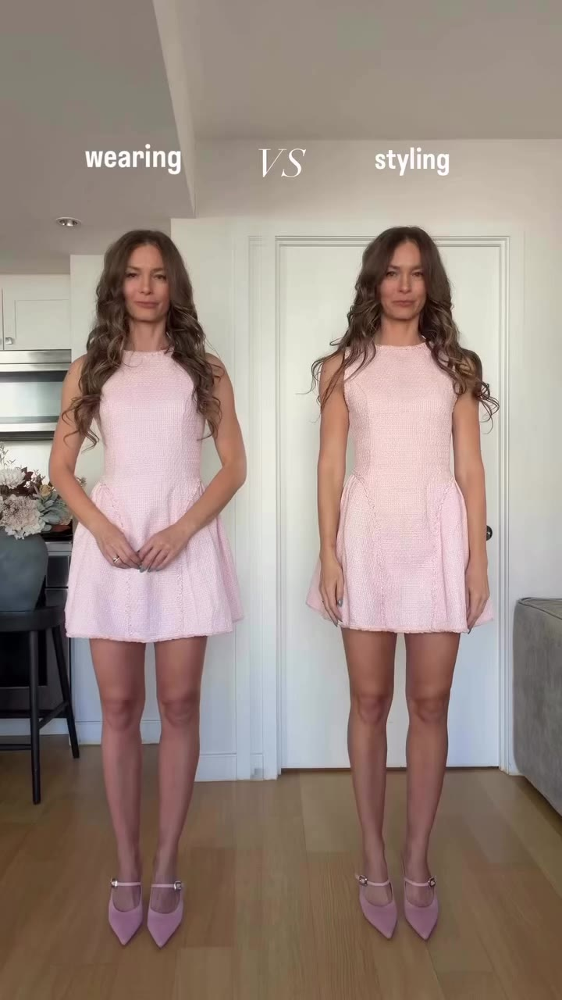

- **장면:** 훅 프레임. 좌우가 착장·포즈 모두 똑같음. 오른쪽은 팔을 옆으로 곧게 내린 정자세, 왼쪽은 손을 앞으로 모음. 상단 타이틀 고정.
- **오른쪽 착장 단계:** 원피스 + 핑크 힐 (기본)
- **왼쪽:** 정지 · 손 앞으로 모음
- **오버레이:** IG 아이콘 + @아이디 + 음원 라벨(스크롤) → 오른쪽 패널 우상단

**① 스플릿 프롬프트**

```text
Composition: split screen. The 9:16 frame is divided exactly down the vertical center into two equal panels with no visible divider line; the room continues seamlessly across both panels (same room, same locked camera, the kitchen behind the left panel, the white door behind the right panel). The SAME woman appears twice, centered in each panel, both full body head to toe: top of head about 22% from the top of the frame, feet about 8% above the bottom edge. The top 20% of the frame is empty wall, left clear as headroom for title text.

RIGHT PANEL ('styling'): she is wearing a baby-pink tweed boucle sleeveless mini dress: high round crew neckline, fitted structured bodice with princess seams, dropped waist, voluminous puffed bubble skirt made of curved gored panels ending mid-thigh, raw frayed self-fringe trim along the seams and hem, fine woven texture with tiny white flecks, and dusty-pink suede pointed-toe Mary Jane kitten heels with a thin strap fastened by a small crystal buckle and a slim clear-silver heel. Action and pose: stands still and upright exactly like the left panel, facing the camera, feet together, arms hanging straight at her sides, calm neutral expression; at a glance the two panels look identical.

LEFT PANEL ('wearing'): she stands still and upright facing the camera, feet together in dusty-pink suede pointed-toe Mary Jane kitten heels with a thin strap fastened by a small crystal buckle and a slim clear-silver heel, wearing only the plain pink tweed dress with no styling (a baby-pink tweed boucle sleeveless mini dress: high round crew neckline, fitted structured bodice with princess seams, dropped waist, voluminous puffed bubble skirt made of curved gored panels ending mid-thigh, raw frayed self-fringe trim along the seams and hem, fine woven texture with tiny white flecks), arms relaxed with hands loosely clasped in front of her hips, calm neutral expression with a faint polite smile.

The woman (identical in every appearance): late 20s to early 30s, slim toned athletic build, light olive warm-toned skin with a subtle tan, oval face with defined cheekbones, almond-shaped eyes, natural brows, soft natural makeup with bronzed cheeks and a nude-mauve lip. Very long voluminous chocolate-brown hair with caramel balayage, middle part, styled in loose glossy mermaid curls falling past the chest. Short grey-blue manicured nails, a thin gold ring.

Setting: bright minimalist modern apartment. White walls and ceiling with a small recessed round downlight at the upper left. Left side of the room: white shaker kitchen cabinets with a stainless-steel built-in wall oven and microwave stack in the background, and a dark wood stool holding a matte slate-blue ceramic vase with a large dried-flower arrangement (cream hydrangeas, dusty-pink and beige dried blooms). Right side: a white paneled interior door with slim white casing and a matte black lever handle, and the arm of a light-grey boucle sofa peeking in at the far right edge. Light natural-oak wide-plank hardwood floor. Clean and uncluttered.

Photorealistic vertical 9:16 smartphone fashion reel still (720x1280). Shot on a modern iPhone main camera (~26mm equivalent) on a locked-off tripod at chest height, perfectly level horizon, no lens distortion, deep focus with everything sharp. Bright, airy natural daylight: soft diffused window light from camera-left and front, neutral-warm white balance, very soft shadows, gentle reflections on the floor. Soft pastel grade with baby pink as the dominant hue, low contrast, clean unclipped whites, realistic skin texture. Authentic at-home influencer aesthetic, not a studio.

Avoid: text, captions, watermark, logo, extra people, deformed hands, different faces or hair between the two panels, a visible split line, cropped head or feet.
```

<details><summary>② 타이틀 텍스트 포함 버전</summary>

```text
Composition: split screen. The 9:16 frame is divided exactly down the vertical center into two equal panels with no visible divider line; the room continues seamlessly across both panels (same room, same locked camera, the kitchen behind the left panel, the white door behind the right panel). The SAME woman appears twice, centered in each panel, both full body head to toe: top of head about 22% from the top of the frame, feet about 8% above the bottom edge. The top 20% of the frame is empty wall, left clear as headroom for title text.

RIGHT PANEL ('styling'): she is wearing a baby-pink tweed boucle sleeveless mini dress: high round crew neckline, fitted structured bodice with princess seams, dropped waist, voluminous puffed bubble skirt made of curved gored panels ending mid-thigh, raw frayed self-fringe trim along the seams and hem, fine woven texture with tiny white flecks, and dusty-pink suede pointed-toe Mary Jane kitten heels with a thin strap fastened by a small crystal buckle and a slim clear-silver heel. Action and pose: stands still and upright exactly like the left panel, facing the camera, feet together, arms hanging straight at her sides, calm neutral expression; at a glance the two panels look identical.

LEFT PANEL ('wearing'): she stands still and upright facing the camera, feet together in dusty-pink suede pointed-toe Mary Jane kitten heels with a thin strap fastened by a small crystal buckle and a slim clear-silver heel, wearing only the plain pink tweed dress with no styling (a baby-pink tweed boucle sleeveless mini dress: high round crew neckline, fitted structured bodice with princess seams, dropped waist, voluminous puffed bubble skirt made of curved gored panels ending mid-thigh, raw frayed self-fringe trim along the seams and hem, fine woven texture with tiny white flecks), arms relaxed with hands loosely clasped in front of her hips, calm neutral expression with a faint polite smile.

The woman (identical in every appearance): late 20s to early 30s, slim toned athletic build, light olive warm-toned skin with a subtle tan, oval face with defined cheekbones, almond-shaped eyes, natural brows, soft natural makeup with bronzed cheeks and a nude-mauve lip. Very long voluminous chocolate-brown hair with caramel balayage, middle part, styled in loose glossy mermaid curls falling past the chest. Short grey-blue manicured nails, a thin gold ring.

Setting: bright minimalist modern apartment. White walls and ceiling with a small recessed round downlight at the upper left. Left side of the room: white shaker kitchen cabinets with a stainless-steel built-in wall oven and microwave stack in the background, and a dark wood stool holding a matte slate-blue ceramic vase with a large dried-flower arrangement (cream hydrangeas, dusty-pink and beige dried blooms). Right side: a white paneled interior door with slim white casing and a matte black lever handle, and the arm of a light-grey boucle sofa peeking in at the far right edge. Light natural-oak wide-plank hardwood floor. Clean and uncluttered.

Photorealistic vertical 9:16 smartphone fashion reel still (720x1280). Shot on a modern iPhone main camera (~26mm equivalent) on a locked-off tripod at chest height, perfectly level horizon, no lens distortion, deep focus with everything sharp. Bright, airy natural daylight: soft diffused window light from camera-left and front, neutral-warm white balance, very soft shadows, gentle reflections on the floor. Soft pastel grade with baby pink as the dominant hue, low contrast, clean unclipped whites, realistic skin texture. Authentic at-home influencer aesthetic, not a studio.

Overlay text in the top 16% of the frame: the lowercase word "wearing" in bold white condensed sans-serif centered over the left panel, a large thin white italic serif "VS" centered on the split line, and "styling" in the same bold white condensed sans-serif centered over the right panel; subtle soft drop shadow.

Avoid: extra captions, watermark, logo, extra people, deformed hands, different faces or hair between the two panels, a visible split line, cropped head or feet.
```
</details>

<details><summary>짧은 버전 (글자 수 제한 있는 모델용)</summary>

```text
Photorealistic vertical 9:16 split-screen fashion reel still: the same woman twice, side by side, full body head to toe, in a bright white minimalist apartment, locked tripod at chest height, soft daylight, airy pastel-pink grade, iPhone look. Woman: late 20s, slim and toned, light olive skin, very long chocolate-brown mermaid curls with caramel balayage, middle part, natural makeup. LEFT ('wearing'): standing still, hands clasped in front, in the plain baby-pink tweed sleeveless bubble mini dress with frayed trim and dusty-pink suede Mary Jane kitten heels. RIGHT ('styling'): in the baby-pink tweed sleeveless bubble mini dress with frayed trim and dusty-pink suede Mary Jane kitten heels; stands still and upright exactly like the left panel, facing the camera, feet together, arms hanging straight at her sides, calm neutral expression; at a glance the two panels look identical. Background continuous across both halves: white kitchen and dried flowers behind the left, white paneled door with a black handle behind the right, light oak floor. Empty headroom at the top. No text, no visible split line.
```
</details>

<details><summary>③ 솔로(오른쪽 인물만) 버전</summary>

```text
Composition: single subject centered, full body head to toe, top of head about 22% from the top of the frame, feet about 8% above the bottom edge, generous empty space on both sides so the frame can be cropped to its central 50% width. Behind her: the white paneled door with a matte black lever handle, the grey boucle sofa arm at the right edge.

Subject: one woman, wearing a baby-pink tweed boucle sleeveless mini dress: high round crew neckline, fitted structured bodice with princess seams, dropped waist, voluminous puffed bubble skirt made of curved gored panels ending mid-thigh, raw frayed self-fringe trim along the seams and hem, fine woven texture with tiny white flecks, and dusty-pink suede pointed-toe Mary Jane kitten heels with a thin strap fastened by a small crystal buckle and a slim clear-silver heel. Action and pose: stands still and upright facing the camera, feet together, arms hanging straight at her sides, calm neutral expression.

The woman (identical in every appearance): late 20s to early 30s, slim toned athletic build, light olive warm-toned skin with a subtle tan, oval face with defined cheekbones, almond-shaped eyes, natural brows, soft natural makeup with bronzed cheeks and a nude-mauve lip. Very long voluminous chocolate-brown hair with caramel balayage, middle part, styled in loose glossy mermaid curls falling past the chest. Short grey-blue manicured nails, a thin gold ring.

Photorealistic vertical 9:16 smartphone fashion reel still (720x1280). Shot on a modern iPhone main camera (~26mm equivalent) on a locked-off tripod at chest height, perfectly level horizon, no lens distortion, deep focus with everything sharp. Bright, airy natural daylight: soft diffused window light from camera-left and front, neutral-warm white balance, very soft shadows, gentle reflections on the floor. Soft pastel grade with baby pink as the dominant hue, low contrast, clean unclipped whites, realistic skin texture. Authentic at-home influencer aesthetic, not a studio.

Avoid: text, captions, watermark, logo, extra people, deformed hands, cropped head or feet.
```
</details>

### F02 · 0.60s (프레임 #18) — 힐 차서 벗기

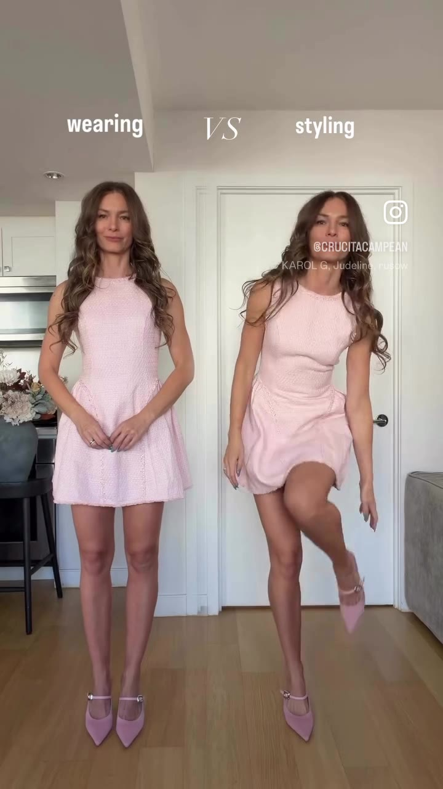

- **장면:** 오른 무릎을 엉덩이 높이까지 들어 핑크 힐을 차서 벗는 순간. 신발이 발에서 떨어져 공중에 있음. 왼팔은 균형 잡느라 살짝 벌림, 머리카락 흔들림.
- **오른쪽 착장 단계:** 원피스 + 핑크 힐 (기본)
- **왼쪽:** 정지 · 손 앞으로 모음
- **오버레이:** IG 아이콘 + @아이디 + 음원 라벨(스크롤) → 오른쪽 패널 우상단

**① 스플릿 프롬프트**

```text
Composition: split screen. The 9:16 frame is divided exactly down the vertical center into two equal panels with no visible divider line; the room continues seamlessly across both panels (same room, same locked camera, the kitchen behind the left panel, the white door behind the right panel). The SAME woman appears twice, centered in each panel, both full body head to toe: top of head about 22% from the top of the frame, feet about 8% above the bottom edge. The top 20% of the frame is empty wall, left clear as headroom for title text.

RIGHT PANEL ('styling'): she is wearing a baby-pink tweed boucle sleeveless mini dress: high round crew neckline, fitted structured bodice with princess seams, dropped waist, voluminous puffed bubble skirt made of curved gored panels ending mid-thigh, raw frayed self-fringe trim along the seams and hem, fine woven texture with tiny white flecks, and dusty-pink suede pointed-toe Mary Jane kitten heels with a thin strap fastened by a small crystal buckle and a slim clear-silver heel. Action and pose: mid-motion kicking off her shoes: right knee lifted high to hip level, the pink Mary Jane heel flicking off her right foot in mid-air, left foot still in its heel, slight lean back, left arm out for balance, curls swinging, playful half-smile.

LEFT PANEL ('wearing'): she stands still and upright facing the camera, feet together in dusty-pink suede pointed-toe Mary Jane kitten heels with a thin strap fastened by a small crystal buckle and a slim clear-silver heel, wearing only the plain pink tweed dress with no styling (a baby-pink tweed boucle sleeveless mini dress: high round crew neckline, fitted structured bodice with princess seams, dropped waist, voluminous puffed bubble skirt made of curved gored panels ending mid-thigh, raw frayed self-fringe trim along the seams and hem, fine woven texture with tiny white flecks), arms relaxed with hands loosely clasped in front of her hips, calm neutral expression with a faint polite smile.

The woman (identical in every appearance): late 20s to early 30s, slim toned athletic build, light olive warm-toned skin with a subtle tan, oval face with defined cheekbones, almond-shaped eyes, natural brows, soft natural makeup with bronzed cheeks and a nude-mauve lip. Very long voluminous chocolate-brown hair with caramel balayage, middle part, styled in loose glossy mermaid curls falling past the chest. Short grey-blue manicured nails, a thin gold ring.

Setting: bright minimalist modern apartment. White walls and ceiling with a small recessed round downlight at the upper left. Left side of the room: white shaker kitchen cabinets with a stainless-steel built-in wall oven and microwave stack in the background, and a dark wood stool holding a matte slate-blue ceramic vase with a large dried-flower arrangement (cream hydrangeas, dusty-pink and beige dried blooms). Right side: a white paneled interior door with slim white casing and a matte black lever handle, and the arm of a light-grey boucle sofa peeking in at the far right edge. Light natural-oak wide-plank hardwood floor. Clean and uncluttered.

Photorealistic vertical 9:16 smartphone fashion reel still (720x1280). Shot on a modern iPhone main camera (~26mm equivalent) on a locked-off tripod at chest height, perfectly level horizon, no lens distortion, deep focus with everything sharp. Bright, airy natural daylight: soft diffused window light from camera-left and front, neutral-warm white balance, very soft shadows, gentle reflections on the floor. Soft pastel grade with baby pink as the dominant hue, low contrast, clean unclipped whites, realistic skin texture. Authentic at-home influencer aesthetic, not a studio.

Avoid: text, captions, watermark, logo, extra people, deformed hands, different faces or hair between the two panels, a visible split line, cropped head or feet.
```

<details><summary>② 타이틀 텍스트 포함 버전</summary>

```text
Composition: split screen. The 9:16 frame is divided exactly down the vertical center into two equal panels with no visible divider line; the room continues seamlessly across both panels (same room, same locked camera, the kitchen behind the left panel, the white door behind the right panel). The SAME woman appears twice, centered in each panel, both full body head to toe: top of head about 22% from the top of the frame, feet about 8% above the bottom edge. The top 20% of the frame is empty wall, left clear as headroom for title text.

RIGHT PANEL ('styling'): she is wearing a baby-pink tweed boucle sleeveless mini dress: high round crew neckline, fitted structured bodice with princess seams, dropped waist, voluminous puffed bubble skirt made of curved gored panels ending mid-thigh, raw frayed self-fringe trim along the seams and hem, fine woven texture with tiny white flecks, and dusty-pink suede pointed-toe Mary Jane kitten heels with a thin strap fastened by a small crystal buckle and a slim clear-silver heel. Action and pose: mid-motion kicking off her shoes: right knee lifted high to hip level, the pink Mary Jane heel flicking off her right foot in mid-air, left foot still in its heel, slight lean back, left arm out for balance, curls swinging, playful half-smile.

LEFT PANEL ('wearing'): she stands still and upright facing the camera, feet together in dusty-pink suede pointed-toe Mary Jane kitten heels with a thin strap fastened by a small crystal buckle and a slim clear-silver heel, wearing only the plain pink tweed dress with no styling (a baby-pink tweed boucle sleeveless mini dress: high round crew neckline, fitted structured bodice with princess seams, dropped waist, voluminous puffed bubble skirt made of curved gored panels ending mid-thigh, raw frayed self-fringe trim along the seams and hem, fine woven texture with tiny white flecks), arms relaxed with hands loosely clasped in front of her hips, calm neutral expression with a faint polite smile.

The woman (identical in every appearance): late 20s to early 30s, slim toned athletic build, light olive warm-toned skin with a subtle tan, oval face with defined cheekbones, almond-shaped eyes, natural brows, soft natural makeup with bronzed cheeks and a nude-mauve lip. Very long voluminous chocolate-brown hair with caramel balayage, middle part, styled in loose glossy mermaid curls falling past the chest. Short grey-blue manicured nails, a thin gold ring.

Setting: bright minimalist modern apartment. White walls and ceiling with a small recessed round downlight at the upper left. Left side of the room: white shaker kitchen cabinets with a stainless-steel built-in wall oven and microwave stack in the background, and a dark wood stool holding a matte slate-blue ceramic vase with a large dried-flower arrangement (cream hydrangeas, dusty-pink and beige dried blooms). Right side: a white paneled interior door with slim white casing and a matte black lever handle, and the arm of a light-grey boucle sofa peeking in at the far right edge. Light natural-oak wide-plank hardwood floor. Clean and uncluttered.

Photorealistic vertical 9:16 smartphone fashion reel still (720x1280). Shot on a modern iPhone main camera (~26mm equivalent) on a locked-off tripod at chest height, perfectly level horizon, no lens distortion, deep focus with everything sharp. Bright, airy natural daylight: soft diffused window light from camera-left and front, neutral-warm white balance, very soft shadows, gentle reflections on the floor. Soft pastel grade with baby pink as the dominant hue, low contrast, clean unclipped whites, realistic skin texture. Authentic at-home influencer aesthetic, not a studio.

Overlay text in the top 16% of the frame: the lowercase word "wearing" in bold white condensed sans-serif centered over the left panel, a large thin white italic serif "VS" centered on the split line, and "styling" in the same bold white condensed sans-serif centered over the right panel; subtle soft drop shadow.

Avoid: extra captions, watermark, logo, extra people, deformed hands, different faces or hair between the two panels, a visible split line, cropped head or feet.
```
</details>

<details><summary>짧은 버전 (글자 수 제한 있는 모델용)</summary>

```text
Photorealistic vertical 9:16 split-screen fashion reel still: the same woman twice, side by side, full body head to toe, in a bright white minimalist apartment, locked tripod at chest height, soft daylight, airy pastel-pink grade, iPhone look. Woman: late 20s, slim and toned, light olive skin, very long chocolate-brown mermaid curls with caramel balayage, middle part, natural makeup. LEFT ('wearing'): standing still, hands clasped in front, in the plain baby-pink tweed sleeveless bubble mini dress with frayed trim and dusty-pink suede Mary Jane kitten heels. RIGHT ('styling'): in the baby-pink tweed sleeveless bubble mini dress with frayed trim and dusty-pink suede Mary Jane kitten heels; mid-motion kicking off her shoes: right knee lifted high to hip level, the pink Mary Jane heel flicking off her right foot in mid-air, left foot still in its heel, slight lean back, left arm out for balance, curls swinging, playful half-smile. Background continuous across both halves: white kitchen and dried flowers behind the left, white paneled door with a black handle behind the right, light oak floor. Empty headroom at the top. No text, no visible split line.
```
</details>

<details><summary>③ 솔로(오른쪽 인물만) 버전</summary>

```text
Composition: single subject centered, full body head to toe, top of head about 22% from the top of the frame, feet about 8% above the bottom edge, generous empty space on both sides so the frame can be cropped to its central 50% width. Behind her: the white paneled door with a matte black lever handle, the grey boucle sofa arm at the right edge.

Subject: one woman, wearing a baby-pink tweed boucle sleeveless mini dress: high round crew neckline, fitted structured bodice with princess seams, dropped waist, voluminous puffed bubble skirt made of curved gored panels ending mid-thigh, raw frayed self-fringe trim along the seams and hem, fine woven texture with tiny white flecks, and dusty-pink suede pointed-toe Mary Jane kitten heels with a thin strap fastened by a small crystal buckle and a slim clear-silver heel. Action and pose: mid-motion kicking off her shoes: right knee lifted high to hip level, the pink Mary Jane heel flicking off her right foot in mid-air, left foot still in its heel, slight lean back, left arm out for balance, curls swinging, playful half-smile.

The woman (identical in every appearance): late 20s to early 30s, slim toned athletic build, light olive warm-toned skin with a subtle tan, oval face with defined cheekbones, almond-shaped eyes, natural brows, soft natural makeup with bronzed cheeks and a nude-mauve lip. Very long voluminous chocolate-brown hair with caramel balayage, middle part, styled in loose glossy mermaid curls falling past the chest. Short grey-blue manicured nails, a thin gold ring.

Photorealistic vertical 9:16 smartphone fashion reel still (720x1280). Shot on a modern iPhone main camera (~26mm equivalent) on a locked-off tripod at chest height, perfectly level horizon, no lens distortion, deep focus with everything sharp. Bright, airy natural daylight: soft diffused window light from camera-left and front, neutral-warm white balance, very soft shadows, gentle reflections on the floor. Soft pastel grade with baby pink as the dominant hue, low contrast, clean unclipped whites, realistic skin texture. Authentic at-home influencer aesthetic, not a studio.

Avoid: text, captions, watermark, logo, extra people, deformed hands, cropped head or feet.
```
</details>

### F03 · 1.30s (프레임 #39) — 힐 들고 보기

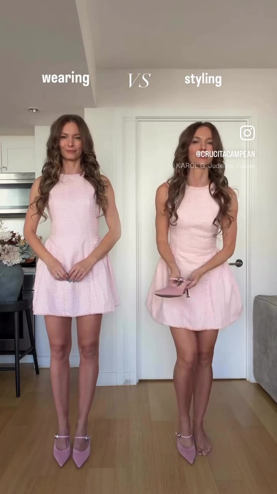

- **장면:** 맨발. 벗은 핑크 메리제인 힐 한 켤레를 오른손에 들고 엉덩이 높이에서 내려다봄. 체중은 왼발.
- **오른쪽 착장 단계:** 원피스 · 맨발
- **왼쪽:** 정지 · 손 앞으로 모음
- **오버레이:** IG 아이콘 + @아이디 + 음원 라벨(스크롤) → 오른쪽 패널 우상단

**① 스플릿 프롬프트**

```text
Composition: split screen. The 9:16 frame is divided exactly down the vertical center into two equal panels with no visible divider line; the room continues seamlessly across both panels (same room, same locked camera, the kitchen behind the left panel, the white door behind the right panel). The SAME woman appears twice, centered in each panel, both full body head to toe: top of head about 22% from the top of the frame, feet about 8% above the bottom edge. The top 20% of the frame is empty wall, left clear as headroom for title text.

RIGHT PANEL ('styling'): she is barefoot, wearing a baby-pink tweed boucle sleeveless mini dress: high round crew neckline, fitted structured bodice with princess seams, dropped waist, voluminous puffed bubble skirt made of curved gored panels ending mid-thigh, raw frayed self-fringe trim along the seams and hem, fine woven texture with tiny white flecks. Action and pose: barefoot, holding the pair of pink Mary Jane kitten heels by their straps in her right hand at hip level, left hand touching one shoe, looking down at them with a small smile, weight on her left leg.

LEFT PANEL ('wearing'): she stands still and upright facing the camera, feet together in dusty-pink suede pointed-toe Mary Jane kitten heels with a thin strap fastened by a small crystal buckle and a slim clear-silver heel, wearing only the plain pink tweed dress with no styling (a baby-pink tweed boucle sleeveless mini dress: high round crew neckline, fitted structured bodice with princess seams, dropped waist, voluminous puffed bubble skirt made of curved gored panels ending mid-thigh, raw frayed self-fringe trim along the seams and hem, fine woven texture with tiny white flecks), arms relaxed with hands loosely clasped in front of her hips, calm neutral expression with a faint polite smile.

The woman (identical in every appearance): late 20s to early 30s, slim toned athletic build, light olive warm-toned skin with a subtle tan, oval face with defined cheekbones, almond-shaped eyes, natural brows, soft natural makeup with bronzed cheeks and a nude-mauve lip. Very long voluminous chocolate-brown hair with caramel balayage, middle part, styled in loose glossy mermaid curls falling past the chest. Short grey-blue manicured nails, a thin gold ring.

Setting: bright minimalist modern apartment. White walls and ceiling with a small recessed round downlight at the upper left. Left side of the room: white shaker kitchen cabinets with a stainless-steel built-in wall oven and microwave stack in the background, and a dark wood stool holding a matte slate-blue ceramic vase with a large dried-flower arrangement (cream hydrangeas, dusty-pink and beige dried blooms). Right side: a white paneled interior door with slim white casing and a matte black lever handle, and the arm of a light-grey boucle sofa peeking in at the far right edge. Light natural-oak wide-plank hardwood floor. Clean and uncluttered.

Photorealistic vertical 9:16 smartphone fashion reel still (720x1280). Shot on a modern iPhone main camera (~26mm equivalent) on a locked-off tripod at chest height, perfectly level horizon, no lens distortion, deep focus with everything sharp. Bright, airy natural daylight: soft diffused window light from camera-left and front, neutral-warm white balance, very soft shadows, gentle reflections on the floor. Soft pastel grade with baby pink as the dominant hue, low contrast, clean unclipped whites, realistic skin texture. Authentic at-home influencer aesthetic, not a studio.

Avoid: text, captions, watermark, logo, extra people, deformed hands, different faces or hair between the two panels, a visible split line, cropped head or feet.
```

<details><summary>② 타이틀 텍스트 포함 버전</summary>

```text
Composition: split screen. The 9:16 frame is divided exactly down the vertical center into two equal panels with no visible divider line; the room continues seamlessly across both panels (same room, same locked camera, the kitchen behind the left panel, the white door behind the right panel). The SAME woman appears twice, centered in each panel, both full body head to toe: top of head about 22% from the top of the frame, feet about 8% above the bottom edge. The top 20% of the frame is empty wall, left clear as headroom for title text.

RIGHT PANEL ('styling'): she is barefoot, wearing a baby-pink tweed boucle sleeveless mini dress: high round crew neckline, fitted structured bodice with princess seams, dropped waist, voluminous puffed bubble skirt made of curved gored panels ending mid-thigh, raw frayed self-fringe trim along the seams and hem, fine woven texture with tiny white flecks. Action and pose: barefoot, holding the pair of pink Mary Jane kitten heels by their straps in her right hand at hip level, left hand touching one shoe, looking down at them with a small smile, weight on her left leg.

LEFT PANEL ('wearing'): she stands still and upright facing the camera, feet together in dusty-pink suede pointed-toe Mary Jane kitten heels with a thin strap fastened by a small crystal buckle and a slim clear-silver heel, wearing only the plain pink tweed dress with no styling (a baby-pink tweed boucle sleeveless mini dress: high round crew neckline, fitted structured bodice with princess seams, dropped waist, voluminous puffed bubble skirt made of curved gored panels ending mid-thigh, raw frayed self-fringe trim along the seams and hem, fine woven texture with tiny white flecks), arms relaxed with hands loosely clasped in front of her hips, calm neutral expression with a faint polite smile.

The woman (identical in every appearance): late 20s to early 30s, slim toned athletic build, light olive warm-toned skin with a subtle tan, oval face with defined cheekbones, almond-shaped eyes, natural brows, soft natural makeup with bronzed cheeks and a nude-mauve lip. Very long voluminous chocolate-brown hair with caramel balayage, middle part, styled in loose glossy mermaid curls falling past the chest. Short grey-blue manicured nails, a thin gold ring.

Setting: bright minimalist modern apartment. White walls and ceiling with a small recessed round downlight at the upper left. Left side of the room: white shaker kitchen cabinets with a stainless-steel built-in wall oven and microwave stack in the background, and a dark wood stool holding a matte slate-blue ceramic vase with a large dried-flower arrangement (cream hydrangeas, dusty-pink and beige dried blooms). Right side: a white paneled interior door with slim white casing and a matte black lever handle, and the arm of a light-grey boucle sofa peeking in at the far right edge. Light natural-oak wide-plank hardwood floor. Clean and uncluttered.

Photorealistic vertical 9:16 smartphone fashion reel still (720x1280). Shot on a modern iPhone main camera (~26mm equivalent) on a locked-off tripod at chest height, perfectly level horizon, no lens distortion, deep focus with everything sharp. Bright, airy natural daylight: soft diffused window light from camera-left and front, neutral-warm white balance, very soft shadows, gentle reflections on the floor. Soft pastel grade with baby pink as the dominant hue, low contrast, clean unclipped whites, realistic skin texture. Authentic at-home influencer aesthetic, not a studio.

Overlay text in the top 16% of the frame: the lowercase word "wearing" in bold white condensed sans-serif centered over the left panel, a large thin white italic serif "VS" centered on the split line, and "styling" in the same bold white condensed sans-serif centered over the right panel; subtle soft drop shadow.

Avoid: extra captions, watermark, logo, extra people, deformed hands, different faces or hair between the two panels, a visible split line, cropped head or feet.
```
</details>

<details><summary>짧은 버전 (글자 수 제한 있는 모델용)</summary>

```text
Photorealistic vertical 9:16 split-screen fashion reel still: the same woman twice, side by side, full body head to toe, in a bright white minimalist apartment, locked tripod at chest height, soft daylight, airy pastel-pink grade, iPhone look. Woman: late 20s, slim and toned, light olive skin, very long chocolate-brown mermaid curls with caramel balayage, middle part, natural makeup. LEFT ('wearing'): standing still, hands clasped in front, in the plain baby-pink tweed sleeveless bubble mini dress with frayed trim and dusty-pink suede Mary Jane kitten heels. RIGHT ('styling'): barefoot in the baby-pink tweed sleeveless bubble mini dress with frayed trim; barefoot, holding the pair of pink Mary Jane kitten heels by their straps in her right hand at hip level, left hand touching one shoe, looking down at them with a small smile, weight on her left leg. Background continuous across both halves: white kitchen and dried flowers behind the left, white paneled door with a black handle behind the right, light oak floor. Empty headroom at the top. No text, no visible split line.
```
</details>

<details><summary>③ 솔로(오른쪽 인물만) 버전</summary>

```text
Composition: single subject centered, full body head to toe, top of head about 22% from the top of the frame, feet about 8% above the bottom edge, generous empty space on both sides so the frame can be cropped to its central 50% width. Behind her: the white paneled door with a matte black lever handle, the grey boucle sofa arm at the right edge.

Subject: one woman, barefoot, wearing a baby-pink tweed boucle sleeveless mini dress: high round crew neckline, fitted structured bodice with princess seams, dropped waist, voluminous puffed bubble skirt made of curved gored panels ending mid-thigh, raw frayed self-fringe trim along the seams and hem, fine woven texture with tiny white flecks. Action and pose: barefoot, holding the pair of pink Mary Jane kitten heels by their straps in her right hand at hip level, left hand touching one shoe, looking down at them with a small smile, weight on her left leg.

The woman (identical in every appearance): late 20s to early 30s, slim toned athletic build, light olive warm-toned skin with a subtle tan, oval face with defined cheekbones, almond-shaped eyes, natural brows, soft natural makeup with bronzed cheeks and a nude-mauve lip. Very long voluminous chocolate-brown hair with caramel balayage, middle part, styled in loose glossy mermaid curls falling past the chest. Short grey-blue manicured nails, a thin gold ring.

Photorealistic vertical 9:16 smartphone fashion reel still (720x1280). Shot on a modern iPhone main camera (~26mm equivalent) on a locked-off tripod at chest height, perfectly level horizon, no lens distortion, deep focus with everything sharp. Bright, airy natural daylight: soft diffused window light from camera-left and front, neutral-warm white balance, very soft shadows, gentle reflections on the floor. Soft pastel grade with baby pink as the dominant hue, low contrast, clean unclipped whites, realistic skin texture. Authentic at-home influencer aesthetic, not a studio.

Avoid: text, captions, watermark, logo, extra people, deformed hands, cropped head or feet.
```
</details>

### F04 · 2.05s (프레임 #61) — 드레스 어깨 내리기

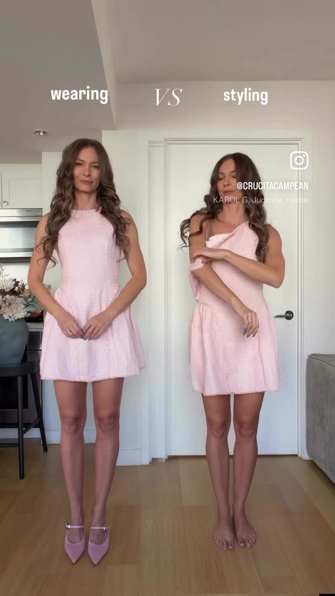

- **장면:** 신발을 프레임 오른쪽 밖으로 던진 직후. 오른손을 가슴 앞으로 교차해 드레스 왼쪽 어깨를 끌어내리며 팔을 빼는 중. 고개 숙이고 눈 내리깜.
- **오른쪽 착장 단계:** 원피스 · 맨발
- **왼쪽:** 정지 · 손 앞으로 모음
- **오버레이:** IG 아이콘 + @아이디 + 음원 라벨(스크롤) → 오른쪽 패널 우상단

**① 스플릿 프롬프트**

```text
Composition: split screen. The 9:16 frame is divided exactly down the vertical center into two equal panels with no visible divider line; the room continues seamlessly across both panels (same room, same locked camera, the kitchen behind the left panel, the white door behind the right panel). The SAME woman appears twice, centered in each panel, both full body head to toe: top of head about 22% from the top of the frame, feet about 8% above the bottom edge. The top 20% of the frame is empty wall, left clear as headroom for title text.

RIGHT PANEL ('styling'): she is barefoot, wearing a baby-pink tweed boucle sleeveless mini dress: high round crew neckline, fitted structured bodice with princess seams, dropped waist, voluminous puffed bubble skirt made of curved gored panels ending mid-thigh, raw frayed self-fringe trim along the seams and hem, fine woven texture with tiny white flecks. Action and pose: barefoot, the heels already tossed out of frame; she crosses her right hand over her chest to pull the left shoulder of the dress bodice down and slips her arm out of the armhole, head tilted down with eyes lowered, the bodice starting to peel off.

LEFT PANEL ('wearing'): she stands still and upright facing the camera, feet together in dusty-pink suede pointed-toe Mary Jane kitten heels with a thin strap fastened by a small crystal buckle and a slim clear-silver heel, wearing only the plain pink tweed dress with no styling (a baby-pink tweed boucle sleeveless mini dress: high round crew neckline, fitted structured bodice with princess seams, dropped waist, voluminous puffed bubble skirt made of curved gored panels ending mid-thigh, raw frayed self-fringe trim along the seams and hem, fine woven texture with tiny white flecks), arms relaxed with hands loosely clasped in front of her hips, calm neutral expression with a faint polite smile.

The woman (identical in every appearance): late 20s to early 30s, slim toned athletic build, light olive warm-toned skin with a subtle tan, oval face with defined cheekbones, almond-shaped eyes, natural brows, soft natural makeup with bronzed cheeks and a nude-mauve lip. Very long voluminous chocolate-brown hair with caramel balayage, middle part, styled in loose glossy mermaid curls falling past the chest. Short grey-blue manicured nails, a thin gold ring.

Setting: bright minimalist modern apartment. White walls and ceiling with a small recessed round downlight at the upper left. Left side of the room: white shaker kitchen cabinets with a stainless-steel built-in wall oven and microwave stack in the background, and a dark wood stool holding a matte slate-blue ceramic vase with a large dried-flower arrangement (cream hydrangeas, dusty-pink and beige dried blooms). Right side: a white paneled interior door with slim white casing and a matte black lever handle, and the arm of a light-grey boucle sofa peeking in at the far right edge. Light natural-oak wide-plank hardwood floor. Clean and uncluttered.

Photorealistic vertical 9:16 smartphone fashion reel still (720x1280). Shot on a modern iPhone main camera (~26mm equivalent) on a locked-off tripod at chest height, perfectly level horizon, no lens distortion, deep focus with everything sharp. Bright, airy natural daylight: soft diffused window light from camera-left and front, neutral-warm white balance, very soft shadows, gentle reflections on the floor. Soft pastel grade with baby pink as the dominant hue, low contrast, clean unclipped whites, realistic skin texture. Authentic at-home influencer aesthetic, not a studio.

Avoid: text, captions, watermark, logo, extra people, deformed hands, different faces or hair between the two panels, a visible split line, cropped head or feet.
```

<details><summary>② 타이틀 텍스트 포함 버전</summary>

```text
Composition: split screen. The 9:16 frame is divided exactly down the vertical center into two equal panels with no visible divider line; the room continues seamlessly across both panels (same room, same locked camera, the kitchen behind the left panel, the white door behind the right panel). The SAME woman appears twice, centered in each panel, both full body head to toe: top of head about 22% from the top of the frame, feet about 8% above the bottom edge. The top 20% of the frame is empty wall, left clear as headroom for title text.

RIGHT PANEL ('styling'): she is barefoot, wearing a baby-pink tweed boucle sleeveless mini dress: high round crew neckline, fitted structured bodice with princess seams, dropped waist, voluminous puffed bubble skirt made of curved gored panels ending mid-thigh, raw frayed self-fringe trim along the seams and hem, fine woven texture with tiny white flecks. Action and pose: barefoot, the heels already tossed out of frame; she crosses her right hand over her chest to pull the left shoulder of the dress bodice down and slips her arm out of the armhole, head tilted down with eyes lowered, the bodice starting to peel off.

LEFT PANEL ('wearing'): she stands still and upright facing the camera, feet together in dusty-pink suede pointed-toe Mary Jane kitten heels with a thin strap fastened by a small crystal buckle and a slim clear-silver heel, wearing only the plain pink tweed dress with no styling (a baby-pink tweed boucle sleeveless mini dress: high round crew neckline, fitted structured bodice with princess seams, dropped waist, voluminous puffed bubble skirt made of curved gored panels ending mid-thigh, raw frayed self-fringe trim along the seams and hem, fine woven texture with tiny white flecks), arms relaxed with hands loosely clasped in front of her hips, calm neutral expression with a faint polite smile.

The woman (identical in every appearance): late 20s to early 30s, slim toned athletic build, light olive warm-toned skin with a subtle tan, oval face with defined cheekbones, almond-shaped eyes, natural brows, soft natural makeup with bronzed cheeks and a nude-mauve lip. Very long voluminous chocolate-brown hair with caramel balayage, middle part, styled in loose glossy mermaid curls falling past the chest. Short grey-blue manicured nails, a thin gold ring.

Setting: bright minimalist modern apartment. White walls and ceiling with a small recessed round downlight at the upper left. Left side of the room: white shaker kitchen cabinets with a stainless-steel built-in wall oven and microwave stack in the background, and a dark wood stool holding a matte slate-blue ceramic vase with a large dried-flower arrangement (cream hydrangeas, dusty-pink and beige dried blooms). Right side: a white paneled interior door with slim white casing and a matte black lever handle, and the arm of a light-grey boucle sofa peeking in at the far right edge. Light natural-oak wide-plank hardwood floor. Clean and uncluttered.

Photorealistic vertical 9:16 smartphone fashion reel still (720x1280). Shot on a modern iPhone main camera (~26mm equivalent) on a locked-off tripod at chest height, perfectly level horizon, no lens distortion, deep focus with everything sharp. Bright, airy natural daylight: soft diffused window light from camera-left and front, neutral-warm white balance, very soft shadows, gentle reflections on the floor. Soft pastel grade with baby pink as the dominant hue, low contrast, clean unclipped whites, realistic skin texture. Authentic at-home influencer aesthetic, not a studio.

Overlay text in the top 16% of the frame: the lowercase word "wearing" in bold white condensed sans-serif centered over the left panel, a large thin white italic serif "VS" centered on the split line, and "styling" in the same bold white condensed sans-serif centered over the right panel; subtle soft drop shadow.

Avoid: extra captions, watermark, logo, extra people, deformed hands, different faces or hair between the two panels, a visible split line, cropped head or feet.
```
</details>

<details><summary>짧은 버전 (글자 수 제한 있는 모델용)</summary>

```text
Photorealistic vertical 9:16 split-screen fashion reel still: the same woman twice, side by side, full body head to toe, in a bright white minimalist apartment, locked tripod at chest height, soft daylight, airy pastel-pink grade, iPhone look. Woman: late 20s, slim and toned, light olive skin, very long chocolate-brown mermaid curls with caramel balayage, middle part, natural makeup. LEFT ('wearing'): standing still, hands clasped in front, in the plain baby-pink tweed sleeveless bubble mini dress with frayed trim and dusty-pink suede Mary Jane kitten heels. RIGHT ('styling'): barefoot in the baby-pink tweed sleeveless bubble mini dress with frayed trim; barefoot, the heels already tossed out of frame; she crosses her right hand over her chest to pull the left shoulder of the dress bodice down and slips her arm out of the armhole, head tilted down with eyes lowered, the bodice starting to peel off. Background continuous across both halves: white kitchen and dried flowers behind the left, white paneled door with a black handle behind the right, light oak floor. Empty headroom at the top. No text, no visible split line.
```
</details>

<details><summary>③ 솔로(오른쪽 인물만) 버전</summary>

```text
Composition: single subject centered, full body head to toe, top of head about 22% from the top of the frame, feet about 8% above the bottom edge, generous empty space on both sides so the frame can be cropped to its central 50% width. Behind her: the white paneled door with a matte black lever handle, the grey boucle sofa arm at the right edge.

Subject: one woman, barefoot, wearing a baby-pink tweed boucle sleeveless mini dress: high round crew neckline, fitted structured bodice with princess seams, dropped waist, voluminous puffed bubble skirt made of curved gored panels ending mid-thigh, raw frayed self-fringe trim along the seams and hem, fine woven texture with tiny white flecks. Action and pose: barefoot, the heels already tossed out of frame; she crosses her right hand over her chest to pull the left shoulder of the dress bodice down and slips her arm out of the armhole, head tilted down with eyes lowered, the bodice starting to peel off.

The woman (identical in every appearance): late 20s to early 30s, slim toned athletic build, light olive warm-toned skin with a subtle tan, oval face with defined cheekbones, almond-shaped eyes, natural brows, soft natural makeup with bronzed cheeks and a nude-mauve lip. Very long voluminous chocolate-brown hair with caramel balayage, middle part, styled in loose glossy mermaid curls falling past the chest. Short grey-blue manicured nails, a thin gold ring.

Photorealistic vertical 9:16 smartphone fashion reel still (720x1280). Shot on a modern iPhone main camera (~26mm equivalent) on a locked-off tripod at chest height, perfectly level horizon, no lens distortion, deep focus with everything sharp. Bright, airy natural daylight: soft diffused window light from camera-left and front, neutral-warm white balance, very soft shadows, gentle reflections on the floor. Soft pastel grade with baby pink as the dominant hue, low contrast, clean unclipped whites, realistic skin texture. Authentic at-home influencer aesthetic, not a studio.

Avoid: text, captions, watermark, logo, extra people, deformed hands, cropped head or feet.
```
</details>

### F05 · 2.50s (프레임 #75) — 상체 허리까지 내림

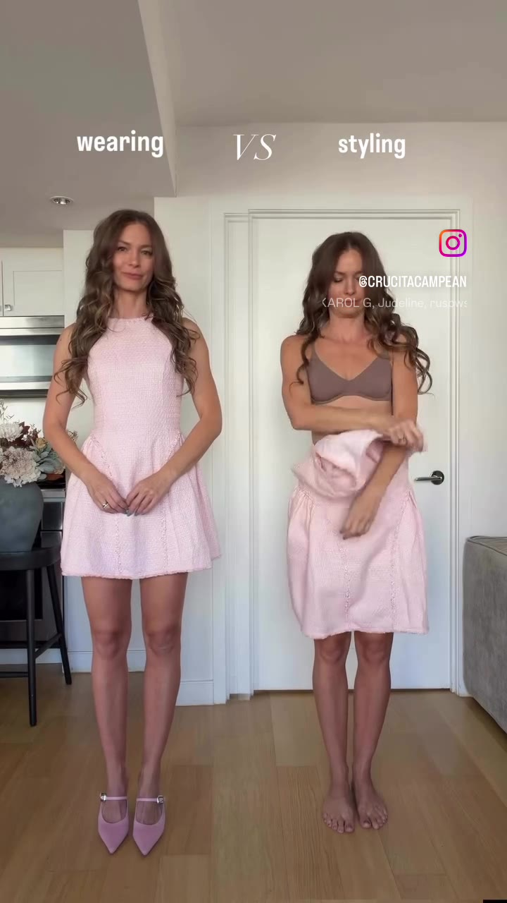

- **장면:** 드레스 상체를 허리까지 내려 모카색 심리스 브라렛 노출. 양손으로 허리에 뭉친 원단을 잡고 드레스를 돌리기 직전.
- **오른쪽 착장 단계:** 원피스 상체 내림 · 브라렛
- **왼쪽:** 정지 · 손 앞으로 모음
- **오버레이:** IG 아이콘 + @아이디 + 음원 라벨(스크롤) → 오른쪽 패널 우상단

**① 스플릿 프롬프트**

```text
Composition: split screen. The 9:16 frame is divided exactly down the vertical center into two equal panels with no visible divider line; the room continues seamlessly across both panels (same room, same locked camera, the kitchen behind the left panel, the white door behind the right panel). The SAME woman appears twice, centered in each panel, both full body head to toe: top of head about 22% from the top of the frame, feet about 8% above the bottom edge. The top 20% of the frame is empty wall, left clear as headroom for title text.

RIGHT PANEL ('styling'): she is barefoot; the pink tweed dress is peeled down so the bodice hangs folded around her waist and hips, revealing a mocha-taupe seamless triangle bralette and a toned midriff. Action and pose: both hands gripping the folded fabric at her waist, elbows bent, looking down at the dress, shoulders relaxed, about to rotate the dress around her body.

LEFT PANEL ('wearing'): she stands still and upright facing the camera, feet together in dusty-pink suede pointed-toe Mary Jane kitten heels with a thin strap fastened by a small crystal buckle and a slim clear-silver heel, wearing only the plain pink tweed dress with no styling (a baby-pink tweed boucle sleeveless mini dress: high round crew neckline, fitted structured bodice with princess seams, dropped waist, voluminous puffed bubble skirt made of curved gored panels ending mid-thigh, raw frayed self-fringe trim along the seams and hem, fine woven texture with tiny white flecks), arms relaxed with hands loosely clasped in front of her hips, calm neutral expression with a faint polite smile.

The woman (identical in every appearance): late 20s to early 30s, slim toned athletic build, light olive warm-toned skin with a subtle tan, oval face with defined cheekbones, almond-shaped eyes, natural brows, soft natural makeup with bronzed cheeks and a nude-mauve lip. Very long voluminous chocolate-brown hair with caramel balayage, middle part, styled in loose glossy mermaid curls falling past the chest. Short grey-blue manicured nails, a thin gold ring.

Setting: bright minimalist modern apartment. White walls and ceiling with a small recessed round downlight at the upper left. Left side of the room: white shaker kitchen cabinets with a stainless-steel built-in wall oven and microwave stack in the background, and a dark wood stool holding a matte slate-blue ceramic vase with a large dried-flower arrangement (cream hydrangeas, dusty-pink and beige dried blooms). Right side: a white paneled interior door with slim white casing and a matte black lever handle, and the arm of a light-grey boucle sofa peeking in at the far right edge. Light natural-oak wide-plank hardwood floor. Clean and uncluttered.

Photorealistic vertical 9:16 smartphone fashion reel still (720x1280). Shot on a modern iPhone main camera (~26mm equivalent) on a locked-off tripod at chest height, perfectly level horizon, no lens distortion, deep focus with everything sharp. Bright, airy natural daylight: soft diffused window light from camera-left and front, neutral-warm white balance, very soft shadows, gentle reflections on the floor. Soft pastel grade with baby pink as the dominant hue, low contrast, clean unclipped whites, realistic skin texture. Authentic at-home influencer aesthetic, not a studio.

Avoid: text, captions, watermark, logo, extra people, deformed hands, different faces or hair between the two panels, a visible split line, cropped head or feet.
```

<details><summary>② 타이틀 텍스트 포함 버전</summary>

```text
Composition: split screen. The 9:16 frame is divided exactly down the vertical center into two equal panels with no visible divider line; the room continues seamlessly across both panels (same room, same locked camera, the kitchen behind the left panel, the white door behind the right panel). The SAME woman appears twice, centered in each panel, both full body head to toe: top of head about 22% from the top of the frame, feet about 8% above the bottom edge. The top 20% of the frame is empty wall, left clear as headroom for title text.

RIGHT PANEL ('styling'): she is barefoot; the pink tweed dress is peeled down so the bodice hangs folded around her waist and hips, revealing a mocha-taupe seamless triangle bralette and a toned midriff. Action and pose: both hands gripping the folded fabric at her waist, elbows bent, looking down at the dress, shoulders relaxed, about to rotate the dress around her body.

LEFT PANEL ('wearing'): she stands still and upright facing the camera, feet together in dusty-pink suede pointed-toe Mary Jane kitten heels with a thin strap fastened by a small crystal buckle and a slim clear-silver heel, wearing only the plain pink tweed dress with no styling (a baby-pink tweed boucle sleeveless mini dress: high round crew neckline, fitted structured bodice with princess seams, dropped waist, voluminous puffed bubble skirt made of curved gored panels ending mid-thigh, raw frayed self-fringe trim along the seams and hem, fine woven texture with tiny white flecks), arms relaxed with hands loosely clasped in front of her hips, calm neutral expression with a faint polite smile.

The woman (identical in every appearance): late 20s to early 30s, slim toned athletic build, light olive warm-toned skin with a subtle tan, oval face with defined cheekbones, almond-shaped eyes, natural brows, soft natural makeup with bronzed cheeks and a nude-mauve lip. Very long voluminous chocolate-brown hair with caramel balayage, middle part, styled in loose glossy mermaid curls falling past the chest. Short grey-blue manicured nails, a thin gold ring.

Setting: bright minimalist modern apartment. White walls and ceiling with a small recessed round downlight at the upper left. Left side of the room: white shaker kitchen cabinets with a stainless-steel built-in wall oven and microwave stack in the background, and a dark wood stool holding a matte slate-blue ceramic vase with a large dried-flower arrangement (cream hydrangeas, dusty-pink and beige dried blooms). Right side: a white paneled interior door with slim white casing and a matte black lever handle, and the arm of a light-grey boucle sofa peeking in at the far right edge. Light natural-oak wide-plank hardwood floor. Clean and uncluttered.

Photorealistic vertical 9:16 smartphone fashion reel still (720x1280). Shot on a modern iPhone main camera (~26mm equivalent) on a locked-off tripod at chest height, perfectly level horizon, no lens distortion, deep focus with everything sharp. Bright, airy natural daylight: soft diffused window light from camera-left and front, neutral-warm white balance, very soft shadows, gentle reflections on the floor. Soft pastel grade with baby pink as the dominant hue, low contrast, clean unclipped whites, realistic skin texture. Authentic at-home influencer aesthetic, not a studio.

Overlay text in the top 16% of the frame: the lowercase word "wearing" in bold white condensed sans-serif centered over the left panel, a large thin white italic serif "VS" centered on the split line, and "styling" in the same bold white condensed sans-serif centered over the right panel; subtle soft drop shadow.

Avoid: extra captions, watermark, logo, extra people, deformed hands, different faces or hair between the two panels, a visible split line, cropped head or feet.
```
</details>

<details><summary>짧은 버전 (글자 수 제한 있는 모델용)</summary>

```text
Photorealistic vertical 9:16 split-screen fashion reel still: the same woman twice, side by side, full body head to toe, in a bright white minimalist apartment, locked tripod at chest height, soft daylight, airy pastel-pink grade, iPhone look. Woman: late 20s, slim and toned, light olive skin, very long chocolate-brown mermaid curls with caramel balayage, middle part, natural makeup. LEFT ('wearing'): standing still, hands clasped in front, in the plain baby-pink tweed sleeveless bubble mini dress with frayed trim and dusty-pink suede Mary Jane kitten heels. RIGHT ('styling'): barefoot, dress bodice peeled down to her waist, mocha seamless bralette; both hands gripping the folded fabric at her waist, elbows bent, looking down at the dress, shoulders relaxed, about to rotate the dress around her body. Background continuous across both halves: white kitchen and dried flowers behind the left, white paneled door with a black handle behind the right, light oak floor. Empty headroom at the top. No text, no visible split line.
```
</details>

<details><summary>③ 솔로(오른쪽 인물만) 버전</summary>

```text
Composition: single subject centered, full body head to toe, top of head about 22% from the top of the frame, feet about 8% above the bottom edge, generous empty space on both sides so the frame can be cropped to its central 50% width. Behind her: the white paneled door with a matte black lever handle, the grey boucle sofa arm at the right edge.

Subject: one woman, barefoot; the pink tweed dress is peeled down so the bodice hangs folded around her waist and hips, revealing a mocha-taupe seamless triangle bralette and a toned midriff. Action and pose: both hands gripping the folded fabric at her waist, elbows bent, looking down at the dress, shoulders relaxed, about to rotate the dress around her body.

The woman (identical in every appearance): late 20s to early 30s, slim toned athletic build, light olive warm-toned skin with a subtle tan, oval face with defined cheekbones, almond-shaped eyes, natural brows, soft natural makeup with bronzed cheeks and a nude-mauve lip. Very long voluminous chocolate-brown hair with caramel balayage, middle part, styled in loose glossy mermaid curls falling past the chest. Short grey-blue manicured nails, a thin gold ring.

Photorealistic vertical 9:16 smartphone fashion reel still (720x1280). Shot on a modern iPhone main camera (~26mm equivalent) on a locked-off tripod at chest height, perfectly level horizon, no lens distortion, deep focus with everything sharp. Bright, airy natural daylight: soft diffused window light from camera-left and front, neutral-warm white balance, very soft shadows, gentle reflections on the floor. Soft pastel grade with baby pink as the dominant hue, low contrast, clean unclipped whites, realistic skin texture. Authentic at-home influencer aesthetic, not a studio.

Avoid: text, captions, watermark, logo, extra people, deformed hands, cropped head or feet.
```
</details>

### F06 · 3.40s (프레임 #102) — 드레스 180° 돌려 올리기

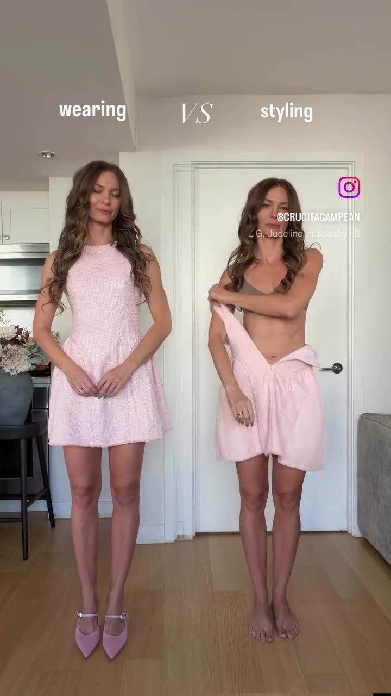

- **장면:** 드레스를 몸 둘레로 돌려서 다시 끌어올리는 중. 오른손으로 한쪽 상체를 가슴 위로 대각선으로 올리고, 왼손은 오른쪽 엉덩이에서 원단을 잡음. 밑단이 비뚤게 꼬여 있음.
- **오른쪽 착장 단계:** 원피스 회전 중 · 브라렛
- **왼쪽:** 정지 · 손 앞으로 모음
- **오버레이:** IG 아이콘 + @아이디 + 음원 라벨(스크롤) → 오른쪽 패널 우상단

**① 스플릿 프롬프트**

```text
Composition: split screen. The 9:16 frame is divided exactly down the vertical center into two equal panels with no visible divider line; the room continues seamlessly across both panels (same room, same locked camera, the kitchen behind the left panel, the white door behind the right panel). The SAME woman appears twice, centered in each panel, both full body head to toe: top of head about 22% from the top of the frame, feet about 8% above the bottom edge. The top 20% of the frame is empty wall, left clear as headroom for title text.

RIGHT PANEL ('styling'): she is barefoot, in a mocha-taupe seamless triangle bralette, with the pink tweed dress half rotated around her body. Action and pose: rotating the pink tweed dress around her body and pulling it back up: her right hand lifts one side of the bodice diagonally across her chest toward her left shoulder, her left hand holds the gathered fabric at her right hip, the skirt hem uneven and twisted, eyes down.

LEFT PANEL ('wearing'): she stands still and upright facing the camera, feet together in dusty-pink suede pointed-toe Mary Jane kitten heels with a thin strap fastened by a small crystal buckle and a slim clear-silver heel, wearing only the plain pink tweed dress with no styling (a baby-pink tweed boucle sleeveless mini dress: high round crew neckline, fitted structured bodice with princess seams, dropped waist, voluminous puffed bubble skirt made of curved gored panels ending mid-thigh, raw frayed self-fringe trim along the seams and hem, fine woven texture with tiny white flecks), arms relaxed with hands loosely clasped in front of her hips, calm neutral expression with a faint polite smile.

The woman (identical in every appearance): late 20s to early 30s, slim toned athletic build, light olive warm-toned skin with a subtle tan, oval face with defined cheekbones, almond-shaped eyes, natural brows, soft natural makeup with bronzed cheeks and a nude-mauve lip. Very long voluminous chocolate-brown hair with caramel balayage, middle part, styled in loose glossy mermaid curls falling past the chest. Short grey-blue manicured nails, a thin gold ring.

Setting: bright minimalist modern apartment. White walls and ceiling with a small recessed round downlight at the upper left. Left side of the room: white shaker kitchen cabinets with a stainless-steel built-in wall oven and microwave stack in the background, and a dark wood stool holding a matte slate-blue ceramic vase with a large dried-flower arrangement (cream hydrangeas, dusty-pink and beige dried blooms). Right side: a white paneled interior door with slim white casing and a matte black lever handle, and the arm of a light-grey boucle sofa peeking in at the far right edge. Light natural-oak wide-plank hardwood floor. Clean and uncluttered.

Photorealistic vertical 9:16 smartphone fashion reel still (720x1280). Shot on a modern iPhone main camera (~26mm equivalent) on a locked-off tripod at chest height, perfectly level horizon, no lens distortion, deep focus with everything sharp. Bright, airy natural daylight: soft diffused window light from camera-left and front, neutral-warm white balance, very soft shadows, gentle reflections on the floor. Soft pastel grade with baby pink as the dominant hue, low contrast, clean unclipped whites, realistic skin texture. Authentic at-home influencer aesthetic, not a studio.

Avoid: text, captions, watermark, logo, extra people, deformed hands, different faces or hair between the two panels, a visible split line, cropped head or feet.
```

<details><summary>② 타이틀 텍스트 포함 버전</summary>

```text
Composition: split screen. The 9:16 frame is divided exactly down the vertical center into two equal panels with no visible divider line; the room continues seamlessly across both panels (same room, same locked camera, the kitchen behind the left panel, the white door behind the right panel). The SAME woman appears twice, centered in each panel, both full body head to toe: top of head about 22% from the top of the frame, feet about 8% above the bottom edge. The top 20% of the frame is empty wall, left clear as headroom for title text.

RIGHT PANEL ('styling'): she is barefoot, in a mocha-taupe seamless triangle bralette, with the pink tweed dress half rotated around her body. Action and pose: rotating the pink tweed dress around her body and pulling it back up: her right hand lifts one side of the bodice diagonally across her chest toward her left shoulder, her left hand holds the gathered fabric at her right hip, the skirt hem uneven and twisted, eyes down.

LEFT PANEL ('wearing'): she stands still and upright facing the camera, feet together in dusty-pink suede pointed-toe Mary Jane kitten heels with a thin strap fastened by a small crystal buckle and a slim clear-silver heel, wearing only the plain pink tweed dress with no styling (a baby-pink tweed boucle sleeveless mini dress: high round crew neckline, fitted structured bodice with princess seams, dropped waist, voluminous puffed bubble skirt made of curved gored panels ending mid-thigh, raw frayed self-fringe trim along the seams and hem, fine woven texture with tiny white flecks), arms relaxed with hands loosely clasped in front of her hips, calm neutral expression with a faint polite smile.

The woman (identical in every appearance): late 20s to early 30s, slim toned athletic build, light olive warm-toned skin with a subtle tan, oval face with defined cheekbones, almond-shaped eyes, natural brows, soft natural makeup with bronzed cheeks and a nude-mauve lip. Very long voluminous chocolate-brown hair with caramel balayage, middle part, styled in loose glossy mermaid curls falling past the chest. Short grey-blue manicured nails, a thin gold ring.

Setting: bright minimalist modern apartment. White walls and ceiling with a small recessed round downlight at the upper left. Left side of the room: white shaker kitchen cabinets with a stainless-steel built-in wall oven and microwave stack in the background, and a dark wood stool holding a matte slate-blue ceramic vase with a large dried-flower arrangement (cream hydrangeas, dusty-pink and beige dried blooms). Right side: a white paneled interior door with slim white casing and a matte black lever handle, and the arm of a light-grey boucle sofa peeking in at the far right edge. Light natural-oak wide-plank hardwood floor. Clean and uncluttered.

Photorealistic vertical 9:16 smartphone fashion reel still (720x1280). Shot on a modern iPhone main camera (~26mm equivalent) on a locked-off tripod at chest height, perfectly level horizon, no lens distortion, deep focus with everything sharp. Bright, airy natural daylight: soft diffused window light from camera-left and front, neutral-warm white balance, very soft shadows, gentle reflections on the floor. Soft pastel grade with baby pink as the dominant hue, low contrast, clean unclipped whites, realistic skin texture. Authentic at-home influencer aesthetic, not a studio.

Overlay text in the top 16% of the frame: the lowercase word "wearing" in bold white condensed sans-serif centered over the left panel, a large thin white italic serif "VS" centered on the split line, and "styling" in the same bold white condensed sans-serif centered over the right panel; subtle soft drop shadow.

Avoid: extra captions, watermark, logo, extra people, deformed hands, different faces or hair between the two panels, a visible split line, cropped head or feet.
```
</details>

<details><summary>짧은 버전 (글자 수 제한 있는 모델용)</summary>

```text
Photorealistic vertical 9:16 split-screen fashion reel still: the same woman twice, side by side, full body head to toe, in a bright white minimalist apartment, locked tripod at chest height, soft daylight, airy pastel-pink grade, iPhone look. Woman: late 20s, slim and toned, light olive skin, very long chocolate-brown mermaid curls with caramel balayage, middle part, natural makeup. LEFT ('wearing'): standing still, hands clasped in front, in the plain baby-pink tweed sleeveless bubble mini dress with frayed trim and dusty-pink suede Mary Jane kitten heels. RIGHT ('styling'): barefoot in a mocha seamless bralette, dress half rotated around her body; rotating the pink tweed dress around her body and pulling it back up: her right hand lifts one side of the bodice diagonally across her chest toward her left shoulder, her left hand holds the gathered fabric at her right hip, the skirt hem uneven and twisted, eyes down. Background continuous across both halves: white kitchen and dried flowers behind the left, white paneled door with a black handle behind the right, light oak floor. Empty headroom at the top. No text, no visible split line.
```
</details>

<details><summary>③ 솔로(오른쪽 인물만) 버전</summary>

```text
Composition: single subject centered, full body head to toe, top of head about 22% from the top of the frame, feet about 8% above the bottom edge, generous empty space on both sides so the frame can be cropped to its central 50% width. Behind her: the white paneled door with a matte black lever handle, the grey boucle sofa arm at the right edge.

Subject: one woman, barefoot, in a mocha-taupe seamless triangle bralette, with the pink tweed dress half rotated around her body. Action and pose: rotating the pink tweed dress around her body and pulling it back up: her right hand lifts one side of the bodice diagonally across her chest toward her left shoulder, her left hand holds the gathered fabric at her right hip, the skirt hem uneven and twisted, eyes down.

The woman (identical in every appearance): late 20s to early 30s, slim toned athletic build, light olive warm-toned skin with a subtle tan, oval face with defined cheekbones, almond-shaped eyes, natural brows, soft natural makeup with bronzed cheeks and a nude-mauve lip. Very long voluminous chocolate-brown hair with caramel balayage, middle part, styled in loose glossy mermaid curls falling past the chest. Short grey-blue manicured nails, a thin gold ring.

Photorealistic vertical 9:16 smartphone fashion reel still (720x1280). Shot on a modern iPhone main camera (~26mm equivalent) on a locked-off tripod at chest height, perfectly level horizon, no lens distortion, deep focus with everything sharp. Bright, airy natural daylight: soft diffused window light from camera-left and front, neutral-warm white balance, very soft shadows, gentle reflections on the floor. Soft pastel grade with baby pink as the dominant hue, low contrast, clean unclipped whites, realistic skin texture. Authentic at-home influencer aesthetic, not a studio.

Avoid: text, captions, watermark, logo, extra people, deformed hands, cropped head or feet.
```
</details>

### F07 · 4.40s (프레임 #132) — U넥 피나포어 완성

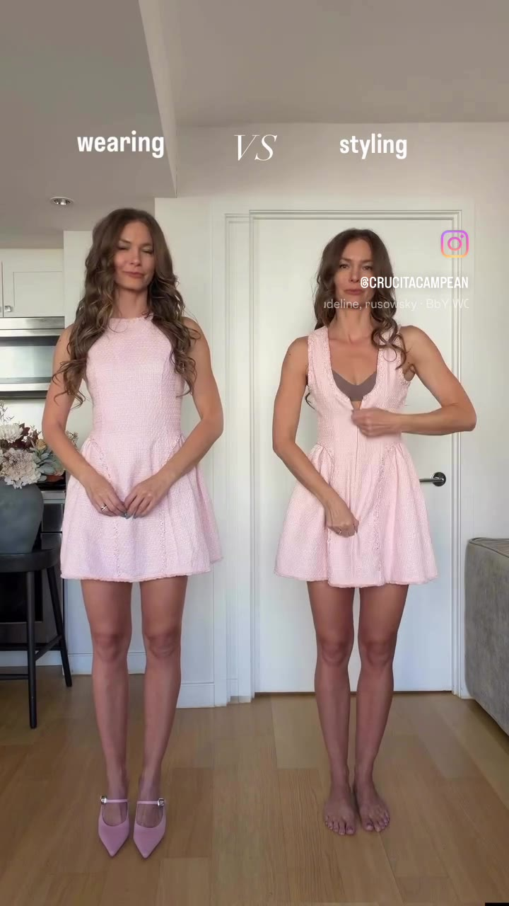

- **장면:** 드레스를 뒤로 돌려 입어 깊은 U넥 피나포어가 됨 (핵심 해크). 앞 중심에 등 솔기선이 보이고 브라렛이 살짝 드러남. 오른손으로 네크라인 정리.
- **오른쪽 착장 단계:** 원피스 뒤로 돌려 입음 = U넥 피나포어
- **왼쪽:** 정지 · 손 앞으로 모음
- **오버레이:** IG 아이콘 + @아이디 + 음원 라벨(스크롤) → 오른쪽 패널 우상단

**① 스플릿 프롬프트**

```text
Composition: split screen. The 9:16 frame is divided exactly down the vertical center into two equal panels with no visible divider line; the room continues seamlessly across both panels (same room, same locked camera, the kitchen behind the left panel, the white door behind the right panel). The SAME woman appears twice, centered in each panel, both full body head to toe: top of head about 22% from the top of the frame, feet about 8% above the bottom edge. The top 20% of the frame is empty wall, left clear as headroom for title text.

RIGHT PANEL ('styling'): she is barefoot, in the same pink tweed dress turned around and worn backwards, so its low scooped back now forms a deep U-shaped neckline in front and the dress reads as a pinafore; a faint vertical center seam runs down the front bodice, over a mocha-taupe seamless triangle bralette that peeks out of the neckline. Action and pose: her right hand at the center of the new neckline adjusting the fit, left hand smoothing the skirt at her hip, looking down at the neckline, feet together.

LEFT PANEL ('wearing'): she stands still and upright facing the camera, feet together in dusty-pink suede pointed-toe Mary Jane kitten heels with a thin strap fastened by a small crystal buckle and a slim clear-silver heel, wearing only the plain pink tweed dress with no styling (a baby-pink tweed boucle sleeveless mini dress: high round crew neckline, fitted structured bodice with princess seams, dropped waist, voluminous puffed bubble skirt made of curved gored panels ending mid-thigh, raw frayed self-fringe trim along the seams and hem, fine woven texture with tiny white flecks), arms relaxed with hands loosely clasped in front of her hips, calm neutral expression with a faint polite smile.

The woman (identical in every appearance): late 20s to early 30s, slim toned athletic build, light olive warm-toned skin with a subtle tan, oval face with defined cheekbones, almond-shaped eyes, natural brows, soft natural makeup with bronzed cheeks and a nude-mauve lip. Very long voluminous chocolate-brown hair with caramel balayage, middle part, styled in loose glossy mermaid curls falling past the chest. Short grey-blue manicured nails, a thin gold ring.

Setting: bright minimalist modern apartment. White walls and ceiling with a small recessed round downlight at the upper left. Left side of the room: white shaker kitchen cabinets with a stainless-steel built-in wall oven and microwave stack in the background, and a dark wood stool holding a matte slate-blue ceramic vase with a large dried-flower arrangement (cream hydrangeas, dusty-pink and beige dried blooms). Right side: a white paneled interior door with slim white casing and a matte black lever handle, and the arm of a light-grey boucle sofa peeking in at the far right edge. Light natural-oak wide-plank hardwood floor. Clean and uncluttered.

Photorealistic vertical 9:16 smartphone fashion reel still (720x1280). Shot on a modern iPhone main camera (~26mm equivalent) on a locked-off tripod at chest height, perfectly level horizon, no lens distortion, deep focus with everything sharp. Bright, airy natural daylight: soft diffused window light from camera-left and front, neutral-warm white balance, very soft shadows, gentle reflections on the floor. Soft pastel grade with baby pink as the dominant hue, low contrast, clean unclipped whites, realistic skin texture. Authentic at-home influencer aesthetic, not a studio.

Avoid: text, captions, watermark, logo, extra people, deformed hands, different faces or hair between the two panels, a visible split line, cropped head or feet.
```

<details><summary>② 타이틀 텍스트 포함 버전</summary>

```text
Composition: split screen. The 9:16 frame is divided exactly down the vertical center into two equal panels with no visible divider line; the room continues seamlessly across both panels (same room, same locked camera, the kitchen behind the left panel, the white door behind the right panel). The SAME woman appears twice, centered in each panel, both full body head to toe: top of head about 22% from the top of the frame, feet about 8% above the bottom edge. The top 20% of the frame is empty wall, left clear as headroom for title text.

RIGHT PANEL ('styling'): she is barefoot, in the same pink tweed dress turned around and worn backwards, so its low scooped back now forms a deep U-shaped neckline in front and the dress reads as a pinafore; a faint vertical center seam runs down the front bodice, over a mocha-taupe seamless triangle bralette that peeks out of the neckline. Action and pose: her right hand at the center of the new neckline adjusting the fit, left hand smoothing the skirt at her hip, looking down at the neckline, feet together.

LEFT PANEL ('wearing'): she stands still and upright facing the camera, feet together in dusty-pink suede pointed-toe Mary Jane kitten heels with a thin strap fastened by a small crystal buckle and a slim clear-silver heel, wearing only the plain pink tweed dress with no styling (a baby-pink tweed boucle sleeveless mini dress: high round crew neckline, fitted structured bodice with princess seams, dropped waist, voluminous puffed bubble skirt made of curved gored panels ending mid-thigh, raw frayed self-fringe trim along the seams and hem, fine woven texture with tiny white flecks), arms relaxed with hands loosely clasped in front of her hips, calm neutral expression with a faint polite smile.

The woman (identical in every appearance): late 20s to early 30s, slim toned athletic build, light olive warm-toned skin with a subtle tan, oval face with defined cheekbones, almond-shaped eyes, natural brows, soft natural makeup with bronzed cheeks and a nude-mauve lip. Very long voluminous chocolate-brown hair with caramel balayage, middle part, styled in loose glossy mermaid curls falling past the chest. Short grey-blue manicured nails, a thin gold ring.

Setting: bright minimalist modern apartment. White walls and ceiling with a small recessed round downlight at the upper left. Left side of the room: white shaker kitchen cabinets with a stainless-steel built-in wall oven and microwave stack in the background, and a dark wood stool holding a matte slate-blue ceramic vase with a large dried-flower arrangement (cream hydrangeas, dusty-pink and beige dried blooms). Right side: a white paneled interior door with slim white casing and a matte black lever handle, and the arm of a light-grey boucle sofa peeking in at the far right edge. Light natural-oak wide-plank hardwood floor. Clean and uncluttered.

Photorealistic vertical 9:16 smartphone fashion reel still (720x1280). Shot on a modern iPhone main camera (~26mm equivalent) on a locked-off tripod at chest height, perfectly level horizon, no lens distortion, deep focus with everything sharp. Bright, airy natural daylight: soft diffused window light from camera-left and front, neutral-warm white balance, very soft shadows, gentle reflections on the floor. Soft pastel grade with baby pink as the dominant hue, low contrast, clean unclipped whites, realistic skin texture. Authentic at-home influencer aesthetic, not a studio.

Overlay text in the top 16% of the frame: the lowercase word "wearing" in bold white condensed sans-serif centered over the left panel, a large thin white italic serif "VS" centered on the split line, and "styling" in the same bold white condensed sans-serif centered over the right panel; subtle soft drop shadow.

Avoid: extra captions, watermark, logo, extra people, deformed hands, different faces or hair between the two panels, a visible split line, cropped head or feet.
```
</details>

<details><summary>짧은 버전 (글자 수 제한 있는 모델용)</summary>

```text
Photorealistic vertical 9:16 split-screen fashion reel still: the same woman twice, side by side, full body head to toe, in a bright white minimalist apartment, locked tripod at chest height, soft daylight, airy pastel-pink grade, iPhone look. Woman: late 20s, slim and toned, light olive skin, very long chocolate-brown mermaid curls with caramel balayage, middle part, natural makeup. LEFT ('wearing'): standing still, hands clasped in front, in the plain baby-pink tweed sleeveless bubble mini dress with frayed trim and dusty-pink suede Mary Jane kitten heels. RIGHT ('styling'): barefoot in the pink tweed dress worn backwards as a deep U-neck pinafore over a mocha seamless bralette; her right hand at the center of the new neckline adjusting the fit, left hand smoothing the skirt at her hip, looking down at the neckline, feet together. Background continuous across both halves: white kitchen and dried flowers behind the left, white paneled door with a black handle behind the right, light oak floor. Empty headroom at the top. No text, no visible split line.
```
</details>

<details><summary>③ 솔로(오른쪽 인물만) 버전</summary>

```text
Composition: single subject centered, full body head to toe, top of head about 22% from the top of the frame, feet about 8% above the bottom edge, generous empty space on both sides so the frame can be cropped to its central 50% width. Behind her: the white paneled door with a matte black lever handle, the grey boucle sofa arm at the right edge.

Subject: one woman, barefoot, in the same pink tweed dress turned around and worn backwards, so its low scooped back now forms a deep U-shaped neckline in front and the dress reads as a pinafore; a faint vertical center seam runs down the front bodice, over a mocha-taupe seamless triangle bralette that peeks out of the neckline. Action and pose: her right hand at the center of the new neckline adjusting the fit, left hand smoothing the skirt at her hip, looking down at the neckline, feet together.

The woman (identical in every appearance): late 20s to early 30s, slim toned athletic build, light olive warm-toned skin with a subtle tan, oval face with defined cheekbones, almond-shaped eyes, natural brows, soft natural makeup with bronzed cheeks and a nude-mauve lip. Very long voluminous chocolate-brown hair with caramel balayage, middle part, styled in loose glossy mermaid curls falling past the chest. Short grey-blue manicured nails, a thin gold ring.

Photorealistic vertical 9:16 smartphone fashion reel still (720x1280). Shot on a modern iPhone main camera (~26mm equivalent) on a locked-off tripod at chest height, perfectly level horizon, no lens distortion, deep focus with everything sharp. Bright, airy natural daylight: soft diffused window light from camera-left and front, neutral-warm white balance, very soft shadows, gentle reflections on the floor. Soft pastel grade with baby pink as the dominant hue, low contrast, clean unclipped whites, realistic skin texture. Authentic at-home influencer aesthetic, not a studio.

Avoid: text, captions, watermark, logo, extra people, deformed hands, cropped head or feet.
```
</details>

### F08 · 5.10s (프레임 #153) — 블라우스 털어 펼치기

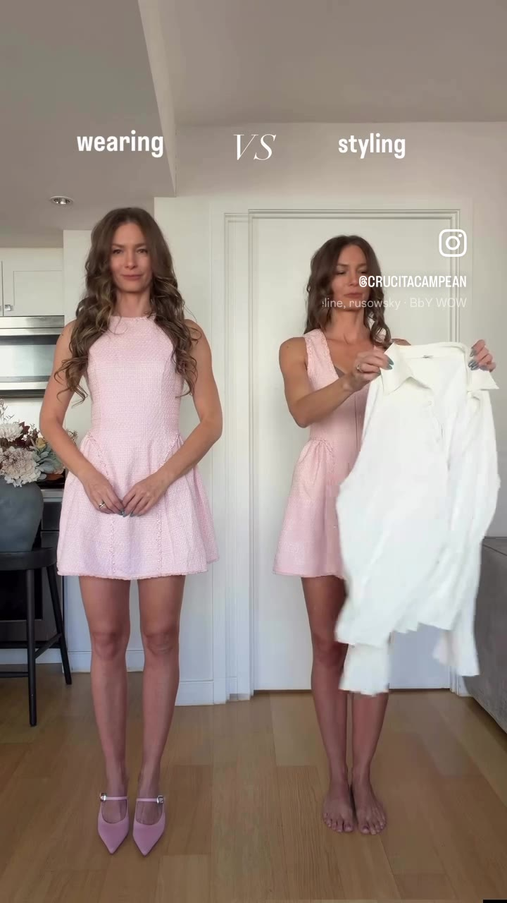

- **장면:** 화이트 보우 블라우스를 양손으로 어깨 높이에 들고 털어 펼침. 긴 소매, 플리츠 벨 커프스, 리본 끈이 모션블러로 흩날림.
- **오른쪽 착장 단계:** 원피스 뒤로 돌려 입음 = U넥 피나포어
- **왼쪽:** 정지 · 손 앞으로 모음
- **오버레이:** IG 아이콘 + @아이디 + 음원 라벨(스크롤) → 오른쪽 패널 우상단

**① 스플릿 프롬프트**

```text
Composition: split screen. The 9:16 frame is divided exactly down the vertical center into two equal panels with no visible divider line; the room continues seamlessly across both panels (same room, same locked camera, the kitchen behind the left panel, the white door behind the right panel). The SAME woman appears twice, centered in each panel, both full body head to toe: top of head about 22% from the top of the frame, feet about 8% above the bottom edge. The top 20% of the frame is empty wall, left clear as headroom for title text.

RIGHT PANEL ('styling'): she is barefoot, in the same pink tweed dress turned around and worn backwards, so its low scooped back now forms a deep U-shaped neckline in front and the dress reads as a pinafore; a faint vertical center seam runs down the front bodice, over a mocha-taupe seamless triangle bralette that peeks out of the neckline. Action and pose: holding a crisp ivory-white long-sleeve blouse up in front of her body with both hands at shoulder height and shaking it open; the long sleeves, knife-pleated bell cuffs and loose ribbon ties swing with slight motion blur; she looks at the blouse.

LEFT PANEL ('wearing'): she stands still and upright facing the camera, feet together in dusty-pink suede pointed-toe Mary Jane kitten heels with a thin strap fastened by a small crystal buckle and a slim clear-silver heel, wearing only the plain pink tweed dress with no styling (a baby-pink tweed boucle sleeveless mini dress: high round crew neckline, fitted structured bodice with princess seams, dropped waist, voluminous puffed bubble skirt made of curved gored panels ending mid-thigh, raw frayed self-fringe trim along the seams and hem, fine woven texture with tiny white flecks), arms relaxed with hands loosely clasped in front of her hips, calm neutral expression with a faint polite smile.

The woman (identical in every appearance): late 20s to early 30s, slim toned athletic build, light olive warm-toned skin with a subtle tan, oval face with defined cheekbones, almond-shaped eyes, natural brows, soft natural makeup with bronzed cheeks and a nude-mauve lip. Very long voluminous chocolate-brown hair with caramel balayage, middle part, styled in loose glossy mermaid curls falling past the chest. Short grey-blue manicured nails, a thin gold ring.

Setting: bright minimalist modern apartment. White walls and ceiling with a small recessed round downlight at the upper left. Left side of the room: white shaker kitchen cabinets with a stainless-steel built-in wall oven and microwave stack in the background, and a dark wood stool holding a matte slate-blue ceramic vase with a large dried-flower arrangement (cream hydrangeas, dusty-pink and beige dried blooms). Right side: a white paneled interior door with slim white casing and a matte black lever handle, and the arm of a light-grey boucle sofa peeking in at the far right edge. Light natural-oak wide-plank hardwood floor. Clean and uncluttered.

Photorealistic vertical 9:16 smartphone fashion reel still (720x1280). Shot on a modern iPhone main camera (~26mm equivalent) on a locked-off tripod at chest height, perfectly level horizon, no lens distortion, deep focus with everything sharp. Bright, airy natural daylight: soft diffused window light from camera-left and front, neutral-warm white balance, very soft shadows, gentle reflections on the floor. Soft pastel grade with baby pink as the dominant hue, low contrast, clean unclipped whites, realistic skin texture. Authentic at-home influencer aesthetic, not a studio.

Avoid: text, captions, watermark, logo, extra people, deformed hands, different faces or hair between the two panels, a visible split line, cropped head or feet.
```

<details><summary>② 타이틀 텍스트 포함 버전</summary>

```text
Composition: split screen. The 9:16 frame is divided exactly down the vertical center into two equal panels with no visible divider line; the room continues seamlessly across both panels (same room, same locked camera, the kitchen behind the left panel, the white door behind the right panel). The SAME woman appears twice, centered in each panel, both full body head to toe: top of head about 22% from the top of the frame, feet about 8% above the bottom edge. The top 20% of the frame is empty wall, left clear as headroom for title text.

RIGHT PANEL ('styling'): she is barefoot, in the same pink tweed dress turned around and worn backwards, so its low scooped back now forms a deep U-shaped neckline in front and the dress reads as a pinafore; a faint vertical center seam runs down the front bodice, over a mocha-taupe seamless triangle bralette that peeks out of the neckline. Action and pose: holding a crisp ivory-white long-sleeve blouse up in front of her body with both hands at shoulder height and shaking it open; the long sleeves, knife-pleated bell cuffs and loose ribbon ties swing with slight motion blur; she looks at the blouse.

LEFT PANEL ('wearing'): she stands still and upright facing the camera, feet together in dusty-pink suede pointed-toe Mary Jane kitten heels with a thin strap fastened by a small crystal buckle and a slim clear-silver heel, wearing only the plain pink tweed dress with no styling (a baby-pink tweed boucle sleeveless mini dress: high round crew neckline, fitted structured bodice with princess seams, dropped waist, voluminous puffed bubble skirt made of curved gored panels ending mid-thigh, raw frayed self-fringe trim along the seams and hem, fine woven texture with tiny white flecks), arms relaxed with hands loosely clasped in front of her hips, calm neutral expression with a faint polite smile.

The woman (identical in every appearance): late 20s to early 30s, slim toned athletic build, light olive warm-toned skin with a subtle tan, oval face with defined cheekbones, almond-shaped eyes, natural brows, soft natural makeup with bronzed cheeks and a nude-mauve lip. Very long voluminous chocolate-brown hair with caramel balayage, middle part, styled in loose glossy mermaid curls falling past the chest. Short grey-blue manicured nails, a thin gold ring.

Setting: bright minimalist modern apartment. White walls and ceiling with a small recessed round downlight at the upper left. Left side of the room: white shaker kitchen cabinets with a stainless-steel built-in wall oven and microwave stack in the background, and a dark wood stool holding a matte slate-blue ceramic vase with a large dried-flower arrangement (cream hydrangeas, dusty-pink and beige dried blooms). Right side: a white paneled interior door with slim white casing and a matte black lever handle, and the arm of a light-grey boucle sofa peeking in at the far right edge. Light natural-oak wide-plank hardwood floor. Clean and uncluttered.

Photorealistic vertical 9:16 smartphone fashion reel still (720x1280). Shot on a modern iPhone main camera (~26mm equivalent) on a locked-off tripod at chest height, perfectly level horizon, no lens distortion, deep focus with everything sharp. Bright, airy natural daylight: soft diffused window light from camera-left and front, neutral-warm white balance, very soft shadows, gentle reflections on the floor. Soft pastel grade with baby pink as the dominant hue, low contrast, clean unclipped whites, realistic skin texture. Authentic at-home influencer aesthetic, not a studio.

Overlay text in the top 16% of the frame: the lowercase word "wearing" in bold white condensed sans-serif centered over the left panel, a large thin white italic serif "VS" centered on the split line, and "styling" in the same bold white condensed sans-serif centered over the right panel; subtle soft drop shadow.

Avoid: extra captions, watermark, logo, extra people, deformed hands, different faces or hair between the two panels, a visible split line, cropped head or feet.
```
</details>

<details><summary>짧은 버전 (글자 수 제한 있는 모델용)</summary>

```text
Photorealistic vertical 9:16 split-screen fashion reel still: the same woman twice, side by side, full body head to toe, in a bright white minimalist apartment, locked tripod at chest height, soft daylight, airy pastel-pink grade, iPhone look. Woman: late 20s, slim and toned, light olive skin, very long chocolate-brown mermaid curls with caramel balayage, middle part, natural makeup. LEFT ('wearing'): standing still, hands clasped in front, in the plain baby-pink tweed sleeveless bubble mini dress with frayed trim and dusty-pink suede Mary Jane kitten heels. RIGHT ('styling'): barefoot in the pink tweed dress worn backwards as a deep U-neck pinafore over a mocha seamless bralette; holding a crisp ivory-white long-sleeve blouse up in front of her body with both hands at shoulder height and shaking it open; the long sleeves, knife-pleated bell cuffs and loose ribbon ties swing with slight motion blur; she looks at the blouse. Background continuous across both halves: white kitchen and dried flowers behind the left, white paneled door with a black handle behind the right, light oak floor. Empty headroom at the top. No text, no visible split line.
```
</details>

<details><summary>③ 솔로(오른쪽 인물만) 버전</summary>

```text
Composition: single subject centered, full body head to toe, top of head about 22% from the top of the frame, feet about 8% above the bottom edge, generous empty space on both sides so the frame can be cropped to its central 50% width. Behind her: the white paneled door with a matte black lever handle, the grey boucle sofa arm at the right edge.

Subject: one woman, barefoot, in the same pink tweed dress turned around and worn backwards, so its low scooped back now forms a deep U-shaped neckline in front and the dress reads as a pinafore; a faint vertical center seam runs down the front bodice, over a mocha-taupe seamless triangle bralette that peeks out of the neckline. Action and pose: holding a crisp ivory-white long-sleeve blouse up in front of her body with both hands at shoulder height and shaking it open; the long sleeves, knife-pleated bell cuffs and loose ribbon ties swing with slight motion blur; she looks at the blouse.

The woman (identical in every appearance): late 20s to early 30s, slim toned athletic build, light olive warm-toned skin with a subtle tan, oval face with defined cheekbones, almond-shaped eyes, natural brows, soft natural makeup with bronzed cheeks and a nude-mauve lip. Very long voluminous chocolate-brown hair with caramel balayage, middle part, styled in loose glossy mermaid curls falling past the chest. Short grey-blue manicured nails, a thin gold ring.

Photorealistic vertical 9:16 smartphone fashion reel still (720x1280). Shot on a modern iPhone main camera (~26mm equivalent) on a locked-off tripod at chest height, perfectly level horizon, no lens distortion, deep focus with everything sharp. Bright, airy natural daylight: soft diffused window light from camera-left and front, neutral-warm white balance, very soft shadows, gentle reflections on the floor. Soft pastel grade with baby pink as the dominant hue, low contrast, clean unclipped whites, realistic skin texture. Authentic at-home influencer aesthetic, not a studio.

Avoid: text, captions, watermark, logo, extra people, deformed hands, cropped head or feet.
```
</details>

### F09 · 5.60s (프레임 #168) — 블라우스 레이어링 · 칼라 정리

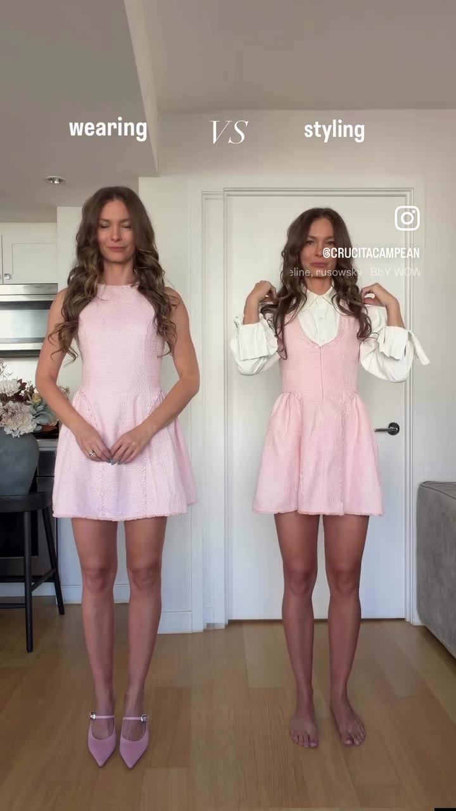

- **장면:** 점프컷으로 이미 블라우스를 피나포어 안에 입은 상태. 양손을 목에 대고 칼라를 세워 정리, 팔꿈치 넓게 벌림. 리본은 아직 안 묶고 늘어뜨림.
- **오른쪽 착장 단계:** 피나포어 + 보우 블라우스
- **왼쪽:** 정지 · 손 앞으로 모음
- **오버레이:** IG 아이콘 + @아이디 + 음원 라벨(스크롤) → 오른쪽 패널 우상단

**① 스플릿 프롬프트**

```text
Composition: split screen. The 9:16 frame is divided exactly down the vertical center into two equal panels with no visible divider line; the room continues seamlessly across both panels (same room, same locked camera, the kitchen behind the left panel, the white door behind the right panel). The SAME woman appears twice, centered in each panel, both full body head to toe: top of head about 22% from the top of the frame, feet about 8% above the bottom edge. The top 20% of the frame is empty wall, left clear as headroom for title text.

RIGHT PANEL ('styling'): she is barefoot, in the same pink tweed dress turned around and worn backwards, so its low scooped back now forms a deep U-shaped neckline in front and the dress reads as a pinafore; a faint vertical center seam runs down the front bodice, layered over a crisp ivory-white long-sleeve blouse underneath: small pointed collar, a ruffled jabot frill down the placket, an oversized pussy bow at the neck with very long satin ribbon tails, voluminous sleeves ending in dramatic knife-pleated bell cuffs that cover half the hand. Action and pose: the bow still untied with both ribbon tails hanging loose; both hands at her neck straightening the pointed collar, elbows out wide, the voluminous sleeves billowing, looking straight at the camera with a relaxed expression.

LEFT PANEL ('wearing'): she stands still and upright facing the camera, feet together in dusty-pink suede pointed-toe Mary Jane kitten heels with a thin strap fastened by a small crystal buckle and a slim clear-silver heel, wearing only the plain pink tweed dress with no styling (a baby-pink tweed boucle sleeveless mini dress: high round crew neckline, fitted structured bodice with princess seams, dropped waist, voluminous puffed bubble skirt made of curved gored panels ending mid-thigh, raw frayed self-fringe trim along the seams and hem, fine woven texture with tiny white flecks), arms relaxed with hands loosely clasped in front of her hips, calm neutral expression with a faint polite smile.

The woman (identical in every appearance): late 20s to early 30s, slim toned athletic build, light olive warm-toned skin with a subtle tan, oval face with defined cheekbones, almond-shaped eyes, natural brows, soft natural makeup with bronzed cheeks and a nude-mauve lip. Very long voluminous chocolate-brown hair with caramel balayage, middle part, styled in loose glossy mermaid curls falling past the chest. Short grey-blue manicured nails, a thin gold ring.

Setting: bright minimalist modern apartment. White walls and ceiling with a small recessed round downlight at the upper left. Left side of the room: white shaker kitchen cabinets with a stainless-steel built-in wall oven and microwave stack in the background, and a dark wood stool holding a matte slate-blue ceramic vase with a large dried-flower arrangement (cream hydrangeas, dusty-pink and beige dried blooms). Right side: a white paneled interior door with slim white casing and a matte black lever handle, and the arm of a light-grey boucle sofa peeking in at the far right edge. Light natural-oak wide-plank hardwood floor. Clean and uncluttered.

Photorealistic vertical 9:16 smartphone fashion reel still (720x1280). Shot on a modern iPhone main camera (~26mm equivalent) on a locked-off tripod at chest height, perfectly level horizon, no lens distortion, deep focus with everything sharp. Bright, airy natural daylight: soft diffused window light from camera-left and front, neutral-warm white balance, very soft shadows, gentle reflections on the floor. Soft pastel grade with baby pink as the dominant hue, low contrast, clean unclipped whites, realistic skin texture. Authentic at-home influencer aesthetic, not a studio.

Avoid: text, captions, watermark, logo, extra people, deformed hands, different faces or hair between the two panels, a visible split line, cropped head or feet.
```

<details><summary>② 타이틀 텍스트 포함 버전</summary>

```text
Composition: split screen. The 9:16 frame is divided exactly down the vertical center into two equal panels with no visible divider line; the room continues seamlessly across both panels (same room, same locked camera, the kitchen behind the left panel, the white door behind the right panel). The SAME woman appears twice, centered in each panel, both full body head to toe: top of head about 22% from the top of the frame, feet about 8% above the bottom edge. The top 20% of the frame is empty wall, left clear as headroom for title text.

RIGHT PANEL ('styling'): she is barefoot, in the same pink tweed dress turned around and worn backwards, so its low scooped back now forms a deep U-shaped neckline in front and the dress reads as a pinafore; a faint vertical center seam runs down the front bodice, layered over a crisp ivory-white long-sleeve blouse underneath: small pointed collar, a ruffled jabot frill down the placket, an oversized pussy bow at the neck with very long satin ribbon tails, voluminous sleeves ending in dramatic knife-pleated bell cuffs that cover half the hand. Action and pose: the bow still untied with both ribbon tails hanging loose; both hands at her neck straightening the pointed collar, elbows out wide, the voluminous sleeves billowing, looking straight at the camera with a relaxed expression.

LEFT PANEL ('wearing'): she stands still and upright facing the camera, feet together in dusty-pink suede pointed-toe Mary Jane kitten heels with a thin strap fastened by a small crystal buckle and a slim clear-silver heel, wearing only the plain pink tweed dress with no styling (a baby-pink tweed boucle sleeveless mini dress: high round crew neckline, fitted structured bodice with princess seams, dropped waist, voluminous puffed bubble skirt made of curved gored panels ending mid-thigh, raw frayed self-fringe trim along the seams and hem, fine woven texture with tiny white flecks), arms relaxed with hands loosely clasped in front of her hips, calm neutral expression with a faint polite smile.

The woman (identical in every appearance): late 20s to early 30s, slim toned athletic build, light olive warm-toned skin with a subtle tan, oval face with defined cheekbones, almond-shaped eyes, natural brows, soft natural makeup with bronzed cheeks and a nude-mauve lip. Very long voluminous chocolate-brown hair with caramel balayage, middle part, styled in loose glossy mermaid curls falling past the chest. Short grey-blue manicured nails, a thin gold ring.

Setting: bright minimalist modern apartment. White walls and ceiling with a small recessed round downlight at the upper left. Left side of the room: white shaker kitchen cabinets with a stainless-steel built-in wall oven and microwave stack in the background, and a dark wood stool holding a matte slate-blue ceramic vase with a large dried-flower arrangement (cream hydrangeas, dusty-pink and beige dried blooms). Right side: a white paneled interior door with slim white casing and a matte black lever handle, and the arm of a light-grey boucle sofa peeking in at the far right edge. Light natural-oak wide-plank hardwood floor. Clean and uncluttered.

Photorealistic vertical 9:16 smartphone fashion reel still (720x1280). Shot on a modern iPhone main camera (~26mm equivalent) on a locked-off tripod at chest height, perfectly level horizon, no lens distortion, deep focus with everything sharp. Bright, airy natural daylight: soft diffused window light from camera-left and front, neutral-warm white balance, very soft shadows, gentle reflections on the floor. Soft pastel grade with baby pink as the dominant hue, low contrast, clean unclipped whites, realistic skin texture. Authentic at-home influencer aesthetic, not a studio.

Overlay text in the top 16% of the frame: the lowercase word "wearing" in bold white condensed sans-serif centered over the left panel, a large thin white italic serif "VS" centered on the split line, and "styling" in the same bold white condensed sans-serif centered over the right panel; subtle soft drop shadow.

Avoid: extra captions, watermark, logo, extra people, deformed hands, different faces or hair between the two panels, a visible split line, cropped head or feet.
```
</details>

<details><summary>짧은 버전 (글자 수 제한 있는 모델용)</summary>

```text
Photorealistic vertical 9:16 split-screen fashion reel still: the same woman twice, side by side, full body head to toe, in a bright white minimalist apartment, locked tripod at chest height, soft daylight, airy pastel-pink grade, iPhone look. Woman: late 20s, slim and toned, light olive skin, very long chocolate-brown mermaid curls with caramel balayage, middle part, natural makeup. LEFT ('wearing'): standing still, hands clasped in front, in the plain baby-pink tweed sleeveless bubble mini dress with frayed trim and dusty-pink suede Mary Jane kitten heels. RIGHT ('styling'): barefoot in the pink tweed dress worn backwards as a deep U-neck pinafore over a white pussy-bow blouse with long ribbon ties and pleated bell sleeves; the bow still untied with both ribbon tails hanging loose; both hands at her neck straightening the pointed collar, elbows out wide, the voluminous sleeves billowing, looking straight at the camera with a relaxed expression. Background continuous across both halves: white kitchen and dried flowers behind the left, white paneled door with a black handle behind the right, light oak floor. Empty headroom at the top. No text, no visible split line.
```
</details>

<details><summary>③ 솔로(오른쪽 인물만) 버전</summary>

```text
Composition: single subject centered, full body head to toe, top of head about 22% from the top of the frame, feet about 8% above the bottom edge, generous empty space on both sides so the frame can be cropped to its central 50% width. Behind her: the white paneled door with a matte black lever handle, the grey boucle sofa arm at the right edge.

Subject: one woman, barefoot, in the same pink tweed dress turned around and worn backwards, so its low scooped back now forms a deep U-shaped neckline in front and the dress reads as a pinafore; a faint vertical center seam runs down the front bodice, layered over a crisp ivory-white long-sleeve blouse underneath: small pointed collar, a ruffled jabot frill down the placket, an oversized pussy bow at the neck with very long satin ribbon tails, voluminous sleeves ending in dramatic knife-pleated bell cuffs that cover half the hand. Action and pose: the bow still untied with both ribbon tails hanging loose; both hands at her neck straightening the pointed collar, elbows out wide, the voluminous sleeves billowing, looking straight at the camera with a relaxed expression.

The woman (identical in every appearance): late 20s to early 30s, slim toned athletic build, light olive warm-toned skin with a subtle tan, oval face with defined cheekbones, almond-shaped eyes, natural brows, soft natural makeup with bronzed cheeks and a nude-mauve lip. Very long voluminous chocolate-brown hair with caramel balayage, middle part, styled in loose glossy mermaid curls falling past the chest. Short grey-blue manicured nails, a thin gold ring.

Photorealistic vertical 9:16 smartphone fashion reel still (720x1280). Shot on a modern iPhone main camera (~26mm equivalent) on a locked-off tripod at chest height, perfectly level horizon, no lens distortion, deep focus with everything sharp. Bright, airy natural daylight: soft diffused window light from camera-left and front, neutral-warm white balance, very soft shadows, gentle reflections on the floor. Soft pastel grade with baby pink as the dominant hue, low contrast, clean unclipped whites, realistic skin texture. Authentic at-home influencer aesthetic, not a studio.

Avoid: text, captions, watermark, logo, extra people, deformed hands, cropped head or feet.
```
</details>

### F10 · 6.40s (프레임 #192) — 소매 볼륨 털기

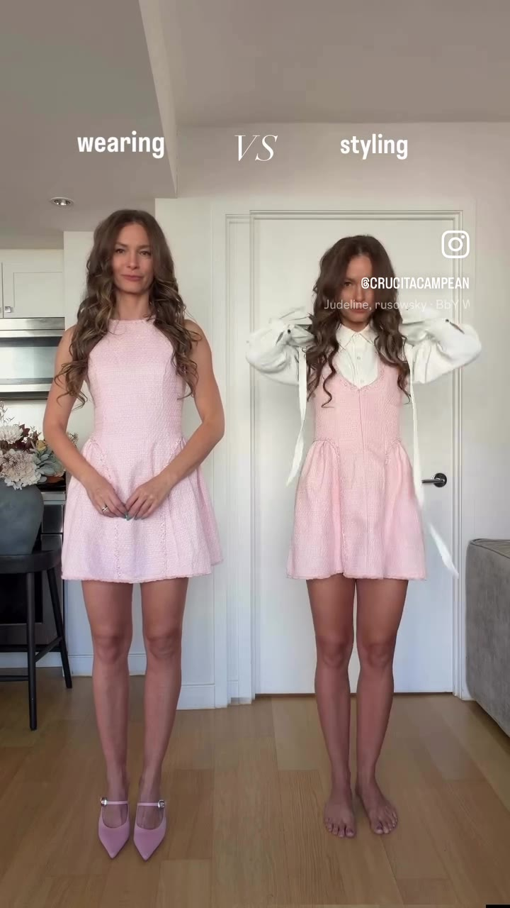

- **장면:** 양팔을 어깨 높이로 옆으로 벌려 소매를 털어 볼륨을 살림. 플리츠 벨 커프스가 퍼지고 풀린 긴 리본이 밑단 아래까지 늘어짐.
- **오른쪽 착장 단계:** 피나포어 + 보우 블라우스
- **왼쪽:** 정지 · 손 앞으로 모음
- **오버레이:** IG 아이콘 + @아이디 + 음원 라벨(스크롤) → 오른쪽 패널 우상단

**① 스플릿 프롬프트**

```text
Composition: split screen. The 9:16 frame is divided exactly down the vertical center into two equal panels with no visible divider line; the room continues seamlessly across both panels (same room, same locked camera, the kitchen behind the left panel, the white door behind the right panel). The SAME woman appears twice, centered in each panel, both full body head to toe: top of head about 22% from the top of the frame, feet about 8% above the bottom edge. The top 20% of the frame is empty wall, left clear as headroom for title text.

RIGHT PANEL ('styling'): she is barefoot, in the same pink tweed dress turned around and worn backwards, so its low scooped back now forms a deep U-shaped neckline in front and the dress reads as a pinafore; a faint vertical center seam runs down the front bodice, layered over a crisp ivory-white long-sleeve blouse underneath: small pointed collar, a ruffled jabot frill down the placket, an oversized pussy bow at the neck with very long satin ribbon tails, voluminous sleeves ending in dramatic knife-pleated bell cuffs that cover half the hand. Action and pose: both arms raised out to the sides at shoulder height, shaking out the voluminous sleeves so the knife-pleated bell cuffs flare, the long untied ribbon tails dangling down her front past the hem, head tilted slightly down.

LEFT PANEL ('wearing'): she stands still and upright facing the camera, feet together in dusty-pink suede pointed-toe Mary Jane kitten heels with a thin strap fastened by a small crystal buckle and a slim clear-silver heel, wearing only the plain pink tweed dress with no styling (a baby-pink tweed boucle sleeveless mini dress: high round crew neckline, fitted structured bodice with princess seams, dropped waist, voluminous puffed bubble skirt made of curved gored panels ending mid-thigh, raw frayed self-fringe trim along the seams and hem, fine woven texture with tiny white flecks), arms relaxed with hands loosely clasped in front of her hips, calm neutral expression with a faint polite smile.

The woman (identical in every appearance): late 20s to early 30s, slim toned athletic build, light olive warm-toned skin with a subtle tan, oval face with defined cheekbones, almond-shaped eyes, natural brows, soft natural makeup with bronzed cheeks and a nude-mauve lip. Very long voluminous chocolate-brown hair with caramel balayage, middle part, styled in loose glossy mermaid curls falling past the chest. Short grey-blue manicured nails, a thin gold ring.

Setting: bright minimalist modern apartment. White walls and ceiling with a small recessed round downlight at the upper left. Left side of the room: white shaker kitchen cabinets with a stainless-steel built-in wall oven and microwave stack in the background, and a dark wood stool holding a matte slate-blue ceramic vase with a large dried-flower arrangement (cream hydrangeas, dusty-pink and beige dried blooms). Right side: a white paneled interior door with slim white casing and a matte black lever handle, and the arm of a light-grey boucle sofa peeking in at the far right edge. Light natural-oak wide-plank hardwood floor. Clean and uncluttered.

Photorealistic vertical 9:16 smartphone fashion reel still (720x1280). Shot on a modern iPhone main camera (~26mm equivalent) on a locked-off tripod at chest height, perfectly level horizon, no lens distortion, deep focus with everything sharp. Bright, airy natural daylight: soft diffused window light from camera-left and front, neutral-warm white balance, very soft shadows, gentle reflections on the floor. Soft pastel grade with baby pink as the dominant hue, low contrast, clean unclipped whites, realistic skin texture. Authentic at-home influencer aesthetic, not a studio.

Avoid: text, captions, watermark, logo, extra people, deformed hands, different faces or hair between the two panels, a visible split line, cropped head or feet.
```

<details><summary>② 타이틀 텍스트 포함 버전</summary>

```text
Composition: split screen. The 9:16 frame is divided exactly down the vertical center into two equal panels with no visible divider line; the room continues seamlessly across both panels (same room, same locked camera, the kitchen behind the left panel, the white door behind the right panel). The SAME woman appears twice, centered in each panel, both full body head to toe: top of head about 22% from the top of the frame, feet about 8% above the bottom edge. The top 20% of the frame is empty wall, left clear as headroom for title text.

RIGHT PANEL ('styling'): she is barefoot, in the same pink tweed dress turned around and worn backwards, so its low scooped back now forms a deep U-shaped neckline in front and the dress reads as a pinafore; a faint vertical center seam runs down the front bodice, layered over a crisp ivory-white long-sleeve blouse underneath: small pointed collar, a ruffled jabot frill down the placket, an oversized pussy bow at the neck with very long satin ribbon tails, voluminous sleeves ending in dramatic knife-pleated bell cuffs that cover half the hand. Action and pose: both arms raised out to the sides at shoulder height, shaking out the voluminous sleeves so the knife-pleated bell cuffs flare, the long untied ribbon tails dangling down her front past the hem, head tilted slightly down.

LEFT PANEL ('wearing'): she stands still and upright facing the camera, feet together in dusty-pink suede pointed-toe Mary Jane kitten heels with a thin strap fastened by a small crystal buckle and a slim clear-silver heel, wearing only the plain pink tweed dress with no styling (a baby-pink tweed boucle sleeveless mini dress: high round crew neckline, fitted structured bodice with princess seams, dropped waist, voluminous puffed bubble skirt made of curved gored panels ending mid-thigh, raw frayed self-fringe trim along the seams and hem, fine woven texture with tiny white flecks), arms relaxed with hands loosely clasped in front of her hips, calm neutral expression with a faint polite smile.

The woman (identical in every appearance): late 20s to early 30s, slim toned athletic build, light olive warm-toned skin with a subtle tan, oval face with defined cheekbones, almond-shaped eyes, natural brows, soft natural makeup with bronzed cheeks and a nude-mauve lip. Very long voluminous chocolate-brown hair with caramel balayage, middle part, styled in loose glossy mermaid curls falling past the chest. Short grey-blue manicured nails, a thin gold ring.

Setting: bright minimalist modern apartment. White walls and ceiling with a small recessed round downlight at the upper left. Left side of the room: white shaker kitchen cabinets with a stainless-steel built-in wall oven and microwave stack in the background, and a dark wood stool holding a matte slate-blue ceramic vase with a large dried-flower arrangement (cream hydrangeas, dusty-pink and beige dried blooms). Right side: a white paneled interior door with slim white casing and a matte black lever handle, and the arm of a light-grey boucle sofa peeking in at the far right edge. Light natural-oak wide-plank hardwood floor. Clean and uncluttered.

Photorealistic vertical 9:16 smartphone fashion reel still (720x1280). Shot on a modern iPhone main camera (~26mm equivalent) on a locked-off tripod at chest height, perfectly level horizon, no lens distortion, deep focus with everything sharp. Bright, airy natural daylight: soft diffused window light from camera-left and front, neutral-warm white balance, very soft shadows, gentle reflections on the floor. Soft pastel grade with baby pink as the dominant hue, low contrast, clean unclipped whites, realistic skin texture. Authentic at-home influencer aesthetic, not a studio.

Overlay text in the top 16% of the frame: the lowercase word "wearing" in bold white condensed sans-serif centered over the left panel, a large thin white italic serif "VS" centered on the split line, and "styling" in the same bold white condensed sans-serif centered over the right panel; subtle soft drop shadow.

Avoid: extra captions, watermark, logo, extra people, deformed hands, different faces or hair between the two panels, a visible split line, cropped head or feet.
```
</details>

<details><summary>짧은 버전 (글자 수 제한 있는 모델용)</summary>

```text
Photorealistic vertical 9:16 split-screen fashion reel still: the same woman twice, side by side, full body head to toe, in a bright white minimalist apartment, locked tripod at chest height, soft daylight, airy pastel-pink grade, iPhone look. Woman: late 20s, slim and toned, light olive skin, very long chocolate-brown mermaid curls with caramel balayage, middle part, natural makeup. LEFT ('wearing'): standing still, hands clasped in front, in the plain baby-pink tweed sleeveless bubble mini dress with frayed trim and dusty-pink suede Mary Jane kitten heels. RIGHT ('styling'): barefoot in the pink tweed dress worn backwards as a deep U-neck pinafore over a white pussy-bow blouse with long ribbon ties and pleated bell sleeves; both arms raised out to the sides at shoulder height, shaking out the voluminous sleeves so the knife-pleated bell cuffs flare, the long untied ribbon tails dangling down her front past the hem, head tilted slightly down. Background continuous across both halves: white kitchen and dried flowers behind the left, white paneled door with a black handle behind the right, light oak floor. Empty headroom at the top. No text, no visible split line.
```
</details>

<details><summary>③ 솔로(오른쪽 인물만) 버전</summary>

```text
Composition: single subject centered, full body head to toe, top of head about 22% from the top of the frame, feet about 8% above the bottom edge, generous empty space on both sides so the frame can be cropped to its central 50% width. Behind her: the white paneled door with a matte black lever handle, the grey boucle sofa arm at the right edge.

Subject: one woman, barefoot, in the same pink tweed dress turned around and worn backwards, so its low scooped back now forms a deep U-shaped neckline in front and the dress reads as a pinafore; a faint vertical center seam runs down the front bodice, layered over a crisp ivory-white long-sleeve blouse underneath: small pointed collar, a ruffled jabot frill down the placket, an oversized pussy bow at the neck with very long satin ribbon tails, voluminous sleeves ending in dramatic knife-pleated bell cuffs that cover half the hand. Action and pose: both arms raised out to the sides at shoulder height, shaking out the voluminous sleeves so the knife-pleated bell cuffs flare, the long untied ribbon tails dangling down her front past the hem, head tilted slightly down.

The woman (identical in every appearance): late 20s to early 30s, slim toned athletic build, light olive warm-toned skin with a subtle tan, oval face with defined cheekbones, almond-shaped eyes, natural brows, soft natural makeup with bronzed cheeks and a nude-mauve lip. Very long voluminous chocolate-brown hair with caramel balayage, middle part, styled in loose glossy mermaid curls falling past the chest. Short grey-blue manicured nails, a thin gold ring.

Photorealistic vertical 9:16 smartphone fashion reel still (720x1280). Shot on a modern iPhone main camera (~26mm equivalent) on a locked-off tripod at chest height, perfectly level horizon, no lens distortion, deep focus with everything sharp. Bright, airy natural daylight: soft diffused window light from camera-left and front, neutral-warm white balance, very soft shadows, gentle reflections on the floor. Soft pastel grade with baby pink as the dominant hue, low contrast, clean unclipped whites, realistic skin texture. Authentic at-home influencer aesthetic, not a studio.

Avoid: text, captions, watermark, logo, extra people, deformed hands, cropped head or feet.
```
</details>

### F11 · 7.30s (프레임 #219) — 리본 묶기

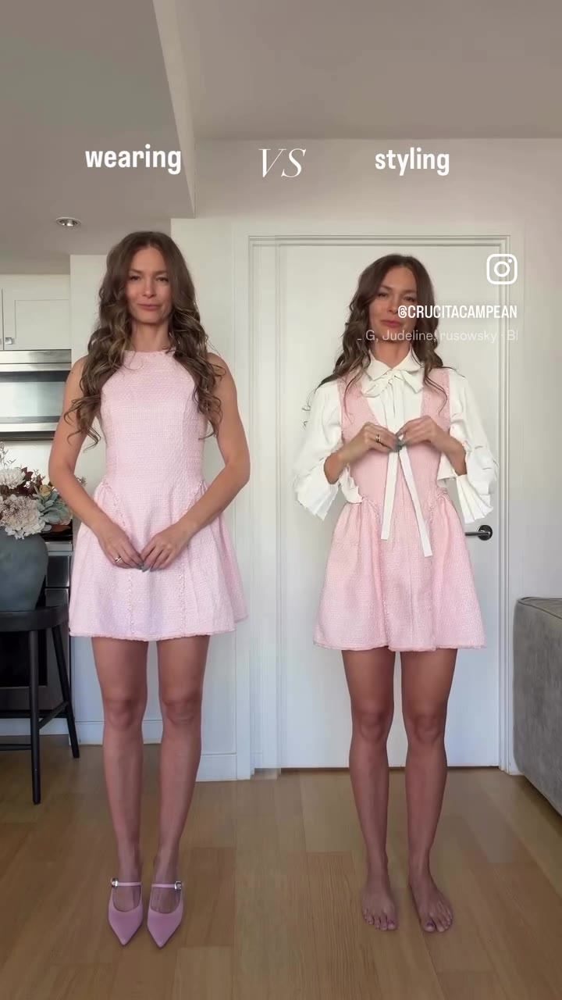

- **장면:** 가슴 높이에서 양손으로 목 앞 푸시보우를 묶는 중. 긴 새틴 리본 꼬리가 피나포어 앞 중심으로 떨어짐. 시선 아래, 집중한 옅은 미소.
- **오른쪽 착장 단계:** 피나포어 + 보우 블라우스
- **왼쪽:** 정지 · 손 앞으로 모음
- **오버레이:** IG 아이콘 + @아이디 + 음원 라벨(스크롤) → 오른쪽 패널 우상단

**① 스플릿 프롬프트**

```text
Composition: split screen. The 9:16 frame is divided exactly down the vertical center into two equal panels with no visible divider line; the room continues seamlessly across both panels (same room, same locked camera, the kitchen behind the left panel, the white door behind the right panel). The SAME woman appears twice, centered in each panel, both full body head to toe: top of head about 22% from the top of the frame, feet about 8% above the bottom edge. The top 20% of the frame is empty wall, left clear as headroom for title text.

RIGHT PANEL ('styling'): she is barefoot, in the same pink tweed dress turned around and worn backwards, so its low scooped back now forms a deep U-shaped neckline in front and the dress reads as a pinafore; a faint vertical center seam runs down the front bodice, layered over a crisp ivory-white long-sleeve blouse underneath: small pointed collar, a ruffled jabot frill down the placket, an oversized pussy bow at the neck with very long satin ribbon tails, voluminous sleeves ending in dramatic knife-pleated bell cuffs that cover half the hand. Action and pose: tying the oversized pussy bow at the center of her collar with both hands at chest height, the long satin ribbon tails falling down the center front of the pinafore, eyes lowered, soft focused smile.

LEFT PANEL ('wearing'): she stands still and upright facing the camera, feet together in dusty-pink suede pointed-toe Mary Jane kitten heels with a thin strap fastened by a small crystal buckle and a slim clear-silver heel, wearing only the plain pink tweed dress with no styling (a baby-pink tweed boucle sleeveless mini dress: high round crew neckline, fitted structured bodice with princess seams, dropped waist, voluminous puffed bubble skirt made of curved gored panels ending mid-thigh, raw frayed self-fringe trim along the seams and hem, fine woven texture with tiny white flecks), arms relaxed with hands loosely clasped in front of her hips, calm neutral expression with a faint polite smile.

The woman (identical in every appearance): late 20s to early 30s, slim toned athletic build, light olive warm-toned skin with a subtle tan, oval face with defined cheekbones, almond-shaped eyes, natural brows, soft natural makeup with bronzed cheeks and a nude-mauve lip. Very long voluminous chocolate-brown hair with caramel balayage, middle part, styled in loose glossy mermaid curls falling past the chest. Short grey-blue manicured nails, a thin gold ring.

Setting: bright minimalist modern apartment. White walls and ceiling with a small recessed round downlight at the upper left. Left side of the room: white shaker kitchen cabinets with a stainless-steel built-in wall oven and microwave stack in the background, and a dark wood stool holding a matte slate-blue ceramic vase with a large dried-flower arrangement (cream hydrangeas, dusty-pink and beige dried blooms). Right side: a white paneled interior door with slim white casing and a matte black lever handle, and the arm of a light-grey boucle sofa peeking in at the far right edge. Light natural-oak wide-plank hardwood floor. Clean and uncluttered.

Photorealistic vertical 9:16 smartphone fashion reel still (720x1280). Shot on a modern iPhone main camera (~26mm equivalent) on a locked-off tripod at chest height, perfectly level horizon, no lens distortion, deep focus with everything sharp. Bright, airy natural daylight: soft diffused window light from camera-left and front, neutral-warm white balance, very soft shadows, gentle reflections on the floor. Soft pastel grade with baby pink as the dominant hue, low contrast, clean unclipped whites, realistic skin texture. Authentic at-home influencer aesthetic, not a studio.

Avoid: text, captions, watermark, logo, extra people, deformed hands, different faces or hair between the two panels, a visible split line, cropped head or feet.
```

<details><summary>② 타이틀 텍스트 포함 버전</summary>

```text
Composition: split screen. The 9:16 frame is divided exactly down the vertical center into two equal panels with no visible divider line; the room continues seamlessly across both panels (same room, same locked camera, the kitchen behind the left panel, the white door behind the right panel). The SAME woman appears twice, centered in each panel, both full body head to toe: top of head about 22% from the top of the frame, feet about 8% above the bottom edge. The top 20% of the frame is empty wall, left clear as headroom for title text.

RIGHT PANEL ('styling'): she is barefoot, in the same pink tweed dress turned around and worn backwards, so its low scooped back now forms a deep U-shaped neckline in front and the dress reads as a pinafore; a faint vertical center seam runs down the front bodice, layered over a crisp ivory-white long-sleeve blouse underneath: small pointed collar, a ruffled jabot frill down the placket, an oversized pussy bow at the neck with very long satin ribbon tails, voluminous sleeves ending in dramatic knife-pleated bell cuffs that cover half the hand. Action and pose: tying the oversized pussy bow at the center of her collar with both hands at chest height, the long satin ribbon tails falling down the center front of the pinafore, eyes lowered, soft focused smile.

LEFT PANEL ('wearing'): she stands still and upright facing the camera, feet together in dusty-pink suede pointed-toe Mary Jane kitten heels with a thin strap fastened by a small crystal buckle and a slim clear-silver heel, wearing only the plain pink tweed dress with no styling (a baby-pink tweed boucle sleeveless mini dress: high round crew neckline, fitted structured bodice with princess seams, dropped waist, voluminous puffed bubble skirt made of curved gored panels ending mid-thigh, raw frayed self-fringe trim along the seams and hem, fine woven texture with tiny white flecks), arms relaxed with hands loosely clasped in front of her hips, calm neutral expression with a faint polite smile.

The woman (identical in every appearance): late 20s to early 30s, slim toned athletic build, light olive warm-toned skin with a subtle tan, oval face with defined cheekbones, almond-shaped eyes, natural brows, soft natural makeup with bronzed cheeks and a nude-mauve lip. Very long voluminous chocolate-brown hair with caramel balayage, middle part, styled in loose glossy mermaid curls falling past the chest. Short grey-blue manicured nails, a thin gold ring.

Setting: bright minimalist modern apartment. White walls and ceiling with a small recessed round downlight at the upper left. Left side of the room: white shaker kitchen cabinets with a stainless-steel built-in wall oven and microwave stack in the background, and a dark wood stool holding a matte slate-blue ceramic vase with a large dried-flower arrangement (cream hydrangeas, dusty-pink and beige dried blooms). Right side: a white paneled interior door with slim white casing and a matte black lever handle, and the arm of a light-grey boucle sofa peeking in at the far right edge. Light natural-oak wide-plank hardwood floor. Clean and uncluttered.

Photorealistic vertical 9:16 smartphone fashion reel still (720x1280). Shot on a modern iPhone main camera (~26mm equivalent) on a locked-off tripod at chest height, perfectly level horizon, no lens distortion, deep focus with everything sharp. Bright, airy natural daylight: soft diffused window light from camera-left and front, neutral-warm white balance, very soft shadows, gentle reflections on the floor. Soft pastel grade with baby pink as the dominant hue, low contrast, clean unclipped whites, realistic skin texture. Authentic at-home influencer aesthetic, not a studio.

Overlay text in the top 16% of the frame: the lowercase word "wearing" in bold white condensed sans-serif centered over the left panel, a large thin white italic serif "VS" centered on the split line, and "styling" in the same bold white condensed sans-serif centered over the right panel; subtle soft drop shadow.

Avoid: extra captions, watermark, logo, extra people, deformed hands, different faces or hair between the two panels, a visible split line, cropped head or feet.
```
</details>

<details><summary>짧은 버전 (글자 수 제한 있는 모델용)</summary>

```text
Photorealistic vertical 9:16 split-screen fashion reel still: the same woman twice, side by side, full body head to toe, in a bright white minimalist apartment, locked tripod at chest height, soft daylight, airy pastel-pink grade, iPhone look. Woman: late 20s, slim and toned, light olive skin, very long chocolate-brown mermaid curls with caramel balayage, middle part, natural makeup. LEFT ('wearing'): standing still, hands clasped in front, in the plain baby-pink tweed sleeveless bubble mini dress with frayed trim and dusty-pink suede Mary Jane kitten heels. RIGHT ('styling'): barefoot in the pink tweed dress worn backwards as a deep U-neck pinafore over a white pussy-bow blouse with long ribbon ties and pleated bell sleeves; tying the oversized pussy bow at the center of her collar with both hands at chest height, the long satin ribbon tails falling down the center front of the pinafore, eyes lowered, soft focused smile. Background continuous across both halves: white kitchen and dried flowers behind the left, white paneled door with a black handle behind the right, light oak floor. Empty headroom at the top. No text, no visible split line.
```
</details>

<details><summary>③ 솔로(오른쪽 인물만) 버전</summary>

```text
Composition: single subject centered, full body head to toe, top of head about 22% from the top of the frame, feet about 8% above the bottom edge, generous empty space on both sides so the frame can be cropped to its central 50% width. Behind her: the white paneled door with a matte black lever handle, the grey boucle sofa arm at the right edge.

Subject: one woman, barefoot, in the same pink tweed dress turned around and worn backwards, so its low scooped back now forms a deep U-shaped neckline in front and the dress reads as a pinafore; a faint vertical center seam runs down the front bodice, layered over a crisp ivory-white long-sleeve blouse underneath: small pointed collar, a ruffled jabot frill down the placket, an oversized pussy bow at the neck with very long satin ribbon tails, voluminous sleeves ending in dramatic knife-pleated bell cuffs that cover half the hand. Action and pose: tying the oversized pussy bow at the center of her collar with both hands at chest height, the long satin ribbon tails falling down the center front of the pinafore, eyes lowered, soft focused smile.

The woman (identical in every appearance): late 20s to early 30s, slim toned athletic build, light olive warm-toned skin with a subtle tan, oval face with defined cheekbones, almond-shaped eyes, natural brows, soft natural makeup with bronzed cheeks and a nude-mauve lip. Very long voluminous chocolate-brown hair with caramel balayage, middle part, styled in loose glossy mermaid curls falling past the chest. Short grey-blue manicured nails, a thin gold ring.

Photorealistic vertical 9:16 smartphone fashion reel still (720x1280). Shot on a modern iPhone main camera (~26mm equivalent) on a locked-off tripod at chest height, perfectly level horizon, no lens distortion, deep focus with everything sharp. Bright, airy natural daylight: soft diffused window light from camera-left and front, neutral-warm white balance, very soft shadows, gentle reflections on the floor. Soft pastel grade with baby pink as the dominant hue, low contrast, clean unclipped whites, realistic skin texture. Authentic at-home influencer aesthetic, not a studio.

Avoid: text, captions, watermark, logo, extra people, deformed hands, cropped head or feet.
```
</details>

### F12 · 8.20s (프레임 #246) — 레이스 타이츠 신기

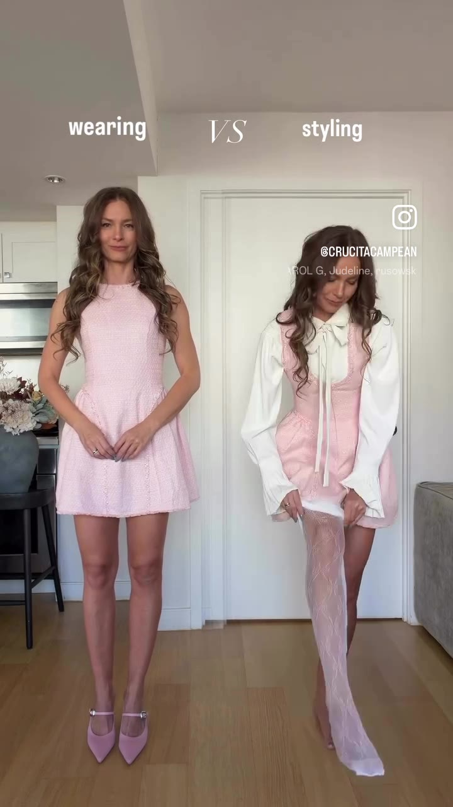

- **장면:** 리본 완성. 왼발로 서서 오른 다리를 앞으로 살짝 든 채 화이트 레이스 타이츠를 허벅지까지 끌어올림. 치마 밑단이 살짝 들림, 고개 숙여 웃음.
- **오른쪽 착장 단계:** 피나포어 + 블라우스 · 타이츠 신는 중
- **왼쪽:** 정지 · 손 앞으로 모음
- **오버레이:** IG 아이콘 + @아이디 + 음원 라벨(스크롤) → 오른쪽 패널 우상단

**① 스플릿 프롬프트**

```text
Composition: split screen. The 9:16 frame is divided exactly down the vertical center into two equal panels with no visible divider line; the room continues seamlessly across both panels (same room, same locked camera, the kitchen behind the left panel, the white door behind the right panel). The SAME woman appears twice, centered in each panel, both full body head to toe: top of head about 22% from the top of the frame, feet about 8% above the bottom edge. The top 20% of the frame is empty wall, left clear as headroom for title text.

RIGHT PANEL ('styling'): she is in the same pink tweed dress turned around and worn backwards, so its low scooped back now forms a deep U-shaped neckline in front and the dress reads as a pinafore; a faint vertical center seam runs down the front bodice, layered over a crisp ivory-white long-sleeve blouse underneath: small pointed collar, a ruffled jabot frill down the placket, an oversized pussy bow at the neck with very long satin ribbon tails, voluminous sleeves ending in dramatic knife-pleated bell cuffs that cover half the hand; halfway into sheer white lace tights with a diamond trellis and tiny bow lace pattern. Action and pose: the bow now neatly tied with long tails; pulling on sheer white lace tights: weight on her left leg, right leg extended forward and slightly lifted with the tights already up to the thigh, both hands gathering the lace at her upper thigh and lifting the skirt hem a little, head bowed, smiling down.

LEFT PANEL ('wearing'): she stands still and upright facing the camera, feet together in dusty-pink suede pointed-toe Mary Jane kitten heels with a thin strap fastened by a small crystal buckle and a slim clear-silver heel, wearing only the plain pink tweed dress with no styling (a baby-pink tweed boucle sleeveless mini dress: high round crew neckline, fitted structured bodice with princess seams, dropped waist, voluminous puffed bubble skirt made of curved gored panels ending mid-thigh, raw frayed self-fringe trim along the seams and hem, fine woven texture with tiny white flecks), arms relaxed with hands loosely clasped in front of her hips, calm neutral expression with a faint polite smile.

The woman (identical in every appearance): late 20s to early 30s, slim toned athletic build, light olive warm-toned skin with a subtle tan, oval face with defined cheekbones, almond-shaped eyes, natural brows, soft natural makeup with bronzed cheeks and a nude-mauve lip. Very long voluminous chocolate-brown hair with caramel balayage, middle part, styled in loose glossy mermaid curls falling past the chest. Short grey-blue manicured nails, a thin gold ring.

Setting: bright minimalist modern apartment. White walls and ceiling with a small recessed round downlight at the upper left. Left side of the room: white shaker kitchen cabinets with a stainless-steel built-in wall oven and microwave stack in the background, and a dark wood stool holding a matte slate-blue ceramic vase with a large dried-flower arrangement (cream hydrangeas, dusty-pink and beige dried blooms). Right side: a white paneled interior door with slim white casing and a matte black lever handle, and the arm of a light-grey boucle sofa peeking in at the far right edge. Light natural-oak wide-plank hardwood floor. Clean and uncluttered.

Photorealistic vertical 9:16 smartphone fashion reel still (720x1280). Shot on a modern iPhone main camera (~26mm equivalent) on a locked-off tripod at chest height, perfectly level horizon, no lens distortion, deep focus with everything sharp. Bright, airy natural daylight: soft diffused window light from camera-left and front, neutral-warm white balance, very soft shadows, gentle reflections on the floor. Soft pastel grade with baby pink as the dominant hue, low contrast, clean unclipped whites, realistic skin texture. Authentic at-home influencer aesthetic, not a studio.

Avoid: text, captions, watermark, logo, extra people, deformed hands, different faces or hair between the two panels, a visible split line, cropped head or feet.
```

<details><summary>② 타이틀 텍스트 포함 버전</summary>

```text
Composition: split screen. The 9:16 frame is divided exactly down the vertical center into two equal panels with no visible divider line; the room continues seamlessly across both panels (same room, same locked camera, the kitchen behind the left panel, the white door behind the right panel). The SAME woman appears twice, centered in each panel, both full body head to toe: top of head about 22% from the top of the frame, feet about 8% above the bottom edge. The top 20% of the frame is empty wall, left clear as headroom for title text.

RIGHT PANEL ('styling'): she is in the same pink tweed dress turned around and worn backwards, so its low scooped back now forms a deep U-shaped neckline in front and the dress reads as a pinafore; a faint vertical center seam runs down the front bodice, layered over a crisp ivory-white long-sleeve blouse underneath: small pointed collar, a ruffled jabot frill down the placket, an oversized pussy bow at the neck with very long satin ribbon tails, voluminous sleeves ending in dramatic knife-pleated bell cuffs that cover half the hand; halfway into sheer white lace tights with a diamond trellis and tiny bow lace pattern. Action and pose: the bow now neatly tied with long tails; pulling on sheer white lace tights: weight on her left leg, right leg extended forward and slightly lifted with the tights already up to the thigh, both hands gathering the lace at her upper thigh and lifting the skirt hem a little, head bowed, smiling down.

LEFT PANEL ('wearing'): she stands still and upright facing the camera, feet together in dusty-pink suede pointed-toe Mary Jane kitten heels with a thin strap fastened by a small crystal buckle and a slim clear-silver heel, wearing only the plain pink tweed dress with no styling (a baby-pink tweed boucle sleeveless mini dress: high round crew neckline, fitted structured bodice with princess seams, dropped waist, voluminous puffed bubble skirt made of curved gored panels ending mid-thigh, raw frayed self-fringe trim along the seams and hem, fine woven texture with tiny white flecks), arms relaxed with hands loosely clasped in front of her hips, calm neutral expression with a faint polite smile.

The woman (identical in every appearance): late 20s to early 30s, slim toned athletic build, light olive warm-toned skin with a subtle tan, oval face with defined cheekbones, almond-shaped eyes, natural brows, soft natural makeup with bronzed cheeks and a nude-mauve lip. Very long voluminous chocolate-brown hair with caramel balayage, middle part, styled in loose glossy mermaid curls falling past the chest. Short grey-blue manicured nails, a thin gold ring.

Setting: bright minimalist modern apartment. White walls and ceiling with a small recessed round downlight at the upper left. Left side of the room: white shaker kitchen cabinets with a stainless-steel built-in wall oven and microwave stack in the background, and a dark wood stool holding a matte slate-blue ceramic vase with a large dried-flower arrangement (cream hydrangeas, dusty-pink and beige dried blooms). Right side: a white paneled interior door with slim white casing and a matte black lever handle, and the arm of a light-grey boucle sofa peeking in at the far right edge. Light natural-oak wide-plank hardwood floor. Clean and uncluttered.

Photorealistic vertical 9:16 smartphone fashion reel still (720x1280). Shot on a modern iPhone main camera (~26mm equivalent) on a locked-off tripod at chest height, perfectly level horizon, no lens distortion, deep focus with everything sharp. Bright, airy natural daylight: soft diffused window light from camera-left and front, neutral-warm white balance, very soft shadows, gentle reflections on the floor. Soft pastel grade with baby pink as the dominant hue, low contrast, clean unclipped whites, realistic skin texture. Authentic at-home influencer aesthetic, not a studio.

Overlay text in the top 16% of the frame: the lowercase word "wearing" in bold white condensed sans-serif centered over the left panel, a large thin white italic serif "VS" centered on the split line, and "styling" in the same bold white condensed sans-serif centered over the right panel; subtle soft drop shadow.

Avoid: extra captions, watermark, logo, extra people, deformed hands, different faces or hair between the two panels, a visible split line, cropped head or feet.
```
</details>

<details><summary>짧은 버전 (글자 수 제한 있는 모델용)</summary>

```text
Photorealistic vertical 9:16 split-screen fashion reel still: the same woman twice, side by side, full body head to toe, in a bright white minimalist apartment, locked tripod at chest height, soft daylight, airy pastel-pink grade, iPhone look. Woman: late 20s, slim and toned, light olive skin, very long chocolate-brown mermaid curls with caramel balayage, middle part, natural makeup. LEFT ('wearing'): standing still, hands clasped in front, in the plain baby-pink tweed sleeveless bubble mini dress with frayed trim and dusty-pink suede Mary Jane kitten heels. RIGHT ('styling'): in the pink tweed dress worn backwards as a deep U-neck pinafore over a white pussy-bow blouse with long ribbon ties and pleated bell sleeves, halfway into white lace tights; the bow now neatly tied with long tails; pulling on sheer white lace tights: weight on her left leg, right leg extended forward and slightly lifted with the tights already up to the thigh, both hands gathering the lace at her upper thigh and lifting the skirt hem a little, head bowed, smiling down. Background continuous across both halves: white kitchen and dried flowers behind the left, white paneled door with a black handle behind the right, light oak floor. Empty headroom at the top. No text, no visible split line.
```
</details>

<details><summary>③ 솔로(오른쪽 인물만) 버전</summary>

```text
Composition: single subject centered, full body head to toe, top of head about 22% from the top of the frame, feet about 8% above the bottom edge, generous empty space on both sides so the frame can be cropped to its central 50% width. Behind her: the white paneled door with a matte black lever handle, the grey boucle sofa arm at the right edge.

Subject: one woman, in the same pink tweed dress turned around and worn backwards, so its low scooped back now forms a deep U-shaped neckline in front and the dress reads as a pinafore; a faint vertical center seam runs down the front bodice, layered over a crisp ivory-white long-sleeve blouse underneath: small pointed collar, a ruffled jabot frill down the placket, an oversized pussy bow at the neck with very long satin ribbon tails, voluminous sleeves ending in dramatic knife-pleated bell cuffs that cover half the hand; halfway into sheer white lace tights with a diamond trellis and tiny bow lace pattern. Action and pose: the bow now neatly tied with long tails; pulling on sheer white lace tights: weight on her left leg, right leg extended forward and slightly lifted with the tights already up to the thigh, both hands gathering the lace at her upper thigh and lifting the skirt hem a little, head bowed, smiling down.

The woman (identical in every appearance): late 20s to early 30s, slim toned athletic build, light olive warm-toned skin with a subtle tan, oval face with defined cheekbones, almond-shaped eyes, natural brows, soft natural makeup with bronzed cheeks and a nude-mauve lip. Very long voluminous chocolate-brown hair with caramel balayage, middle part, styled in loose glossy mermaid curls falling past the chest. Short grey-blue manicured nails, a thin gold ring.

Photorealistic vertical 9:16 smartphone fashion reel still (720x1280). Shot on a modern iPhone main camera (~26mm equivalent) on a locked-off tripod at chest height, perfectly level horizon, no lens distortion, deep focus with everything sharp. Bright, airy natural daylight: soft diffused window light from camera-left and front, neutral-warm white balance, very soft shadows, gentle reflections on the floor. Soft pastel grade with baby pink as the dominant hue, low contrast, clean unclipped whites, realistic skin texture. Authentic at-home influencer aesthetic, not a studio.

Avoid: text, captions, watermark, logo, extra people, deformed hands, cropped head or feet.
```
</details>

### F13 · 9.20s (프레임 #276) — 타이츠 완성 · 정자세

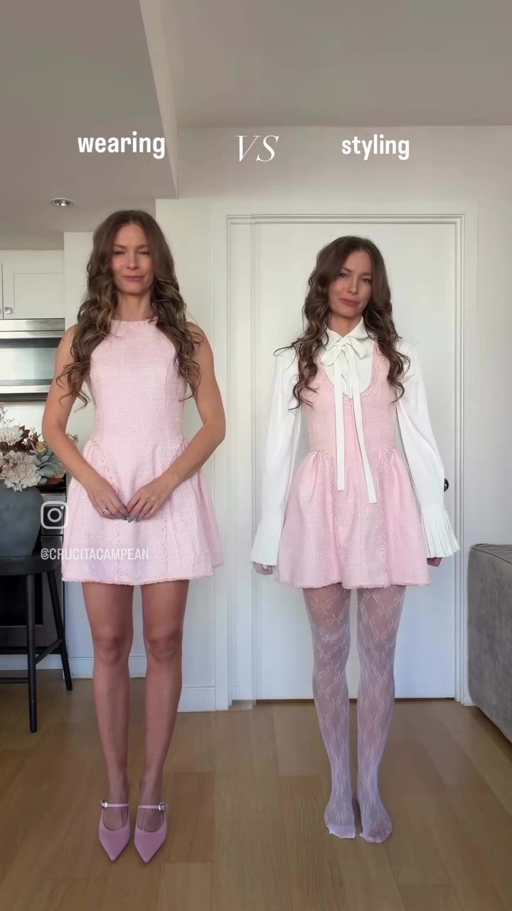

- **장면:** 타이츠 착용 완료. 발 모으고 정면 정자세, 팔은 옆으로 내려 벨 커프스가 손을 덮음. 턱 살짝 당기고 입 다문 미소. 이 시점부터 IG 배지가 왼쪽 패널로 이동.
- **오른쪽 착장 단계:** + 화이트 레이스 타이츠
- **왼쪽:** 정지 · 손 앞으로 모음
- **오버레이:** IG 아이콘 + @아이디 → 왼쪽 패널 왼쪽 엉덩이 높이 (음원 라벨 없음)

**① 스플릿 프롬프트**

```text
Composition: split screen. The 9:16 frame is divided exactly down the vertical center into two equal panels with no visible divider line; the room continues seamlessly across both panels (same room, same locked camera, the kitchen behind the left panel, the white door behind the right panel). The SAME woman appears twice, centered in each panel, both full body head to toe: top of head about 22% from the top of the frame, feet about 8% above the bottom edge. The top 20% of the frame is empty wall, left clear as headroom for title text.

RIGHT PANEL ('styling'): she is in the same pink tweed dress turned around and worn backwards, so its low scooped back now forms a deep U-shaped neckline in front and the dress reads as a pinafore; a faint vertical center seam runs down the front bodice, layered over a crisp ivory-white long-sleeve blouse underneath: small pointed collar, a ruffled jabot frill down the placket, an oversized pussy bow at the neck with very long satin ribbon tails, voluminous sleeves ending in dramatic knife-pleated bell cuffs that cover half the hand; legs in sheer white lace tights with a diamond trellis and tiny bow lace pattern, no shoes. Action and pose: standing straight and still, feet together in the lace tights, arms relaxed at her sides with the bell cuffs draping over her hands, chin slightly down, soft closed-lip smile at the camera.

LEFT PANEL ('wearing'): she stands still and upright facing the camera, feet together in dusty-pink suede pointed-toe Mary Jane kitten heels with a thin strap fastened by a small crystal buckle and a slim clear-silver heel, wearing only the plain pink tweed dress with no styling (a baby-pink tweed boucle sleeveless mini dress: high round crew neckline, fitted structured bodice with princess seams, dropped waist, voluminous puffed bubble skirt made of curved gored panels ending mid-thigh, raw frayed self-fringe trim along the seams and hem, fine woven texture with tiny white flecks), arms relaxed with hands loosely clasped in front of her hips, calm neutral expression with a faint polite smile.

The woman (identical in every appearance): late 20s to early 30s, slim toned athletic build, light olive warm-toned skin with a subtle tan, oval face with defined cheekbones, almond-shaped eyes, natural brows, soft natural makeup with bronzed cheeks and a nude-mauve lip. Very long voluminous chocolate-brown hair with caramel balayage, middle part, styled in loose glossy mermaid curls falling past the chest. Short grey-blue manicured nails, a thin gold ring.

Setting: bright minimalist modern apartment. White walls and ceiling with a small recessed round downlight at the upper left. Left side of the room: white shaker kitchen cabinets with a stainless-steel built-in wall oven and microwave stack in the background, and a dark wood stool holding a matte slate-blue ceramic vase with a large dried-flower arrangement (cream hydrangeas, dusty-pink and beige dried blooms). Right side: a white paneled interior door with slim white casing and a matte black lever handle, and the arm of a light-grey boucle sofa peeking in at the far right edge. Light natural-oak wide-plank hardwood floor. Clean and uncluttered.

Photorealistic vertical 9:16 smartphone fashion reel still (720x1280). Shot on a modern iPhone main camera (~26mm equivalent) on a locked-off tripod at chest height, perfectly level horizon, no lens distortion, deep focus with everything sharp. Bright, airy natural daylight: soft diffused window light from camera-left and front, neutral-warm white balance, very soft shadows, gentle reflections on the floor. Soft pastel grade with baby pink as the dominant hue, low contrast, clean unclipped whites, realistic skin texture. Authentic at-home influencer aesthetic, not a studio.

Avoid: text, captions, watermark, logo, extra people, deformed hands, different faces or hair between the two panels, a visible split line, cropped head or feet.
```

<details><summary>② 타이틀 텍스트 포함 버전</summary>

```text
Composition: split screen. The 9:16 frame is divided exactly down the vertical center into two equal panels with no visible divider line; the room continues seamlessly across both panels (same room, same locked camera, the kitchen behind the left panel, the white door behind the right panel). The SAME woman appears twice, centered in each panel, both full body head to toe: top of head about 22% from the top of the frame, feet about 8% above the bottom edge. The top 20% of the frame is empty wall, left clear as headroom for title text.

RIGHT PANEL ('styling'): she is in the same pink tweed dress turned around and worn backwards, so its low scooped back now forms a deep U-shaped neckline in front and the dress reads as a pinafore; a faint vertical center seam runs down the front bodice, layered over a crisp ivory-white long-sleeve blouse underneath: small pointed collar, a ruffled jabot frill down the placket, an oversized pussy bow at the neck with very long satin ribbon tails, voluminous sleeves ending in dramatic knife-pleated bell cuffs that cover half the hand; legs in sheer white lace tights with a diamond trellis and tiny bow lace pattern, no shoes. Action and pose: standing straight and still, feet together in the lace tights, arms relaxed at her sides with the bell cuffs draping over her hands, chin slightly down, soft closed-lip smile at the camera.

LEFT PANEL ('wearing'): she stands still and upright facing the camera, feet together in dusty-pink suede pointed-toe Mary Jane kitten heels with a thin strap fastened by a small crystal buckle and a slim clear-silver heel, wearing only the plain pink tweed dress with no styling (a baby-pink tweed boucle sleeveless mini dress: high round crew neckline, fitted structured bodice with princess seams, dropped waist, voluminous puffed bubble skirt made of curved gored panels ending mid-thigh, raw frayed self-fringe trim along the seams and hem, fine woven texture with tiny white flecks), arms relaxed with hands loosely clasped in front of her hips, calm neutral expression with a faint polite smile.

The woman (identical in every appearance): late 20s to early 30s, slim toned athletic build, light olive warm-toned skin with a subtle tan, oval face with defined cheekbones, almond-shaped eyes, natural brows, soft natural makeup with bronzed cheeks and a nude-mauve lip. Very long voluminous chocolate-brown hair with caramel balayage, middle part, styled in loose glossy mermaid curls falling past the chest. Short grey-blue manicured nails, a thin gold ring.

Setting: bright minimalist modern apartment. White walls and ceiling with a small recessed round downlight at the upper left. Left side of the room: white shaker kitchen cabinets with a stainless-steel built-in wall oven and microwave stack in the background, and a dark wood stool holding a matte slate-blue ceramic vase with a large dried-flower arrangement (cream hydrangeas, dusty-pink and beige dried blooms). Right side: a white paneled interior door with slim white casing and a matte black lever handle, and the arm of a light-grey boucle sofa peeking in at the far right edge. Light natural-oak wide-plank hardwood floor. Clean and uncluttered.

Photorealistic vertical 9:16 smartphone fashion reel still (720x1280). Shot on a modern iPhone main camera (~26mm equivalent) on a locked-off tripod at chest height, perfectly level horizon, no lens distortion, deep focus with everything sharp. Bright, airy natural daylight: soft diffused window light from camera-left and front, neutral-warm white balance, very soft shadows, gentle reflections on the floor. Soft pastel grade with baby pink as the dominant hue, low contrast, clean unclipped whites, realistic skin texture. Authentic at-home influencer aesthetic, not a studio.

Overlay text in the top 16% of the frame: the lowercase word "wearing" in bold white condensed sans-serif centered over the left panel, a large thin white italic serif "VS" centered on the split line, and "styling" in the same bold white condensed sans-serif centered over the right panel; subtle soft drop shadow.

Avoid: extra captions, watermark, logo, extra people, deformed hands, different faces or hair between the two panels, a visible split line, cropped head or feet.
```
</details>

<details><summary>짧은 버전 (글자 수 제한 있는 모델용)</summary>

```text
Photorealistic vertical 9:16 split-screen fashion reel still: the same woman twice, side by side, full body head to toe, in a bright white minimalist apartment, locked tripod at chest height, soft daylight, airy pastel-pink grade, iPhone look. Woman: late 20s, slim and toned, light olive skin, very long chocolate-brown mermaid curls with caramel balayage, middle part, natural makeup. LEFT ('wearing'): standing still, hands clasped in front, in the plain baby-pink tweed sleeveless bubble mini dress with frayed trim and dusty-pink suede Mary Jane kitten heels. RIGHT ('styling'): in the pink tweed dress worn backwards as a deep U-neck pinafore over a white pussy-bow blouse with long ribbon ties and pleated bell sleeves, white lace tights, no shoes; standing straight and still, feet together in the lace tights, arms relaxed at her sides with the bell cuffs draping over her hands, chin slightly down, soft closed-lip smile at the camera. Background continuous across both halves: white kitchen and dried flowers behind the left, white paneled door with a black handle behind the right, light oak floor. Empty headroom at the top. No text, no visible split line.
```
</details>

<details><summary>③ 솔로(오른쪽 인물만) 버전</summary>

```text
Composition: single subject centered, full body head to toe, top of head about 22% from the top of the frame, feet about 8% above the bottom edge, generous empty space on both sides so the frame can be cropped to its central 50% width. Behind her: the white paneled door with a matte black lever handle, the grey boucle sofa arm at the right edge.

Subject: one woman, in the same pink tweed dress turned around and worn backwards, so its low scooped back now forms a deep U-shaped neckline in front and the dress reads as a pinafore; a faint vertical center seam runs down the front bodice, layered over a crisp ivory-white long-sleeve blouse underneath: small pointed collar, a ruffled jabot frill down the placket, an oversized pussy bow at the neck with very long satin ribbon tails, voluminous sleeves ending in dramatic knife-pleated bell cuffs that cover half the hand; legs in sheer white lace tights with a diamond trellis and tiny bow lace pattern, no shoes. Action and pose: standing straight and still, feet together in the lace tights, arms relaxed at her sides with the bell cuffs draping over her hands, chin slightly down, soft closed-lip smile at the camera.

The woman (identical in every appearance): late 20s to early 30s, slim toned athletic build, light olive warm-toned skin with a subtle tan, oval face with defined cheekbones, almond-shaped eyes, natural brows, soft natural makeup with bronzed cheeks and a nude-mauve lip. Very long voluminous chocolate-brown hair with caramel balayage, middle part, styled in loose glossy mermaid curls falling past the chest. Short grey-blue manicured nails, a thin gold ring.

Photorealistic vertical 9:16 smartphone fashion reel still (720x1280). Shot on a modern iPhone main camera (~26mm equivalent) on a locked-off tripod at chest height, perfectly level horizon, no lens distortion, deep focus with everything sharp. Bright, airy natural daylight: soft diffused window light from camera-left and front, neutral-warm white balance, very soft shadows, gentle reflections on the floor. Soft pastel grade with baby pink as the dominant hue, low contrast, clean unclipped whites, realistic skin texture. Authentic at-home influencer aesthetic, not a studio.

Avoid: text, captions, watermark, logo, extra people, deformed hands, cropped head or feet.
```
</details>

### F14 · 9.90s (프레임 #297) — 부츠 들고 등장

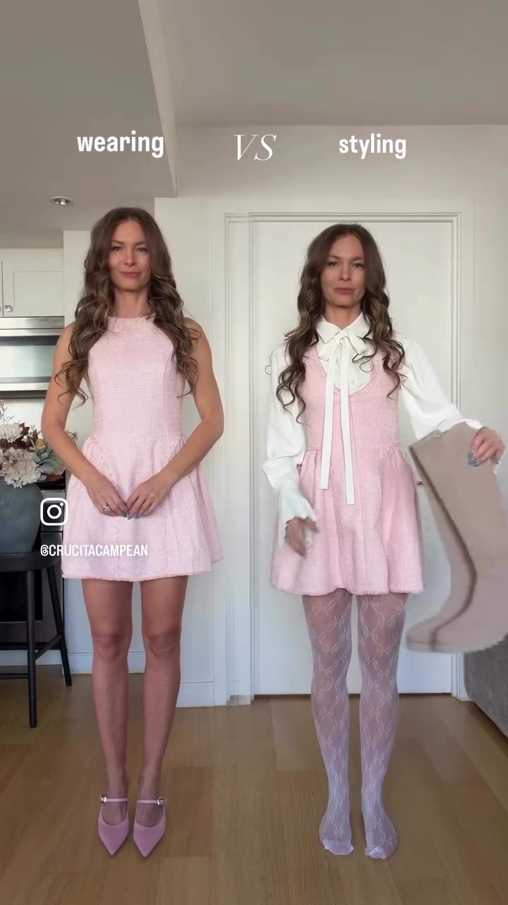

- **장면:** 토프 스웨이드 니하이 부츠 한 켤레를 왼손으로 휙 들고 프레임 안으로 가져옴(부츠에 모션블러). 자신감 있는 표정으로 정면 응시.
- **오른쪽 착장 단계:** + 화이트 레이스 타이츠
- **왼쪽:** 정지 · 손 앞으로 모음
- **오버레이:** IG 아이콘 + @아이디 → 왼쪽 패널 왼쪽 엉덩이 높이 (음원 라벨 없음)

**① 스플릿 프롬프트**

```text
Composition: split screen. The 9:16 frame is divided exactly down the vertical center into two equal panels with no visible divider line; the room continues seamlessly across both panels (same room, same locked camera, the kitchen behind the left panel, the white door behind the right panel). The SAME woman appears twice, centered in each panel, both full body head to toe: top of head about 22% from the top of the frame, feet about 8% above the bottom edge. The top 20% of the frame is empty wall, left clear as headroom for title text.

RIGHT PANEL ('styling'): she is in the same pink tweed dress turned around and worn backwards, so its low scooped back now forms a deep U-shaped neckline in front and the dress reads as a pinafore; a faint vertical center seam runs down the front bodice, layered over a crisp ivory-white long-sleeve blouse underneath: small pointed collar, a ruffled jabot frill down the placket, an oversized pussy bow at the neck with very long satin ribbon tails, voluminous sleeves ending in dramatic knife-pleated bell cuffs that cover half the hand; legs in sheer white lace tights with a diamond trellis and tiny bow lace pattern, no shoes. Action and pose: swinging a pair of greige-taupe suede knee-high boots with chunky cream lug soles into the frame with her left hand at hip level (the boots slightly motion-blurred), right arm relaxed, looking at the camera with a confident subtle smile.

LEFT PANEL ('wearing'): she stands still and upright facing the camera, feet together in dusty-pink suede pointed-toe Mary Jane kitten heels with a thin strap fastened by a small crystal buckle and a slim clear-silver heel, wearing only the plain pink tweed dress with no styling (a baby-pink tweed boucle sleeveless mini dress: high round crew neckline, fitted structured bodice with princess seams, dropped waist, voluminous puffed bubble skirt made of curved gored panels ending mid-thigh, raw frayed self-fringe trim along the seams and hem, fine woven texture with tiny white flecks), arms relaxed with hands loosely clasped in front of her hips, calm neutral expression with a faint polite smile.

The woman (identical in every appearance): late 20s to early 30s, slim toned athletic build, light olive warm-toned skin with a subtle tan, oval face with defined cheekbones, almond-shaped eyes, natural brows, soft natural makeup with bronzed cheeks and a nude-mauve lip. Very long voluminous chocolate-brown hair with caramel balayage, middle part, styled in loose glossy mermaid curls falling past the chest. Short grey-blue manicured nails, a thin gold ring.

Setting: bright minimalist modern apartment. White walls and ceiling with a small recessed round downlight at the upper left. Left side of the room: white shaker kitchen cabinets with a stainless-steel built-in wall oven and microwave stack in the background, and a dark wood stool holding a matte slate-blue ceramic vase with a large dried-flower arrangement (cream hydrangeas, dusty-pink and beige dried blooms). Right side: a white paneled interior door with slim white casing and a matte black lever handle, and the arm of a light-grey boucle sofa peeking in at the far right edge. Light natural-oak wide-plank hardwood floor. Clean and uncluttered.

Photorealistic vertical 9:16 smartphone fashion reel still (720x1280). Shot on a modern iPhone main camera (~26mm equivalent) on a locked-off tripod at chest height, perfectly level horizon, no lens distortion, deep focus with everything sharp. Bright, airy natural daylight: soft diffused window light from camera-left and front, neutral-warm white balance, very soft shadows, gentle reflections on the floor. Soft pastel grade with baby pink as the dominant hue, low contrast, clean unclipped whites, realistic skin texture. Authentic at-home influencer aesthetic, not a studio.

Avoid: text, captions, watermark, logo, extra people, deformed hands, different faces or hair between the two panels, a visible split line, cropped head or feet.
```

<details><summary>② 타이틀 텍스트 포함 버전</summary>

```text
Composition: split screen. The 9:16 frame is divided exactly down the vertical center into two equal panels with no visible divider line; the room continues seamlessly across both panels (same room, same locked camera, the kitchen behind the left panel, the white door behind the right panel). The SAME woman appears twice, centered in each panel, both full body head to toe: top of head about 22% from the top of the frame, feet about 8% above the bottom edge. The top 20% of the frame is empty wall, left clear as headroom for title text.

RIGHT PANEL ('styling'): she is in the same pink tweed dress turned around and worn backwards, so its low scooped back now forms a deep U-shaped neckline in front and the dress reads as a pinafore; a faint vertical center seam runs down the front bodice, layered over a crisp ivory-white long-sleeve blouse underneath: small pointed collar, a ruffled jabot frill down the placket, an oversized pussy bow at the neck with very long satin ribbon tails, voluminous sleeves ending in dramatic knife-pleated bell cuffs that cover half the hand; legs in sheer white lace tights with a diamond trellis and tiny bow lace pattern, no shoes. Action and pose: swinging a pair of greige-taupe suede knee-high boots with chunky cream lug soles into the frame with her left hand at hip level (the boots slightly motion-blurred), right arm relaxed, looking at the camera with a confident subtle smile.

LEFT PANEL ('wearing'): she stands still and upright facing the camera, feet together in dusty-pink suede pointed-toe Mary Jane kitten heels with a thin strap fastened by a small crystal buckle and a slim clear-silver heel, wearing only the plain pink tweed dress with no styling (a baby-pink tweed boucle sleeveless mini dress: high round crew neckline, fitted structured bodice with princess seams, dropped waist, voluminous puffed bubble skirt made of curved gored panels ending mid-thigh, raw frayed self-fringe trim along the seams and hem, fine woven texture with tiny white flecks), arms relaxed with hands loosely clasped in front of her hips, calm neutral expression with a faint polite smile.

The woman (identical in every appearance): late 20s to early 30s, slim toned athletic build, light olive warm-toned skin with a subtle tan, oval face with defined cheekbones, almond-shaped eyes, natural brows, soft natural makeup with bronzed cheeks and a nude-mauve lip. Very long voluminous chocolate-brown hair with caramel balayage, middle part, styled in loose glossy mermaid curls falling past the chest. Short grey-blue manicured nails, a thin gold ring.

Setting: bright minimalist modern apartment. White walls and ceiling with a small recessed round downlight at the upper left. Left side of the room: white shaker kitchen cabinets with a stainless-steel built-in wall oven and microwave stack in the background, and a dark wood stool holding a matte slate-blue ceramic vase with a large dried-flower arrangement (cream hydrangeas, dusty-pink and beige dried blooms). Right side: a white paneled interior door with slim white casing and a matte black lever handle, and the arm of a light-grey boucle sofa peeking in at the far right edge. Light natural-oak wide-plank hardwood floor. Clean and uncluttered.

Photorealistic vertical 9:16 smartphone fashion reel still (720x1280). Shot on a modern iPhone main camera (~26mm equivalent) on a locked-off tripod at chest height, perfectly level horizon, no lens distortion, deep focus with everything sharp. Bright, airy natural daylight: soft diffused window light from camera-left and front, neutral-warm white balance, very soft shadows, gentle reflections on the floor. Soft pastel grade with baby pink as the dominant hue, low contrast, clean unclipped whites, realistic skin texture. Authentic at-home influencer aesthetic, not a studio.

Overlay text in the top 16% of the frame: the lowercase word "wearing" in bold white condensed sans-serif centered over the left panel, a large thin white italic serif "VS" centered on the split line, and "styling" in the same bold white condensed sans-serif centered over the right panel; subtle soft drop shadow.

Avoid: extra captions, watermark, logo, extra people, deformed hands, different faces or hair between the two panels, a visible split line, cropped head or feet.
```
</details>

<details><summary>짧은 버전 (글자 수 제한 있는 모델용)</summary>

```text
Photorealistic vertical 9:16 split-screen fashion reel still: the same woman twice, side by side, full body head to toe, in a bright white minimalist apartment, locked tripod at chest height, soft daylight, airy pastel-pink grade, iPhone look. Woman: late 20s, slim and toned, light olive skin, very long chocolate-brown mermaid curls with caramel balayage, middle part, natural makeup. LEFT ('wearing'): standing still, hands clasped in front, in the plain baby-pink tweed sleeveless bubble mini dress with frayed trim and dusty-pink suede Mary Jane kitten heels. RIGHT ('styling'): in the pink tweed dress worn backwards as a deep U-neck pinafore over a white pussy-bow blouse with long ribbon ties and pleated bell sleeves, white lace tights, no shoes; swinging a pair of greige-taupe suede knee-high boots with chunky cream lug soles into the frame with her left hand at hip level (the boots slightly motion-blurred), right arm relaxed, looking at the camera with a confident subtle smile. Background continuous across both halves: white kitchen and dried flowers behind the left, white paneled door with a black handle behind the right, light oak floor. Empty headroom at the top. No text, no visible split line.
```
</details>

<details><summary>③ 솔로(오른쪽 인물만) 버전</summary>

```text
Composition: single subject centered, full body head to toe, top of head about 22% from the top of the frame, feet about 8% above the bottom edge, generous empty space on both sides so the frame can be cropped to its central 50% width. Behind her: the white paneled door with a matte black lever handle, the grey boucle sofa arm at the right edge.

Subject: one woman, in the same pink tweed dress turned around and worn backwards, so its low scooped back now forms a deep U-shaped neckline in front and the dress reads as a pinafore; a faint vertical center seam runs down the front bodice, layered over a crisp ivory-white long-sleeve blouse underneath: small pointed collar, a ruffled jabot frill down the placket, an oversized pussy bow at the neck with very long satin ribbon tails, voluminous sleeves ending in dramatic knife-pleated bell cuffs that cover half the hand; legs in sheer white lace tights with a diamond trellis and tiny bow lace pattern, no shoes. Action and pose: swinging a pair of greige-taupe suede knee-high boots with chunky cream lug soles into the frame with her left hand at hip level (the boots slightly motion-blurred), right arm relaxed, looking at the camera with a confident subtle smile.

The woman (identical in every appearance): late 20s to early 30s, slim toned athletic build, light olive warm-toned skin with a subtle tan, oval face with defined cheekbones, almond-shaped eyes, natural brows, soft natural makeup with bronzed cheeks and a nude-mauve lip. Very long voluminous chocolate-brown hair with caramel balayage, middle part, styled in loose glossy mermaid curls falling past the chest. Short grey-blue manicured nails, a thin gold ring.

Photorealistic vertical 9:16 smartphone fashion reel still (720x1280). Shot on a modern iPhone main camera (~26mm equivalent) on a locked-off tripod at chest height, perfectly level horizon, no lens distortion, deep focus with everything sharp. Bright, airy natural daylight: soft diffused window light from camera-left and front, neutral-warm white balance, very soft shadows, gentle reflections on the floor. Soft pastel grade with baby pink as the dominant hue, low contrast, clean unclipped whites, realistic skin texture. Authentic at-home influencer aesthetic, not a studio.

Avoid: text, captions, watermark, logo, extra people, deformed hands, cropped head or feet.
```
</details>

### F15 · 10.40s (프레임 #312) — 부츠 신기

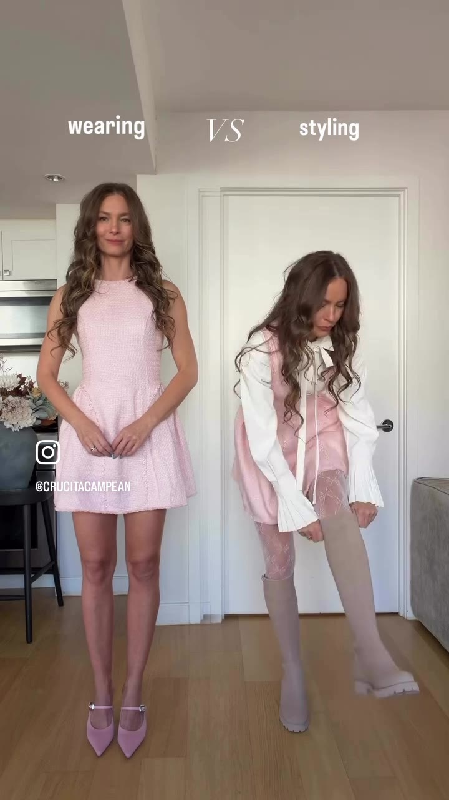

- **장면:** 허리를 숙여 양손으로 오른쪽 부츠를 종아리 위로 끌어올림. 오른발 앞으로, 왼쪽은 이미 신은 상태. 긴 컬이 얼굴 앞으로 쏟아짐.
- **오른쪽 착장 단계:** + 타이츠 · 부츠 신는 중
- **왼쪽:** 정지 · 손 앞으로 모음
- **오버레이:** IG 아이콘 + @아이디 → 왼쪽 패널 왼쪽 엉덩이 높이 (음원 라벨 없음)

**① 스플릿 프롬프트**

```text
Composition: split screen. The 9:16 frame is divided exactly down the vertical center into two equal panels with no visible divider line; the room continues seamlessly across both panels (same room, same locked camera, the kitchen behind the left panel, the white door behind the right panel). The SAME woman appears twice, centered in each panel, both full body head to toe: top of head about 22% from the top of the frame, feet about 8% above the bottom edge. The top 20% of the frame is empty wall, left clear as headroom for title text.

RIGHT PANEL ('styling'): she is in the same pink tweed dress turned around and worn backwards, so its low scooped back now forms a deep U-shaped neckline in front and the dress reads as a pinafore; a faint vertical center seam runs down the front bodice, layered over a crisp ivory-white long-sleeve blouse underneath: small pointed collar, a ruffled jabot frill down the placket, an oversized pussy bow at the neck with very long satin ribbon tails, voluminous sleeves ending in dramatic knife-pleated bell cuffs that cover half the hand; sheer white lace tights with a diamond trellis and tiny bow lace pattern; the left leg already in greige-taupe suede pull-on knee-high boots with a chunky cream rubber lug sole and a low block heel, the right boot being pulled on. Action and pose: bent forward at the waist pulling the right boot up her calf with both hands on the shaft, right foot stepped forward, the left boot already on, long curls falling forward around her face, concentrating.

LEFT PANEL ('wearing'): she stands still and upright facing the camera, feet together in dusty-pink suede pointed-toe Mary Jane kitten heels with a thin strap fastened by a small crystal buckle and a slim clear-silver heel, wearing only the plain pink tweed dress with no styling (a baby-pink tweed boucle sleeveless mini dress: high round crew neckline, fitted structured bodice with princess seams, dropped waist, voluminous puffed bubble skirt made of curved gored panels ending mid-thigh, raw frayed self-fringe trim along the seams and hem, fine woven texture with tiny white flecks), arms relaxed with hands loosely clasped in front of her hips, calm neutral expression with a faint polite smile.

The woman (identical in every appearance): late 20s to early 30s, slim toned athletic build, light olive warm-toned skin with a subtle tan, oval face with defined cheekbones, almond-shaped eyes, natural brows, soft natural makeup with bronzed cheeks and a nude-mauve lip. Very long voluminous chocolate-brown hair with caramel balayage, middle part, styled in loose glossy mermaid curls falling past the chest. Short grey-blue manicured nails, a thin gold ring.

Setting: bright minimalist modern apartment. White walls and ceiling with a small recessed round downlight at the upper left. Left side of the room: white shaker kitchen cabinets with a stainless-steel built-in wall oven and microwave stack in the background, and a dark wood stool holding a matte slate-blue ceramic vase with a large dried-flower arrangement (cream hydrangeas, dusty-pink and beige dried blooms). Right side: a white paneled interior door with slim white casing and a matte black lever handle, and the arm of a light-grey boucle sofa peeking in at the far right edge. Light natural-oak wide-plank hardwood floor. Clean and uncluttered.

Photorealistic vertical 9:16 smartphone fashion reel still (720x1280). Shot on a modern iPhone main camera (~26mm equivalent) on a locked-off tripod at chest height, perfectly level horizon, no lens distortion, deep focus with everything sharp. Bright, airy natural daylight: soft diffused window light from camera-left and front, neutral-warm white balance, very soft shadows, gentle reflections on the floor. Soft pastel grade with baby pink as the dominant hue, low contrast, clean unclipped whites, realistic skin texture. Authentic at-home influencer aesthetic, not a studio.

Avoid: text, captions, watermark, logo, extra people, deformed hands, different faces or hair between the two panels, a visible split line, cropped head or feet.
```

<details><summary>② 타이틀 텍스트 포함 버전</summary>

```text
Composition: split screen. The 9:16 frame is divided exactly down the vertical center into two equal panels with no visible divider line; the room continues seamlessly across both panels (same room, same locked camera, the kitchen behind the left panel, the white door behind the right panel). The SAME woman appears twice, centered in each panel, both full body head to toe: top of head about 22% from the top of the frame, feet about 8% above the bottom edge. The top 20% of the frame is empty wall, left clear as headroom for title text.

RIGHT PANEL ('styling'): she is in the same pink tweed dress turned around and worn backwards, so its low scooped back now forms a deep U-shaped neckline in front and the dress reads as a pinafore; a faint vertical center seam runs down the front bodice, layered over a crisp ivory-white long-sleeve blouse underneath: small pointed collar, a ruffled jabot frill down the placket, an oversized pussy bow at the neck with very long satin ribbon tails, voluminous sleeves ending in dramatic knife-pleated bell cuffs that cover half the hand; sheer white lace tights with a diamond trellis and tiny bow lace pattern; the left leg already in greige-taupe suede pull-on knee-high boots with a chunky cream rubber lug sole and a low block heel, the right boot being pulled on. Action and pose: bent forward at the waist pulling the right boot up her calf with both hands on the shaft, right foot stepped forward, the left boot already on, long curls falling forward around her face, concentrating.

LEFT PANEL ('wearing'): she stands still and upright facing the camera, feet together in dusty-pink suede pointed-toe Mary Jane kitten heels with a thin strap fastened by a small crystal buckle and a slim clear-silver heel, wearing only the plain pink tweed dress with no styling (a baby-pink tweed boucle sleeveless mini dress: high round crew neckline, fitted structured bodice with princess seams, dropped waist, voluminous puffed bubble skirt made of curved gored panels ending mid-thigh, raw frayed self-fringe trim along the seams and hem, fine woven texture with tiny white flecks), arms relaxed with hands loosely clasped in front of her hips, calm neutral expression with a faint polite smile.

The woman (identical in every appearance): late 20s to early 30s, slim toned athletic build, light olive warm-toned skin with a subtle tan, oval face with defined cheekbones, almond-shaped eyes, natural brows, soft natural makeup with bronzed cheeks and a nude-mauve lip. Very long voluminous chocolate-brown hair with caramel balayage, middle part, styled in loose glossy mermaid curls falling past the chest. Short grey-blue manicured nails, a thin gold ring.

Setting: bright minimalist modern apartment. White walls and ceiling with a small recessed round downlight at the upper left. Left side of the room: white shaker kitchen cabinets with a stainless-steel built-in wall oven and microwave stack in the background, and a dark wood stool holding a matte slate-blue ceramic vase with a large dried-flower arrangement (cream hydrangeas, dusty-pink and beige dried blooms). Right side: a white paneled interior door with slim white casing and a matte black lever handle, and the arm of a light-grey boucle sofa peeking in at the far right edge. Light natural-oak wide-plank hardwood floor. Clean and uncluttered.

Photorealistic vertical 9:16 smartphone fashion reel still (720x1280). Shot on a modern iPhone main camera (~26mm equivalent) on a locked-off tripod at chest height, perfectly level horizon, no lens distortion, deep focus with everything sharp. Bright, airy natural daylight: soft diffused window light from camera-left and front, neutral-warm white balance, very soft shadows, gentle reflections on the floor. Soft pastel grade with baby pink as the dominant hue, low contrast, clean unclipped whites, realistic skin texture. Authentic at-home influencer aesthetic, not a studio.

Overlay text in the top 16% of the frame: the lowercase word "wearing" in bold white condensed sans-serif centered over the left panel, a large thin white italic serif "VS" centered on the split line, and "styling" in the same bold white condensed sans-serif centered over the right panel; subtle soft drop shadow.

Avoid: extra captions, watermark, logo, extra people, deformed hands, different faces or hair between the two panels, a visible split line, cropped head or feet.
```
</details>

<details><summary>짧은 버전 (글자 수 제한 있는 모델용)</summary>

```text
Photorealistic vertical 9:16 split-screen fashion reel still: the same woman twice, side by side, full body head to toe, in a bright white minimalist apartment, locked tripod at chest height, soft daylight, airy pastel-pink grade, iPhone look. Woman: late 20s, slim and toned, light olive skin, very long chocolate-brown mermaid curls with caramel balayage, middle part, natural makeup. LEFT ('wearing'): standing still, hands clasped in front, in the plain baby-pink tweed sleeveless bubble mini dress with frayed trim and dusty-pink suede Mary Jane kitten heels. RIGHT ('styling'): in the pink tweed dress worn backwards as a deep U-neck pinafore over a white pussy-bow blouse with long ribbon ties and pleated bell sleeves, white lace tights, pulling on taupe suede knee-high lug-sole boots; bent forward at the waist pulling the right boot up her calf with both hands on the shaft, right foot stepped forward, the left boot already on, long curls falling forward around her face, concentrating. Background continuous across both halves: white kitchen and dried flowers behind the left, white paneled door with a black handle behind the right, light oak floor. Empty headroom at the top. No text, no visible split line.
```
</details>

<details><summary>③ 솔로(오른쪽 인물만) 버전</summary>

```text
Composition: single subject centered, full body head to toe, top of head about 22% from the top of the frame, feet about 8% above the bottom edge, generous empty space on both sides so the frame can be cropped to its central 50% width. Behind her: the white paneled door with a matte black lever handle, the grey boucle sofa arm at the right edge.

Subject: one woman, in the same pink tweed dress turned around and worn backwards, so its low scooped back now forms a deep U-shaped neckline in front and the dress reads as a pinafore; a faint vertical center seam runs down the front bodice, layered over a crisp ivory-white long-sleeve blouse underneath: small pointed collar, a ruffled jabot frill down the placket, an oversized pussy bow at the neck with very long satin ribbon tails, voluminous sleeves ending in dramatic knife-pleated bell cuffs that cover half the hand; sheer white lace tights with a diamond trellis and tiny bow lace pattern; the left leg already in greige-taupe suede pull-on knee-high boots with a chunky cream rubber lug sole and a low block heel, the right boot being pulled on. Action and pose: bent forward at the waist pulling the right boot up her calf with both hands on the shaft, right foot stepped forward, the left boot already on, long curls falling forward around her face, concentrating.

The woman (identical in every appearance): late 20s to early 30s, slim toned athletic build, light olive warm-toned skin with a subtle tan, oval face with defined cheekbones, almond-shaped eyes, natural brows, soft natural makeup with bronzed cheeks and a nude-mauve lip. Very long voluminous chocolate-brown hair with caramel balayage, middle part, styled in loose glossy mermaid curls falling past the chest. Short grey-blue manicured nails, a thin gold ring.

Photorealistic vertical 9:16 smartphone fashion reel still (720x1280). Shot on a modern iPhone main camera (~26mm equivalent) on a locked-off tripod at chest height, perfectly level horizon, no lens distortion, deep focus with everything sharp. Bright, airy natural daylight: soft diffused window light from camera-left and front, neutral-warm white balance, very soft shadows, gentle reflections on the floor. Soft pastel grade with baby pink as the dominant hue, low contrast, clean unclipped whites, realistic skin texture. Authentic at-home influencer aesthetic, not a studio.

Avoid: text, captions, watermark, logo, extra people, deformed hands, cropped head or feet.
```
</details>

### F16 · 11.10s (프레임 #333) — 양손 허리 포즈

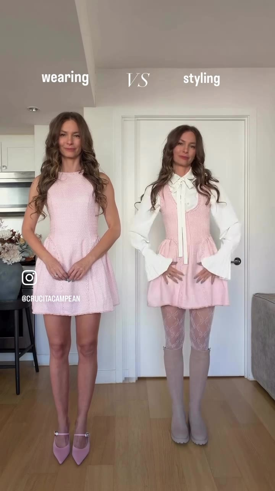

- **장면:** 부츠까지 착용. 드롭웨이스트 위치에 양손을 올리고 팔꿈치를 벌린 자신감 포즈. 벨 커프스가 퍼짐, 고개 살짝 기울이고 미소.
- **오른쪽 착장 단계:** + 토프 스웨이드 니하이 부츠
- **왼쪽:** 정지 · 손 앞으로 모음
- **오버레이:** IG 아이콘 + @아이디 → 왼쪽 패널 왼쪽 엉덩이 높이 (음원 라벨 없음)

**① 스플릿 프롬프트**

```text
Composition: split screen. The 9:16 frame is divided exactly down the vertical center into two equal panels with no visible divider line; the room continues seamlessly across both panels (same room, same locked camera, the kitchen behind the left panel, the white door behind the right panel). The SAME woman appears twice, centered in each panel, both full body head to toe: top of head about 22% from the top of the frame, feet about 8% above the bottom edge. The top 20% of the frame is empty wall, left clear as headroom for title text.

RIGHT PANEL ('styling'): she is in the same pink tweed dress turned around and worn backwards, so its low scooped back now forms a deep U-shaped neckline in front and the dress reads as a pinafore; a faint vertical center seam runs down the front bodice, layered over a crisp ivory-white long-sleeve blouse underneath: small pointed collar, a ruffled jabot frill down the placket, an oversized pussy bow at the neck with very long satin ribbon tails, voluminous sleeves ending in dramatic knife-pleated bell cuffs that cover half the hand; sheer white lace tights with a diamond trellis and tiny bow lace pattern; greige-taupe suede pull-on knee-high boots with a chunky cream rubber lug sole and a low block heel. Action and pose: standing tall with both hands on her hips at the dropped waist, elbows out, the pleated bell cuffs flaring, weight slightly on one leg, head tilted a little, confident smile at the camera.

LEFT PANEL ('wearing'): she stands still and upright facing the camera, feet together in dusty-pink suede pointed-toe Mary Jane kitten heels with a thin strap fastened by a small crystal buckle and a slim clear-silver heel, wearing only the plain pink tweed dress with no styling (a baby-pink tweed boucle sleeveless mini dress: high round crew neckline, fitted structured bodice with princess seams, dropped waist, voluminous puffed bubble skirt made of curved gored panels ending mid-thigh, raw frayed self-fringe trim along the seams and hem, fine woven texture with tiny white flecks), arms relaxed with hands loosely clasped in front of her hips, calm neutral expression with a faint polite smile.

The woman (identical in every appearance): late 20s to early 30s, slim toned athletic build, light olive warm-toned skin with a subtle tan, oval face with defined cheekbones, almond-shaped eyes, natural brows, soft natural makeup with bronzed cheeks and a nude-mauve lip. Very long voluminous chocolate-brown hair with caramel balayage, middle part, styled in loose glossy mermaid curls falling past the chest. Short grey-blue manicured nails, a thin gold ring.

Setting: bright minimalist modern apartment. White walls and ceiling with a small recessed round downlight at the upper left. Left side of the room: white shaker kitchen cabinets with a stainless-steel built-in wall oven and microwave stack in the background, and a dark wood stool holding a matte slate-blue ceramic vase with a large dried-flower arrangement (cream hydrangeas, dusty-pink and beige dried blooms). Right side: a white paneled interior door with slim white casing and a matte black lever handle, and the arm of a light-grey boucle sofa peeking in at the far right edge. Light natural-oak wide-plank hardwood floor. Clean and uncluttered.

Photorealistic vertical 9:16 smartphone fashion reel still (720x1280). Shot on a modern iPhone main camera (~26mm equivalent) on a locked-off tripod at chest height, perfectly level horizon, no lens distortion, deep focus with everything sharp. Bright, airy natural daylight: soft diffused window light from camera-left and front, neutral-warm white balance, very soft shadows, gentle reflections on the floor. Soft pastel grade with baby pink as the dominant hue, low contrast, clean unclipped whites, realistic skin texture. Authentic at-home influencer aesthetic, not a studio.

Avoid: text, captions, watermark, logo, extra people, deformed hands, different faces or hair between the two panels, a visible split line, cropped head or feet.
```

<details><summary>② 타이틀 텍스트 포함 버전</summary>

```text
Composition: split screen. The 9:16 frame is divided exactly down the vertical center into two equal panels with no visible divider line; the room continues seamlessly across both panels (same room, same locked camera, the kitchen behind the left panel, the white door behind the right panel). The SAME woman appears twice, centered in each panel, both full body head to toe: top of head about 22% from the top of the frame, feet about 8% above the bottom edge. The top 20% of the frame is empty wall, left clear as headroom for title text.

RIGHT PANEL ('styling'): she is in the same pink tweed dress turned around and worn backwards, so its low scooped back now forms a deep U-shaped neckline in front and the dress reads as a pinafore; a faint vertical center seam runs down the front bodice, layered over a crisp ivory-white long-sleeve blouse underneath: small pointed collar, a ruffled jabot frill down the placket, an oversized pussy bow at the neck with very long satin ribbon tails, voluminous sleeves ending in dramatic knife-pleated bell cuffs that cover half the hand; sheer white lace tights with a diamond trellis and tiny bow lace pattern; greige-taupe suede pull-on knee-high boots with a chunky cream rubber lug sole and a low block heel. Action and pose: standing tall with both hands on her hips at the dropped waist, elbows out, the pleated bell cuffs flaring, weight slightly on one leg, head tilted a little, confident smile at the camera.

LEFT PANEL ('wearing'): she stands still and upright facing the camera, feet together in dusty-pink suede pointed-toe Mary Jane kitten heels with a thin strap fastened by a small crystal buckle and a slim clear-silver heel, wearing only the plain pink tweed dress with no styling (a baby-pink tweed boucle sleeveless mini dress: high round crew neckline, fitted structured bodice with princess seams, dropped waist, voluminous puffed bubble skirt made of curved gored panels ending mid-thigh, raw frayed self-fringe trim along the seams and hem, fine woven texture with tiny white flecks), arms relaxed with hands loosely clasped in front of her hips, calm neutral expression with a faint polite smile.

The woman (identical in every appearance): late 20s to early 30s, slim toned athletic build, light olive warm-toned skin with a subtle tan, oval face with defined cheekbones, almond-shaped eyes, natural brows, soft natural makeup with bronzed cheeks and a nude-mauve lip. Very long voluminous chocolate-brown hair with caramel balayage, middle part, styled in loose glossy mermaid curls falling past the chest. Short grey-blue manicured nails, a thin gold ring.

Setting: bright minimalist modern apartment. White walls and ceiling with a small recessed round downlight at the upper left. Left side of the room: white shaker kitchen cabinets with a stainless-steel built-in wall oven and microwave stack in the background, and a dark wood stool holding a matte slate-blue ceramic vase with a large dried-flower arrangement (cream hydrangeas, dusty-pink and beige dried blooms). Right side: a white paneled interior door with slim white casing and a matte black lever handle, and the arm of a light-grey boucle sofa peeking in at the far right edge. Light natural-oak wide-plank hardwood floor. Clean and uncluttered.

Photorealistic vertical 9:16 smartphone fashion reel still (720x1280). Shot on a modern iPhone main camera (~26mm equivalent) on a locked-off tripod at chest height, perfectly level horizon, no lens distortion, deep focus with everything sharp. Bright, airy natural daylight: soft diffused window light from camera-left and front, neutral-warm white balance, very soft shadows, gentle reflections on the floor. Soft pastel grade with baby pink as the dominant hue, low contrast, clean unclipped whites, realistic skin texture. Authentic at-home influencer aesthetic, not a studio.

Overlay text in the top 16% of the frame: the lowercase word "wearing" in bold white condensed sans-serif centered over the left panel, a large thin white italic serif "VS" centered on the split line, and "styling" in the same bold white condensed sans-serif centered over the right panel; subtle soft drop shadow.

Avoid: extra captions, watermark, logo, extra people, deformed hands, different faces or hair between the two panels, a visible split line, cropped head or feet.
```
</details>

<details><summary>짧은 버전 (글자 수 제한 있는 모델용)</summary>

```text
Photorealistic vertical 9:16 split-screen fashion reel still: the same woman twice, side by side, full body head to toe, in a bright white minimalist apartment, locked tripod at chest height, soft daylight, airy pastel-pink grade, iPhone look. Woman: late 20s, slim and toned, light olive skin, very long chocolate-brown mermaid curls with caramel balayage, middle part, natural makeup. LEFT ('wearing'): standing still, hands clasped in front, in the plain baby-pink tweed sleeveless bubble mini dress with frayed trim and dusty-pink suede Mary Jane kitten heels. RIGHT ('styling'): in the pink tweed dress worn backwards as a deep U-neck pinafore over a white pussy-bow blouse with long ribbon ties and pleated bell sleeves, white lace tights, taupe suede knee-high lug-sole boots; standing tall with both hands on her hips at the dropped waist, elbows out, the pleated bell cuffs flaring, weight slightly on one leg, head tilted a little, confident smile at the camera. Background continuous across both halves: white kitchen and dried flowers behind the left, white paneled door with a black handle behind the right, light oak floor. Empty headroom at the top. No text, no visible split line.
```
</details>

<details><summary>③ 솔로(오른쪽 인물만) 버전</summary>

```text
Composition: single subject centered, full body head to toe, top of head about 22% from the top of the frame, feet about 8% above the bottom edge, generous empty space on both sides so the frame can be cropped to its central 50% width. Behind her: the white paneled door with a matte black lever handle, the grey boucle sofa arm at the right edge.

Subject: one woman, in the same pink tweed dress turned around and worn backwards, so its low scooped back now forms a deep U-shaped neckline in front and the dress reads as a pinafore; a faint vertical center seam runs down the front bodice, layered over a crisp ivory-white long-sleeve blouse underneath: small pointed collar, a ruffled jabot frill down the placket, an oversized pussy bow at the neck with very long satin ribbon tails, voluminous sleeves ending in dramatic knife-pleated bell cuffs that cover half the hand; sheer white lace tights with a diamond trellis and tiny bow lace pattern; greige-taupe suede pull-on knee-high boots with a chunky cream rubber lug sole and a low block heel. Action and pose: standing tall with both hands on her hips at the dropped waist, elbows out, the pleated bell cuffs flaring, weight slightly on one leg, head tilted a little, confident smile at the camera.

The woman (identical in every appearance): late 20s to early 30s, slim toned athletic build, light olive warm-toned skin with a subtle tan, oval face with defined cheekbones, almond-shaped eyes, natural brows, soft natural makeup with bronzed cheeks and a nude-mauve lip. Very long voluminous chocolate-brown hair with caramel balayage, middle part, styled in loose glossy mermaid curls falling past the chest. Short grey-blue manicured nails, a thin gold ring.

Photorealistic vertical 9:16 smartphone fashion reel still (720x1280). Shot on a modern iPhone main camera (~26mm equivalent) on a locked-off tripod at chest height, perfectly level horizon, no lens distortion, deep focus with everything sharp. Bright, airy natural daylight: soft diffused window light from camera-left and front, neutral-warm white balance, very soft shadows, gentle reflections on the floor. Soft pastel grade with baby pink as the dominant hue, low contrast, clean unclipped whites, realistic skin texture. Authentic at-home influencer aesthetic, not a studio.

Avoid: text, captions, watermark, logo, extra people, deformed hands, cropped head or feet.
```
</details>

### F17 · 11.80s (프레임 #354) — 미니백 들기

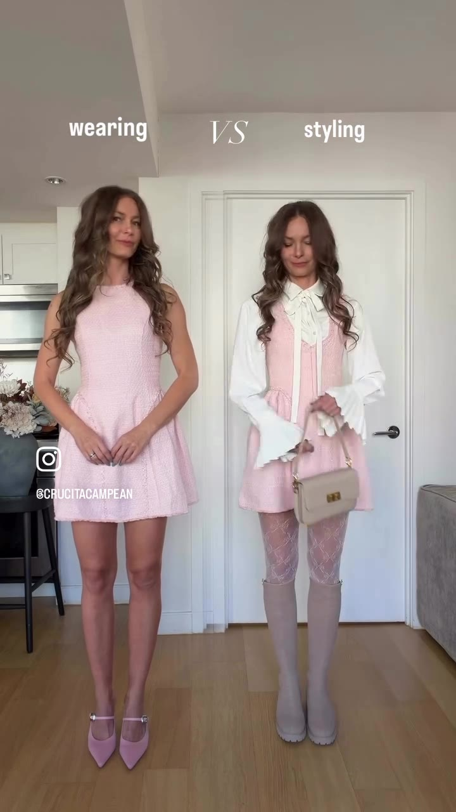

- **장면:** 크림색 구조적 미니 숄더백(금장 턴락)을 오른손으로 짧은 스트랩을 잡아 엉덩이 앞에 들고 내려다보며 미소.
- **오른쪽 착장 단계:** + 토프 스웨이드 니하이 부츠
- **왼쪽:** 정지 · 손 앞으로 모음
- **오버레이:** IG 아이콘 + @아이디 → 왼쪽 패널 왼쪽 엉덩이 높이 (음원 라벨 없음)

**① 스플릿 프롬프트**

```text
Composition: split screen. The 9:16 frame is divided exactly down the vertical center into two equal panels with no visible divider line; the room continues seamlessly across both panels (same room, same locked camera, the kitchen behind the left panel, the white door behind the right panel). The SAME woman appears twice, centered in each panel, both full body head to toe: top of head about 22% from the top of the frame, feet about 8% above the bottom edge. The top 20% of the frame is empty wall, left clear as headroom for title text.

RIGHT PANEL ('styling'): she is in the same pink tweed dress turned around and worn backwards, so its low scooped back now forms a deep U-shaped neckline in front and the dress reads as a pinafore; a faint vertical center seam runs down the front bodice, layered over a crisp ivory-white long-sleeve blouse underneath: small pointed collar, a ruffled jabot frill down the placket, an oversized pussy bow at the neck with very long satin ribbon tails, voluminous sleeves ending in dramatic knife-pleated bell cuffs that cover half the hand; sheer white lace tights with a diamond trellis and tiny bow lace pattern; greige-taupe suede pull-on knee-high boots with a chunky cream rubber lug sole and a low block heel. Action and pose: holding a small cream structured leather shoulder bag with a front flap and a gold turn-lock clasp, short shoulder strap by its short strap in her right hand in front of her hip, looking down at it with a soft smile.

LEFT PANEL ('wearing'): she stands still and upright facing the camera, feet together in dusty-pink suede pointed-toe Mary Jane kitten heels with a thin strap fastened by a small crystal buckle and a slim clear-silver heel, wearing only the plain pink tweed dress with no styling (a baby-pink tweed boucle sleeveless mini dress: high round crew neckline, fitted structured bodice with princess seams, dropped waist, voluminous puffed bubble skirt made of curved gored panels ending mid-thigh, raw frayed self-fringe trim along the seams and hem, fine woven texture with tiny white flecks), arms relaxed with hands loosely clasped in front of her hips, calm neutral expression with a faint polite smile.

The woman (identical in every appearance): late 20s to early 30s, slim toned athletic build, light olive warm-toned skin with a subtle tan, oval face with defined cheekbones, almond-shaped eyes, natural brows, soft natural makeup with bronzed cheeks and a nude-mauve lip. Very long voluminous chocolate-brown hair with caramel balayage, middle part, styled in loose glossy mermaid curls falling past the chest. Short grey-blue manicured nails, a thin gold ring.

Setting: bright minimalist modern apartment. White walls and ceiling with a small recessed round downlight at the upper left. Left side of the room: white shaker kitchen cabinets with a stainless-steel built-in wall oven and microwave stack in the background, and a dark wood stool holding a matte slate-blue ceramic vase with a large dried-flower arrangement (cream hydrangeas, dusty-pink and beige dried blooms). Right side: a white paneled interior door with slim white casing and a matte black lever handle, and the arm of a light-grey boucle sofa peeking in at the far right edge. Light natural-oak wide-plank hardwood floor. Clean and uncluttered.

Photorealistic vertical 9:16 smartphone fashion reel still (720x1280). Shot on a modern iPhone main camera (~26mm equivalent) on a locked-off tripod at chest height, perfectly level horizon, no lens distortion, deep focus with everything sharp. Bright, airy natural daylight: soft diffused window light from camera-left and front, neutral-warm white balance, very soft shadows, gentle reflections on the floor. Soft pastel grade with baby pink as the dominant hue, low contrast, clean unclipped whites, realistic skin texture. Authentic at-home influencer aesthetic, not a studio.

Avoid: text, captions, watermark, logo, extra people, deformed hands, different faces or hair between the two panels, a visible split line, cropped head or feet.
```

<details><summary>② 타이틀 텍스트 포함 버전</summary>

```text
Composition: split screen. The 9:16 frame is divided exactly down the vertical center into two equal panels with no visible divider line; the room continues seamlessly across both panels (same room, same locked camera, the kitchen behind the left panel, the white door behind the right panel). The SAME woman appears twice, centered in each panel, both full body head to toe: top of head about 22% from the top of the frame, feet about 8% above the bottom edge. The top 20% of the frame is empty wall, left clear as headroom for title text.

RIGHT PANEL ('styling'): she is in the same pink tweed dress turned around and worn backwards, so its low scooped back now forms a deep U-shaped neckline in front and the dress reads as a pinafore; a faint vertical center seam runs down the front bodice, layered over a crisp ivory-white long-sleeve blouse underneath: small pointed collar, a ruffled jabot frill down the placket, an oversized pussy bow at the neck with very long satin ribbon tails, voluminous sleeves ending in dramatic knife-pleated bell cuffs that cover half the hand; sheer white lace tights with a diamond trellis and tiny bow lace pattern; greige-taupe suede pull-on knee-high boots with a chunky cream rubber lug sole and a low block heel. Action and pose: holding a small cream structured leather shoulder bag with a front flap and a gold turn-lock clasp, short shoulder strap by its short strap in her right hand in front of her hip, looking down at it with a soft smile.

LEFT PANEL ('wearing'): she stands still and upright facing the camera, feet together in dusty-pink suede pointed-toe Mary Jane kitten heels with a thin strap fastened by a small crystal buckle and a slim clear-silver heel, wearing only the plain pink tweed dress with no styling (a baby-pink tweed boucle sleeveless mini dress: high round crew neckline, fitted structured bodice with princess seams, dropped waist, voluminous puffed bubble skirt made of curved gored panels ending mid-thigh, raw frayed self-fringe trim along the seams and hem, fine woven texture with tiny white flecks), arms relaxed with hands loosely clasped in front of her hips, calm neutral expression with a faint polite smile.

The woman (identical in every appearance): late 20s to early 30s, slim toned athletic build, light olive warm-toned skin with a subtle tan, oval face with defined cheekbones, almond-shaped eyes, natural brows, soft natural makeup with bronzed cheeks and a nude-mauve lip. Very long voluminous chocolate-brown hair with caramel balayage, middle part, styled in loose glossy mermaid curls falling past the chest. Short grey-blue manicured nails, a thin gold ring.

Setting: bright minimalist modern apartment. White walls and ceiling with a small recessed round downlight at the upper left. Left side of the room: white shaker kitchen cabinets with a stainless-steel built-in wall oven and microwave stack in the background, and a dark wood stool holding a matte slate-blue ceramic vase with a large dried-flower arrangement (cream hydrangeas, dusty-pink and beige dried blooms). Right side: a white paneled interior door with slim white casing and a matte black lever handle, and the arm of a light-grey boucle sofa peeking in at the far right edge. Light natural-oak wide-plank hardwood floor. Clean and uncluttered.

Photorealistic vertical 9:16 smartphone fashion reel still (720x1280). Shot on a modern iPhone main camera (~26mm equivalent) on a locked-off tripod at chest height, perfectly level horizon, no lens distortion, deep focus with everything sharp. Bright, airy natural daylight: soft diffused window light from camera-left and front, neutral-warm white balance, very soft shadows, gentle reflections on the floor. Soft pastel grade with baby pink as the dominant hue, low contrast, clean unclipped whites, realistic skin texture. Authentic at-home influencer aesthetic, not a studio.

Overlay text in the top 16% of the frame: the lowercase word "wearing" in bold white condensed sans-serif centered over the left panel, a large thin white italic serif "VS" centered on the split line, and "styling" in the same bold white condensed sans-serif centered over the right panel; subtle soft drop shadow.

Avoid: extra captions, watermark, logo, extra people, deformed hands, different faces or hair between the two panels, a visible split line, cropped head or feet.
```
</details>

<details><summary>짧은 버전 (글자 수 제한 있는 모델용)</summary>

```text
Photorealistic vertical 9:16 split-screen fashion reel still: the same woman twice, side by side, full body head to toe, in a bright white minimalist apartment, locked tripod at chest height, soft daylight, airy pastel-pink grade, iPhone look. Woman: late 20s, slim and toned, light olive skin, very long chocolate-brown mermaid curls with caramel balayage, middle part, natural makeup. LEFT ('wearing'): standing still, hands clasped in front, in the plain baby-pink tweed sleeveless bubble mini dress with frayed trim and dusty-pink suede Mary Jane kitten heels. RIGHT ('styling'): in the pink tweed dress worn backwards as a deep U-neck pinafore over a white pussy-bow blouse with long ribbon ties and pleated bell sleeves, white lace tights, taupe suede knee-high lug-sole boots; holding a small cream structured leather shoulder bag with a front flap and a gold turn-lock clasp, short shoulder strap by its short strap in her right hand in front of her hip, looking down at it with a soft smile. Background continuous across both halves: white kitchen and dried flowers behind the left, white paneled door with a black handle behind the right, light oak floor. Empty headroom at the top. No text, no visible split line.
```
</details>

<details><summary>③ 솔로(오른쪽 인물만) 버전</summary>

```text
Composition: single subject centered, full body head to toe, top of head about 22% from the top of the frame, feet about 8% above the bottom edge, generous empty space on both sides so the frame can be cropped to its central 50% width. Behind her: the white paneled door with a matte black lever handle, the grey boucle sofa arm at the right edge.

Subject: one woman, in the same pink tweed dress turned around and worn backwards, so its low scooped back now forms a deep U-shaped neckline in front and the dress reads as a pinafore; a faint vertical center seam runs down the front bodice, layered over a crisp ivory-white long-sleeve blouse underneath: small pointed collar, a ruffled jabot frill down the placket, an oversized pussy bow at the neck with very long satin ribbon tails, voluminous sleeves ending in dramatic knife-pleated bell cuffs that cover half the hand; sheer white lace tights with a diamond trellis and tiny bow lace pattern; greige-taupe suede pull-on knee-high boots with a chunky cream rubber lug sole and a low block heel. Action and pose: holding a small cream structured leather shoulder bag with a front flap and a gold turn-lock clasp, short shoulder strap by its short strap in her right hand in front of her hip, looking down at it with a soft smile.

The woman (identical in every appearance): late 20s to early 30s, slim toned athletic build, light olive warm-toned skin with a subtle tan, oval face with defined cheekbones, almond-shaped eyes, natural brows, soft natural makeup with bronzed cheeks and a nude-mauve lip. Very long voluminous chocolate-brown hair with caramel balayage, middle part, styled in loose glossy mermaid curls falling past the chest. Short grey-blue manicured nails, a thin gold ring.

Photorealistic vertical 9:16 smartphone fashion reel still (720x1280). Shot on a modern iPhone main camera (~26mm equivalent) on a locked-off tripod at chest height, perfectly level horizon, no lens distortion, deep focus with everything sharp. Bright, airy natural daylight: soft diffused window light from camera-left and front, neutral-warm white balance, very soft shadows, gentle reflections on the floor. Soft pastel grade with baby pink as the dominant hue, low contrast, clean unclipped whites, realistic skin texture. Authentic at-home influencer aesthetic, not a studio.

Avoid: text, captions, watermark, logo, extra people, deformed hands, cropped head or feet.
```
</details>

### F18 · 12.40s (프레임 #372) — 가방 메기 · 왼쪽이 쳐다봄

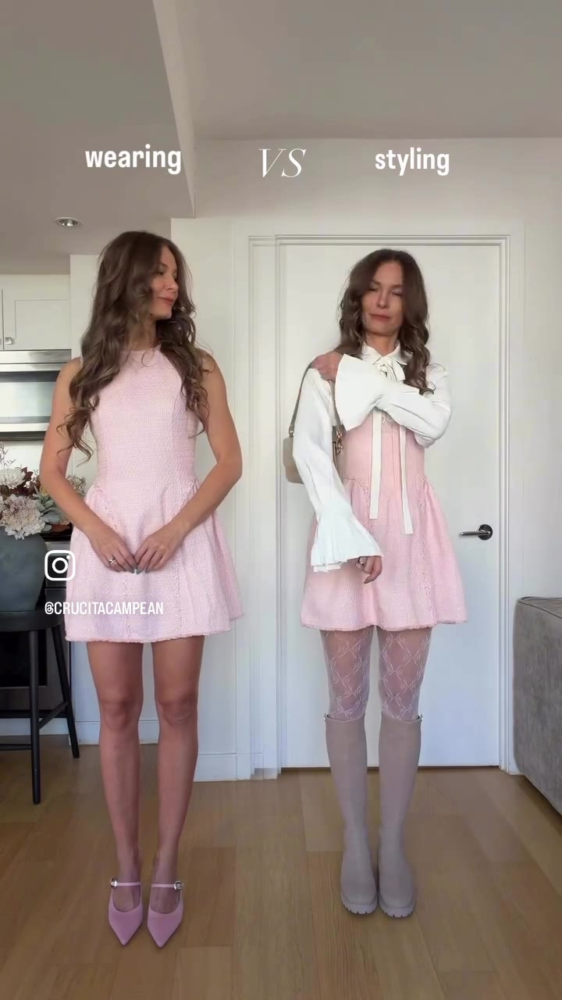

- **장면:** 가방을 오른쪽 어깨에 메고, 왼손을 가슴 앞으로 교차해 스트랩을 정리. 이때 왼쪽 패널의 '나'가 고개를 돌려 오른쪽을 쳐다보기 시작 (12.0초부터).
- **오른쪽 착장 단계:** + 토프 스웨이드 니하이 부츠
- **왼쪽:** 고개를 돌려 오른쪽을 바라봄
- **오버레이:** IG 아이콘 + @아이디 → 왼쪽 패널 왼쪽 엉덩이 높이 (음원 라벨 없음)

**① 스플릿 프롬프트**

```text
Composition: split screen. The 9:16 frame is divided exactly down the vertical center into two equal panels with no visible divider line; the room continues seamlessly across both panels (same room, same locked camera, the kitchen behind the left panel, the white door behind the right panel). The SAME woman appears twice, centered in each panel, both full body head to toe: top of head about 22% from the top of the frame, feet about 8% above the bottom edge. The top 20% of the frame is empty wall, left clear as headroom for title text.

RIGHT PANEL ('styling'): she is in the same pink tweed dress turned around and worn backwards, so its low scooped back now forms a deep U-shaped neckline in front and the dress reads as a pinafore; a faint vertical center seam runs down the front bodice, layered over a crisp ivory-white long-sleeve blouse underneath: small pointed collar, a ruffled jabot frill down the placket, an oversized pussy bow at the neck with very long satin ribbon tails, voluminous sleeves ending in dramatic knife-pleated bell cuffs that cover half the hand; sheer white lace tights with a diamond trellis and tiny bow lace pattern; greige-taupe suede pull-on knee-high boots with a chunky cream rubber lug sole and a low block heel. Action and pose: the cream bag now hanging from her right shoulder; her left hand reaches across her chest to adjust the strap on her right shoulder, right arm bent at the elbow, head turned slightly down toward the strap, gentle smile.

LEFT PANEL ('wearing'): same unstyled look and stance (plain pink tweed dress, pink Mary Jane heels, hands loosely clasped in front of her hips), but she has turned her head to her left and glances sideways toward the right panel with a small amused, impressed smile; her body still faces the camera.

The woman (identical in every appearance): late 20s to early 30s, slim toned athletic build, light olive warm-toned skin with a subtle tan, oval face with defined cheekbones, almond-shaped eyes, natural brows, soft natural makeup with bronzed cheeks and a nude-mauve lip. Very long voluminous chocolate-brown hair with caramel balayage, middle part, styled in loose glossy mermaid curls falling past the chest. Short grey-blue manicured nails, a thin gold ring.

Setting: bright minimalist modern apartment. White walls and ceiling with a small recessed round downlight at the upper left. Left side of the room: white shaker kitchen cabinets with a stainless-steel built-in wall oven and microwave stack in the background, and a dark wood stool holding a matte slate-blue ceramic vase with a large dried-flower arrangement (cream hydrangeas, dusty-pink and beige dried blooms). Right side: a white paneled interior door with slim white casing and a matte black lever handle, and the arm of a light-grey boucle sofa peeking in at the far right edge. Light natural-oak wide-plank hardwood floor. Clean and uncluttered.

Photorealistic vertical 9:16 smartphone fashion reel still (720x1280). Shot on a modern iPhone main camera (~26mm equivalent) on a locked-off tripod at chest height, perfectly level horizon, no lens distortion, deep focus with everything sharp. Bright, airy natural daylight: soft diffused window light from camera-left and front, neutral-warm white balance, very soft shadows, gentle reflections on the floor. Soft pastel grade with baby pink as the dominant hue, low contrast, clean unclipped whites, realistic skin texture. Authentic at-home influencer aesthetic, not a studio.

Avoid: text, captions, watermark, logo, extra people, deformed hands, different faces or hair between the two panels, a visible split line, cropped head or feet.
```

<details><summary>② 타이틀 텍스트 포함 버전</summary>

```text
Composition: split screen. The 9:16 frame is divided exactly down the vertical center into two equal panels with no visible divider line; the room continues seamlessly across both panels (same room, same locked camera, the kitchen behind the left panel, the white door behind the right panel). The SAME woman appears twice, centered in each panel, both full body head to toe: top of head about 22% from the top of the frame, feet about 8% above the bottom edge. The top 20% of the frame is empty wall, left clear as headroom for title text.

RIGHT PANEL ('styling'): she is in the same pink tweed dress turned around and worn backwards, so its low scooped back now forms a deep U-shaped neckline in front and the dress reads as a pinafore; a faint vertical center seam runs down the front bodice, layered over a crisp ivory-white long-sleeve blouse underneath: small pointed collar, a ruffled jabot frill down the placket, an oversized pussy bow at the neck with very long satin ribbon tails, voluminous sleeves ending in dramatic knife-pleated bell cuffs that cover half the hand; sheer white lace tights with a diamond trellis and tiny bow lace pattern; greige-taupe suede pull-on knee-high boots with a chunky cream rubber lug sole and a low block heel. Action and pose: the cream bag now hanging from her right shoulder; her left hand reaches across her chest to adjust the strap on her right shoulder, right arm bent at the elbow, head turned slightly down toward the strap, gentle smile.

LEFT PANEL ('wearing'): same unstyled look and stance (plain pink tweed dress, pink Mary Jane heels, hands loosely clasped in front of her hips), but she has turned her head to her left and glances sideways toward the right panel with a small amused, impressed smile; her body still faces the camera.

The woman (identical in every appearance): late 20s to early 30s, slim toned athletic build, light olive warm-toned skin with a subtle tan, oval face with defined cheekbones, almond-shaped eyes, natural brows, soft natural makeup with bronzed cheeks and a nude-mauve lip. Very long voluminous chocolate-brown hair with caramel balayage, middle part, styled in loose glossy mermaid curls falling past the chest. Short grey-blue manicured nails, a thin gold ring.

Setting: bright minimalist modern apartment. White walls and ceiling with a small recessed round downlight at the upper left. Left side of the room: white shaker kitchen cabinets with a stainless-steel built-in wall oven and microwave stack in the background, and a dark wood stool holding a matte slate-blue ceramic vase with a large dried-flower arrangement (cream hydrangeas, dusty-pink and beige dried blooms). Right side: a white paneled interior door with slim white casing and a matte black lever handle, and the arm of a light-grey boucle sofa peeking in at the far right edge. Light natural-oak wide-plank hardwood floor. Clean and uncluttered.

Photorealistic vertical 9:16 smartphone fashion reel still (720x1280). Shot on a modern iPhone main camera (~26mm equivalent) on a locked-off tripod at chest height, perfectly level horizon, no lens distortion, deep focus with everything sharp. Bright, airy natural daylight: soft diffused window light from camera-left and front, neutral-warm white balance, very soft shadows, gentle reflections on the floor. Soft pastel grade with baby pink as the dominant hue, low contrast, clean unclipped whites, realistic skin texture. Authentic at-home influencer aesthetic, not a studio.

Overlay text in the top 16% of the frame: the lowercase word "wearing" in bold white condensed sans-serif centered over the left panel, a large thin white italic serif "VS" centered on the split line, and "styling" in the same bold white condensed sans-serif centered over the right panel; subtle soft drop shadow.

Avoid: extra captions, watermark, logo, extra people, deformed hands, different faces or hair between the two panels, a visible split line, cropped head or feet.
```
</details>

<details><summary>짧은 버전 (글자 수 제한 있는 모델용)</summary>

```text
Photorealistic vertical 9:16 split-screen fashion reel still: the same woman twice, side by side, full body head to toe, in a bright white minimalist apartment, locked tripod at chest height, soft daylight, airy pastel-pink grade, iPhone look. Woman: late 20s, slim and toned, light olive skin, very long chocolate-brown mermaid curls with caramel balayage, middle part, natural makeup. LEFT ('wearing'): standing still, hands clasped in front, in the plain baby-pink tweed sleeveless bubble mini dress with frayed trim and dusty-pink suede Mary Jane kitten heels, head turned to glance at the right side with an amused smile. RIGHT ('styling'): in the pink tweed dress worn backwards as a deep U-neck pinafore over a white pussy-bow blouse with long ribbon ties and pleated bell sleeves, white lace tights, taupe suede knee-high lug-sole boots; the cream bag now hanging from her right shoulder; her left hand reaches across her chest to adjust the strap on her right shoulder, right arm bent at the elbow, head turned slightly down toward the strap, gentle smile. Background continuous across both halves: white kitchen and dried flowers behind the left, white paneled door with a black handle behind the right, light oak floor. Empty headroom at the top. No text, no visible split line.
```
</details>

<details><summary>③ 솔로(오른쪽 인물만) 버전</summary>

```text
Composition: single subject centered, full body head to toe, top of head about 22% from the top of the frame, feet about 8% above the bottom edge, generous empty space on both sides so the frame can be cropped to its central 50% width. Behind her: the white paneled door with a matte black lever handle, the grey boucle sofa arm at the right edge.

Subject: one woman, in the same pink tweed dress turned around and worn backwards, so its low scooped back now forms a deep U-shaped neckline in front and the dress reads as a pinafore; a faint vertical center seam runs down the front bodice, layered over a crisp ivory-white long-sleeve blouse underneath: small pointed collar, a ruffled jabot frill down the placket, an oversized pussy bow at the neck with very long satin ribbon tails, voluminous sleeves ending in dramatic knife-pleated bell cuffs that cover half the hand; sheer white lace tights with a diamond trellis and tiny bow lace pattern; greige-taupe suede pull-on knee-high boots with a chunky cream rubber lug sole and a low block heel. Action and pose: the cream bag now hanging from her right shoulder; her left hand reaches across her chest to adjust the strap on her right shoulder, right arm bent at the elbow, head turned slightly down toward the strap, gentle smile.

The woman (identical in every appearance): late 20s to early 30s, slim toned athletic build, light olive warm-toned skin with a subtle tan, oval face with defined cheekbones, almond-shaped eyes, natural brows, soft natural makeup with bronzed cheeks and a nude-mauve lip. Very long voluminous chocolate-brown hair with caramel balayage, middle part, styled in loose glossy mermaid curls falling past the chest. Short grey-blue manicured nails, a thin gold ring.

Photorealistic vertical 9:16 smartphone fashion reel still (720x1280). Shot on a modern iPhone main camera (~26mm equivalent) on a locked-off tripod at chest height, perfectly level horizon, no lens distortion, deep focus with everything sharp. Bright, airy natural daylight: soft diffused window light from camera-left and front, neutral-warm white balance, very soft shadows, gentle reflections on the floor. Soft pastel grade with baby pink as the dominant hue, low contrast, clean unclipped whites, realistic skin texture. Authentic at-home influencer aesthetic, not a studio.

Avoid: text, captions, watermark, logo, extra people, deformed hands, cropped head or feet.
```
</details>

### F19 · 13.30s (프레임 #399) — 피날레 · 오프닝 포즈 반복

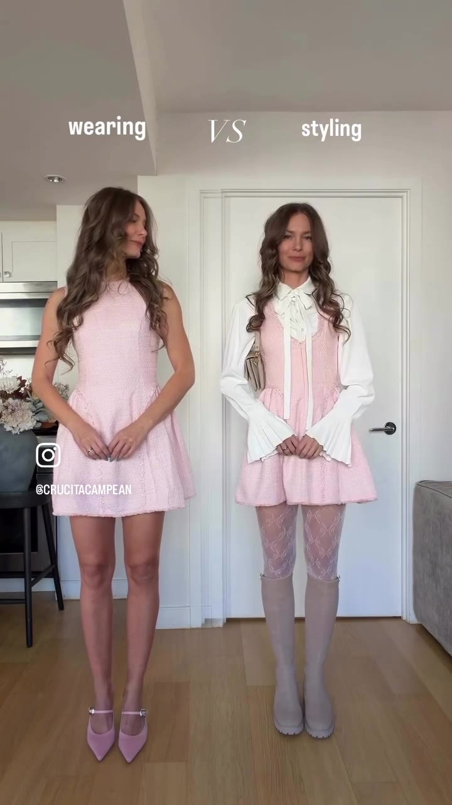

- **장면:** 오프닝과 같은 손 모은 정자세로 마무리, 가방은 오른쪽 어깨, 리본은 가운데. 왼쪽 '나'는 계속 오른쪽을 바라봄. 비포/애프터 대비가 가장 큰 프레임.
- **오른쪽 착장 단계:** + 크림 미니 숄더백 (완성)
- **왼쪽:** 고개를 돌려 오른쪽을 바라봄
- **오버레이:** IG 아이콘 + @아이디 → 왼쪽 패널 왼쪽 엉덩이 높이 (음원 라벨 없음)

**① 스플릿 프롬프트**

```text
Composition: split screen. The 9:16 frame is divided exactly down the vertical center into two equal panels with no visible divider line; the room continues seamlessly across both panels (same room, same locked camera, the kitchen behind the left panel, the white door behind the right panel). The SAME woman appears twice, centered in each panel, both full body head to toe: top of head about 22% from the top of the frame, feet about 8% above the bottom edge. The top 20% of the frame is empty wall, left clear as headroom for title text.

RIGHT PANEL ('styling'): she is in the same pink tweed dress turned around and worn backwards, so its low scooped back now forms a deep U-shaped neckline in front and the dress reads as a pinafore; a faint vertical center seam runs down the front bodice, layered over a crisp ivory-white long-sleeve blouse underneath: small pointed collar, a ruffled jabot frill down the placket, an oversized pussy bow at the neck with very long satin ribbon tails, voluminous sleeves ending in dramatic knife-pleated bell cuffs that cover half the hand; sheer white lace tights with a diamond trellis and tiny bow lace pattern; greige-taupe suede pull-on knee-high boots with a chunky cream rubber lug sole and a low block heel; carrying a small cream structured leather shoulder bag with a front flap and a gold turn-lock clasp, short shoulder strap. Action and pose: final pose mirroring the opening: standing straight facing the camera, feet together in the boots, hands loosely clasped in front of her hips, the cream bag on her right shoulder, the bow and ribbon tails centered, soft confident closed-mouth smile.

LEFT PANEL ('wearing'): same unstyled look and stance (plain pink tweed dress, pink Mary Jane heels, hands loosely clasped in front of her hips), but she has turned her head to her left and glances sideways toward the right panel with a small amused, impressed smile; her body still faces the camera.

The woman (identical in every appearance): late 20s to early 30s, slim toned athletic build, light olive warm-toned skin with a subtle tan, oval face with defined cheekbones, almond-shaped eyes, natural brows, soft natural makeup with bronzed cheeks and a nude-mauve lip. Very long voluminous chocolate-brown hair with caramel balayage, middle part, styled in loose glossy mermaid curls falling past the chest. Short grey-blue manicured nails, a thin gold ring.

Setting: bright minimalist modern apartment. White walls and ceiling with a small recessed round downlight at the upper left. Left side of the room: white shaker kitchen cabinets with a stainless-steel built-in wall oven and microwave stack in the background, and a dark wood stool holding a matte slate-blue ceramic vase with a large dried-flower arrangement (cream hydrangeas, dusty-pink and beige dried blooms). Right side: a white paneled interior door with slim white casing and a matte black lever handle, and the arm of a light-grey boucle sofa peeking in at the far right edge. Light natural-oak wide-plank hardwood floor. Clean and uncluttered.

Photorealistic vertical 9:16 smartphone fashion reel still (720x1280). Shot on a modern iPhone main camera (~26mm equivalent) on a locked-off tripod at chest height, perfectly level horizon, no lens distortion, deep focus with everything sharp. Bright, airy natural daylight: soft diffused window light from camera-left and front, neutral-warm white balance, very soft shadows, gentle reflections on the floor. Soft pastel grade with baby pink as the dominant hue, low contrast, clean unclipped whites, realistic skin texture. Authentic at-home influencer aesthetic, not a studio.

Avoid: text, captions, watermark, logo, extra people, deformed hands, different faces or hair between the two panels, a visible split line, cropped head or feet.
```

<details><summary>② 타이틀 텍스트 포함 버전</summary>

```text
Composition: split screen. The 9:16 frame is divided exactly down the vertical center into two equal panels with no visible divider line; the room continues seamlessly across both panels (same room, same locked camera, the kitchen behind the left panel, the white door behind the right panel). The SAME woman appears twice, centered in each panel, both full body head to toe: top of head about 22% from the top of the frame, feet about 8% above the bottom edge. The top 20% of the frame is empty wall, left clear as headroom for title text.

RIGHT PANEL ('styling'): she is in the same pink tweed dress turned around and worn backwards, so its low scooped back now forms a deep U-shaped neckline in front and the dress reads as a pinafore; a faint vertical center seam runs down the front bodice, layered over a crisp ivory-white long-sleeve blouse underneath: small pointed collar, a ruffled jabot frill down the placket, an oversized pussy bow at the neck with very long satin ribbon tails, voluminous sleeves ending in dramatic knife-pleated bell cuffs that cover half the hand; sheer white lace tights with a diamond trellis and tiny bow lace pattern; greige-taupe suede pull-on knee-high boots with a chunky cream rubber lug sole and a low block heel; carrying a small cream structured leather shoulder bag with a front flap and a gold turn-lock clasp, short shoulder strap. Action and pose: final pose mirroring the opening: standing straight facing the camera, feet together in the boots, hands loosely clasped in front of her hips, the cream bag on her right shoulder, the bow and ribbon tails centered, soft confident closed-mouth smile.

LEFT PANEL ('wearing'): same unstyled look and stance (plain pink tweed dress, pink Mary Jane heels, hands loosely clasped in front of her hips), but she has turned her head to her left and glances sideways toward the right panel with a small amused, impressed smile; her body still faces the camera.

The woman (identical in every appearance): late 20s to early 30s, slim toned athletic build, light olive warm-toned skin with a subtle tan, oval face with defined cheekbones, almond-shaped eyes, natural brows, soft natural makeup with bronzed cheeks and a nude-mauve lip. Very long voluminous chocolate-brown hair with caramel balayage, middle part, styled in loose glossy mermaid curls falling past the chest. Short grey-blue manicured nails, a thin gold ring.

Setting: bright minimalist modern apartment. White walls and ceiling with a small recessed round downlight at the upper left. Left side of the room: white shaker kitchen cabinets with a stainless-steel built-in wall oven and microwave stack in the background, and a dark wood stool holding a matte slate-blue ceramic vase with a large dried-flower arrangement (cream hydrangeas, dusty-pink and beige dried blooms). Right side: a white paneled interior door with slim white casing and a matte black lever handle, and the arm of a light-grey boucle sofa peeking in at the far right edge. Light natural-oak wide-plank hardwood floor. Clean and uncluttered.

Photorealistic vertical 9:16 smartphone fashion reel still (720x1280). Shot on a modern iPhone main camera (~26mm equivalent) on a locked-off tripod at chest height, perfectly level horizon, no lens distortion, deep focus with everything sharp. Bright, airy natural daylight: soft diffused window light from camera-left and front, neutral-warm white balance, very soft shadows, gentle reflections on the floor. Soft pastel grade with baby pink as the dominant hue, low contrast, clean unclipped whites, realistic skin texture. Authentic at-home influencer aesthetic, not a studio.

Overlay text in the top 16% of the frame: the lowercase word "wearing" in bold white condensed sans-serif centered over the left panel, a large thin white italic serif "VS" centered on the split line, and "styling" in the same bold white condensed sans-serif centered over the right panel; subtle soft drop shadow.

Avoid: extra captions, watermark, logo, extra people, deformed hands, different faces or hair between the two panels, a visible split line, cropped head or feet.
```
</details>

<details><summary>짧은 버전 (글자 수 제한 있는 모델용)</summary>

```text
Photorealistic vertical 9:16 split-screen fashion reel still: the same woman twice, side by side, full body head to toe, in a bright white minimalist apartment, locked tripod at chest height, soft daylight, airy pastel-pink grade, iPhone look. Woman: late 20s, slim and toned, light olive skin, very long chocolate-brown mermaid curls with caramel balayage, middle part, natural makeup. LEFT ('wearing'): standing still, hands clasped in front, in the plain baby-pink tweed sleeveless bubble mini dress with frayed trim and dusty-pink suede Mary Jane kitten heels, head turned to glance at the right side with an amused smile. RIGHT ('styling'): in the pink tweed dress worn backwards as a deep U-neck pinafore over a white pussy-bow blouse with long ribbon ties and pleated bell sleeves, white lace tights, taupe suede knee-high lug-sole boots, cream mini shoulder bag with gold clasp on her right shoulder; final pose mirroring the opening: standing straight facing the camera, feet together in the boots, hands loosely clasped in front of her hips, the cream bag on her right shoulder, the bow and ribbon tails centered, soft confident closed-mouth smile. Background continuous across both halves: white kitchen and dried flowers behind the left, white paneled door with a black handle behind the right, light oak floor. Empty headroom at the top. No text, no visible split line.
```
</details>

<details><summary>③ 솔로(오른쪽 인물만) 버전</summary>

```text
Composition: single subject centered, full body head to toe, top of head about 22% from the top of the frame, feet about 8% above the bottom edge, generous empty space on both sides so the frame can be cropped to its central 50% width. Behind her: the white paneled door with a matte black lever handle, the grey boucle sofa arm at the right edge.

Subject: one woman, in the same pink tweed dress turned around and worn backwards, so its low scooped back now forms a deep U-shaped neckline in front and the dress reads as a pinafore; a faint vertical center seam runs down the front bodice, layered over a crisp ivory-white long-sleeve blouse underneath: small pointed collar, a ruffled jabot frill down the placket, an oversized pussy bow at the neck with very long satin ribbon tails, voluminous sleeves ending in dramatic knife-pleated bell cuffs that cover half the hand; sheer white lace tights with a diamond trellis and tiny bow lace pattern; greige-taupe suede pull-on knee-high boots with a chunky cream rubber lug sole and a low block heel; carrying a small cream structured leather shoulder bag with a front flap and a gold turn-lock clasp, short shoulder strap. Action and pose: final pose mirroring the opening: standing straight facing the camera, feet together in the boots, hands loosely clasped in front of her hips, the cream bag on her right shoulder, the bow and ribbon tails centered, soft confident closed-mouth smile.

The woman (identical in every appearance): late 20s to early 30s, slim toned athletic build, light olive warm-toned skin with a subtle tan, oval face with defined cheekbones, almond-shaped eyes, natural brows, soft natural makeup with bronzed cheeks and a nude-mauve lip. Very long voluminous chocolate-brown hair with caramel balayage, middle part, styled in loose glossy mermaid curls falling past the chest. Short grey-blue manicured nails, a thin gold ring.

Photorealistic vertical 9:16 smartphone fashion reel still (720x1280). Shot on a modern iPhone main camera (~26mm equivalent) on a locked-off tripod at chest height, perfectly level horizon, no lens distortion, deep focus with everything sharp. Bright, airy natural daylight: soft diffused window light from camera-left and front, neutral-warm white balance, very soft shadows, gentle reflections on the floor. Soft pastel grade with baby pink as the dominant hue, low contrast, clean unclipped whites, realistic skin texture. Authentic at-home influencer aesthetic, not a studio.

Avoid: text, captions, watermark, logo, extra people, deformed hands, cropped head or feet.
```
</details>

### F20 · 13.80s (프레임 #414) — 엔드카드 진입

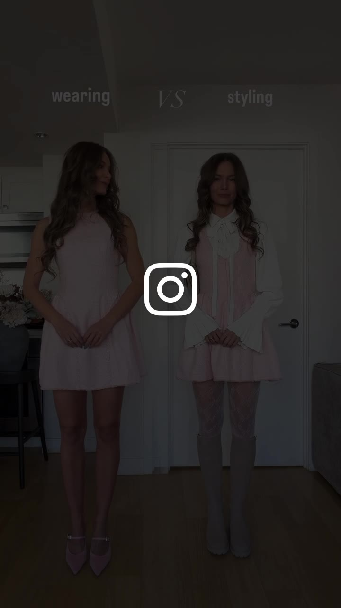

- **장면:** 13.7초 하드컷. 마지막 프레임을 정지시키고 약 70% 검은 오버레이. 중앙(세로 49%)에 흰색 인스타그램 아이콘이 팝인. 상단 타이틀도 같이 어두워짐.
- **오른쪽 착장 단계:** + 크림 미니 숄더백 (완성)
- **왼쪽:** 고개를 돌려 오른쪽을 바라봄
- **오버레이:** 화면 중앙 대형 IG 아이콘 (흰색) 팝인

**이미지 프롬프트 (엔드카드)**

```text
The final split-screen frame frozen and darkened by a roughly 70% black overlay, so both women and the room are only faintly visible in muted pink and grey; a large white rounded-square camera glyph icon (outline, circle lens, small dot) sits centered at mid-height, about 13% of the frame width. Flat graphic overlay, crisp edges, no other text. Tip: build this card in the video editor instead of generating it.
```

**@아이디 포함 버전**

```text
The final split-screen frame frozen and darkened by a roughly 70% black overlay, so both women and the room are only faintly visible in muted pink and grey; a large white rounded-square camera glyph icon (outline, circle lens, small dot) sits centered at mid-height, about 13% of the frame width, with "@yourhandle" in bold white condensed capitals centered just below it. Flat graphic overlay, crisp edges, no other text. Tip: build this card in the video editor instead of generating it.
```

### F21 · 15.50s (프레임 #465) — 엔드카드 · 아이콘 + @아이디

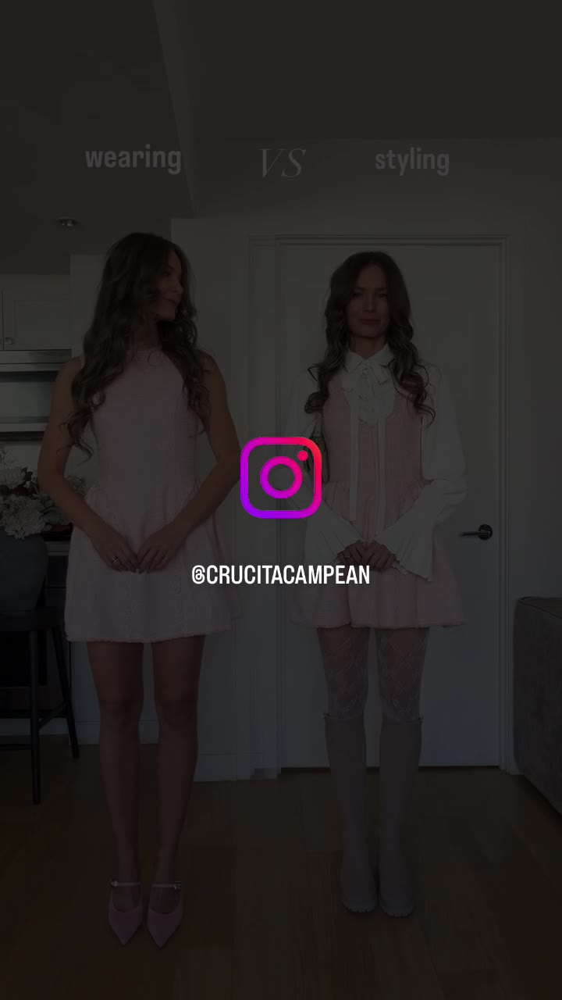

- **장면:** 아이콘이 약 0.5초마다 흰색 → 연핑크 → 핑크·오렌지 그라데이션 → 보라·마젠타 그라데이션 → 흰색으로 색이 바뀜. 14.0초부터 아이콘 아래 흰색 굵은 대문자 @아이디. 오디오는 15.9초에 끝나고 이후 무음.
- **오른쪽 착장 단계:** + 크림 미니 숄더백 (완성)
- **왼쪽:** 고개를 돌려 오른쪽을 바라봄
- **오버레이:** 중앙 아이콘(컬러 순환) + 하단 @아이디

**이미지 프롬프트 (엔드카드)**

```text
The final split-screen frame frozen and darkened by a roughly 70% black overlay, so both women and the room are only faintly visible in muted pink and grey; a large white rounded-square camera glyph icon (outline, circle lens, small dot) sits centered at mid-height, about 13% of the frame width. Flat graphic overlay, crisp edges, no other text. Tip: build this card in the video editor instead of generating it.
```

**@아이디 포함 버전**

```text
The final split-screen frame frozen and darkened by a roughly 70% black overlay, so both women and the room are only faintly visible in muted pink and grey; a large white rounded-square camera glyph icon (outline, circle lens, small dot) sits centered at mid-height, about 13% of the frame width, with "@yourhandle" in bold white condensed capitals centered just below it. Flat graphic overlay, crisp edges, no other text. Tip: build this card in the video editor instead of generating it.
```

## 6. 영상 세그먼트 프롬프트 (시작/끝 프레임 지정)

### V1 · 0.0–2.0s — 신발 벗기 (F01 → F04)

- 오른쪽: 무릎 들어 힐 차서 벗기 → 두 짝 들고 보기 → 프레임 밖으로 던지기 → 드레스 어깨 내리기 시작.

```text
Vertical 9:16 split-screen video, locked-off tripod camera with zero camera movement, the same bright white apartment continuous across both halves, the same woman in both halves. LEFT HALF: she stays almost frozen in the plain pink tweed dress and pink heels with hands clasped, only breathing and blinking. RIGHT HALF action: she kicks off her right pink Mary Jane heel with a high knee lift, then the left one, picks both shoes up and glances at them, tosses them out of frame to the right with a playful swing, then crosses her hand over her chest and starts pulling the left shoulder of the dress down. Natural, quick, confident movements with getting-ready energy; fabric moves realistically; hands stay anatomically correct; faces and hair stay identical between halves. No text, no cuts inside the clip.

Start frame: F01 image. End frame: F04 image.
```

### V2 · 2.0–4.8s — 드레스 뒤집어 피나포어로 (F04 → F07)

- 오른쪽: 팔 빼고 상체를 허리까지 내림(브라렛) → 드레스를 허리에서 180° 돌림 → 다시 끌어올려 팔 끼움 → 등쪽 U라인이 앞으로 온 피나포어 완성, 네크라인 정리.

```text
Vertical 9:16 split-screen video, locked-off tripod camera with zero camera movement, the same bright white apartment continuous across both halves, the same woman in both halves. LEFT HALF: she stays almost frozen in the plain pink tweed dress and pink heels with hands clasped, only breathing and blinking. RIGHT HALF action: she slips both arms out and peels the pink tweed bodice down to her waist, revealing a mocha-taupe bralette, rotates the whole dress 180 degrees around her waist, then pulls it back up and slides her arms through the armholes so the low scooped back now sits in front as a deep U-neck pinafore, and smooths the neckline with one hand. Natural, quick, confident movements with getting-ready energy; fabric moves realistically; hands stay anatomically correct; faces and hair stay identical between halves. No text, no cuts inside the clip.

Start frame: F04 image. End frame: F07 image.
```

### V3 · 4.8–7.9s — 블라우스 레이어링 + 리본 (F07 → F11)

- 오른쪽: 화이트 벨슬리브 블라우스 털어 펼치기 → (점프컷) 피나포어 안에 입은 상태로 칼라 정리 → 팔 벌려 소매 털기 → 목 앞 푸시보우 묶기.

```text
Vertical 9:16 split-screen video, locked-off tripod camera with zero camera movement, the same bright white apartment continuous across both halves, the same woman in both halves. LEFT HALF: she stays almost frozen in the plain pink tweed dress and pink heels with hands clasped, only breathing and blinking. RIGHT HALF action: she lifts a crisp white blouse with pleated bell sleeves and long ribbon ties into frame and shakes it open, then (already wearing it under the pinafore) straightens the pointed collar with both hands, raises her arms to the sides to fluff the voluminous sleeves, and ties the long satin pussy bow at her neck, letting the ribbon tails fall down the front. Natural, quick, confident movements with getting-ready energy; fabric moves realistically; hands stay anatomically correct; faces and hair stay identical between halves. No text, no cuts inside the clip.

Start frame: F07 image. End frame: F11 image.
```

### V4 · 7.9–9.5s — 레이스 타이츠 (F11 → F13)

- 오른쪽: 한쪽 다리 들고 화이트 레이스 타이츠를 허벅지까지 끌어올림 → 반대쪽 → 치마 안으로 정리 → 정자세로 미소.

```text
Vertical 9:16 split-screen video, locked-off tripod camera with zero camera movement, the same bright white apartment continuous across both halves, the same woman in both halves. LEFT HALF: she stays almost frozen in the plain pink tweed dress and pink heels with hands clasped, only breathing and blinking. RIGHT HALF action: she lifts her right leg and pulls sheer white lace tights up to her thigh, switches legs, smooths them up under the skirt, then stands straight with feet together and a soft smile. Natural, quick, confident movements with getting-ready energy; fabric moves realistically; hands stay anatomically correct; faces and hair stay identical between halves. No text, no cuts inside the clip.

Start frame: F11 image. End frame: F13 image.
```

### V5 · 9.5–11.4s — 니하이 부츠 (F13 → F16)

- 오른쪽: 토프 스웨이드 부츠를 들고 들어옴 → 숙여서 한 짝씩 신음 → 일어나 양손 허리 포즈.

```text
Vertical 9:16 split-screen video, locked-off tripod camera with zero camera movement, the same bright white apartment continuous across both halves, the same woman in both halves. LEFT HALF: she stays almost frozen in the plain pink tweed dress and pink heels with hands clasped, only breathing and blinking. RIGHT HALF action: she swings a pair of greige-taupe suede knee-high lug-sole boots into frame, bends forward and pulls one boot on, then the other, straightens up and places both hands on her hips with a confident smile. Natural, quick, confident movements with getting-ready energy; fabric moves realistically; hands stay anatomically correct; faces and hair stay identical between halves. No text, no cuts inside the clip.

Start frame: F13 image. End frame: F16 image.
```

### V6 · 11.4–13.7s — 가방 + 피날레 (F16 → F19)

- 오른쪽: 크림 미니백 들어 보기 → 오른쪽 어깨에 메고 스트랩 정리 → 손 모은 오프닝 포즈로 마무리. 왼쪽: 중간쯤(12.0초) 천천히 고개를 돌려 오른쪽을 쳐다보고 그대로 유지.

```text
Vertical 9:16 split-screen video, locked-off tripod camera with zero camera movement, the same bright white apartment continuous across both halves, the same woman in both halves. LEFT HALF: she stays almost frozen in the plain pink tweed dress and pink heels with hands clasped, only breathing and blinking. RIGHT HALF action: she picks up a small cream structured shoulder bag with a gold turn-lock, looks at it, slides the strap onto her right shoulder and adjusts it, then settles into the opening pose with hands clasped in front and a soft confident smile. EXCEPTION FOR THE LEFT HALF in this clip: about halfway through, the left woman slowly turns her head to her left to glance at the styled version with a small amused, impressed smile, and holds that glance. Natural, quick, confident movements with getting-ready energy; fabric moves realistically; hands stay anatomically correct; faces and hair stay identical between halves. No text, no cuts inside the clip.

Start frame: F16 image. End frame: F19 image.
```

### 왼쪽 패널 대기 클립 (14초, 끝에 고개 돌리기)

```text
Vertical 9:16 video, locked-off tripod, bright white apartment kitchen behind her. A woman stands still and upright facing the camera in a plain baby-pink tweed sleeveless mini dress with a bubble skirt and dusty-pink suede Mary Jane kitten heels, hands loosely clasped in front of her hips, calm neutral face with a faint smile; for most of the clip she only breathes, blinks and sways very slightly. Near the end she slowly turns her head to her left (toward screen right) and glances sideways with a small amused smile, then holds. No camera movement, no text.
```

### 마스터 프롬프트 (한 번에 생성할 때)

```text
A 14-second vertical 9:16 split-screen fashion reel, locked-off tripod, bright white apartment continuous across both halves, the same woman in both halves. The woman (identical in every appearance): late 20s to early 30s, slim toned athletic build, light olive warm-toned skin with a subtle tan, oval face with defined cheekbones, almond-shaped eyes, natural brows, soft natural makeup with bronzed cheeks and a nude-mauve lip. Very long voluminous chocolate-brown hair with caramel balayage, middle part, styled in loose glossy mermaid curls falling past the chest. Short grey-blue manicured nails, a thin gold ring. LEFT HALF ('wearing'): she stands still the whole time in a plain baby-pink tweed sleeveless bubble mini dress and dusty-pink Mary Jane kitten heels, hands clasped, and near the end turns her head to glance at the right half with an amused smile. RIGHT HALF ('styling'), fast sped-up jump cuts every half second: she kicks off the heels and tosses them away, peels the dress down to a mocha bralette, spins it around and re-wears it backwards as a deep U-neck pinafore, layers a white pussy-bow blouse with pleated bell sleeves underneath and ties the bow, pulls on white lace tights, steps into taupe suede knee-high lug-sole boots, puts a cream gold-clasp mini bag on her shoulder, and ends in the same hands-clasped pose as the start. Photorealistic vertical 9:16 smartphone fashion reel still (720x1280). Shot on a modern iPhone main camera (~26mm equivalent) on a locked-off tripod at chest height, perfectly level horizon, no lens distortion, deep focus with everything sharp. Bright, airy natural daylight: soft diffused window light from camera-left and front, neutral-warm white balance, very soft shadows, gentle reflections on the floor. Soft pastel grade with baby pink as the dominant hue, low contrast, clean unclipped whites, realistic skin texture. Authentic at-home influencer aesthetic, not a studio. No text.
```

## 7. 편집 스펙

| 항목 | 내용 |
|---|---|
| 캔버스 | 720×1280 (업로드는 1080×1920 권장), 30fps. 화면을 정확히 세로 중앙(x=360)에서 반으로 나눔. 경계선 없음. |
| 좌우 합성 | 원본은 같은 방, 같은 삼각대 위치에서 두 번 찍은 테이크를 반씩 이어 붙인 것. 왼쪽 = 주방 앞, 오른쪽 = 흰 문 앞. 각 클립을 중앙 50%로 크롭해 좌우에 배치. |
| 속도·컷 | 오른쪽 클립은 약 1.6~2배속 + 0.4~0.7초 간격 점프컷 (13.7초 동안 약 22컷). 왼쪽은 원속도로 끊김 없이 재생. |
| 타이틀 | 세로 위치 약 16%(y≈200px). 'wearing' = 왼쪽 패널 중앙, 'styling' = 오른쪽 패널 중앙: 흰색 볼드 컨덴스드 산세리프 소문자, 글자 높이 약 30px (대체 폰트: Oswald Medium, Archivo Narrow Bold). 'VS' = 정중앙, 흰색 얇은 이탤릭 세리프 대문자, 약 45px (대체 폰트: Playfair Display Italic, Bodoni Italic). 옅은 그림자. 0초부터 13.7초까지 고정. |
| 크리에이터 배지 ① | 0~9.0초: 오른쪽 패널 우상단 (x≈670, y≈160) 흰색 IG 아이콘 약 40px → 아래 '@아이디' 흰색 볼드 컨덴스드 대문자 약 16px → 그 아래 회색 70% 투명도 음원 라벨이 마키처럼 스크롤. 아이콘 색이 흰색 ↔ 그라데이션으로 주기적으로 바뀜. |
| 크리에이터 배지 ② | 9.0~13.7초: 왼쪽 패널 왼쪽 가장자리, 엉덩이 높이 (아이콘 x≈75, y≈720 / 아이디 y≈775)로 이동. 음원 라벨은 없어짐. 오른쪽 하체(타이츠·부츠)를 가리지 않으려는 위치 변경. |
| 엔드카드 | 13.7초 하드컷 → 마지막 프레임 정지 + 검은색 약 70% 오버레이. 중앙(세로 49%)에 흰색 IG 아이콘 약 95px 팝인 → 14.0초부터 아래에 '@아이디' 흰색 볼드 대문자 약 22px. 아이콘 색은 약 0.5초마다 흰색 → 연핑크 → 핑크·오렌지 → 보라·마젠타 그라데이션 → 흰색으로 순환. 17.7초까지 4초 유지. |
| 오디오 | 라틴팝/레게톤 계열, 약 120BPM, 1초마다 강박. 0~13초는 일정한 볼륨, 13.7~14.5초 엔드카드 진입 시 소리가 커짐(약 2배), 15.9초에 끝나고 이후 무음. 음원은 인스타 음악 라이브러리에서 붙이는 게 저작권상 안전. |
| 컬러 | 밝고 공기감 있는 파스텔 톤. 노출 +0.3, 대비 -10, 하이라이트 -15, 색온도 살짝 따뜻하게, 핑크 채도 +5 정도면 비슷함. |

## 8. 제작 순서

- **1. 캐릭터 고정** — '캐릭터 레퍼런스' 프롬프트로 기준 인물 이미지 1장을 만들고, 이후 모든 생성에 레퍼런스로 붙임 (Nano Banana Pro / GPT Image 편집 / Higgsfield Soul ID 등). 좌우 얼굴이 달라지는 게 가장 흔한 실패.
- **2. 의상 레퍼런스** — '의상 플랫레이' 프롬프트로 아이템 7개를 한 장에 생성 → 캐릭터 레퍼런스와 함께 첨부하면 원피스 텍스처, 블라우스 소매, 타이츠 패턴이 프레임마다 유지됨.
- **3. 키프레임 이미지** — F01, F04, F07, F11, F13, F16, F19 7장을 먼저 만들고, 나머지 프레임은 필요할 때 채움. 스플릿이 잘 안 나오면 '솔로' 프롬프트로 한 명씩 만들어 편집에서 합성.
- **4. 영상 생성** — V1~V6를 시작/끝 프레임 지정(first-last frame) 방식으로 생성 (Kling, Veo, Seedance 등). 클립당 5초 정도로 만들고 편집에서 1.6~2배속 + 점프컷으로 1.5~3초로 줄임.
- **5. 왼쪽 패널** — '왼쪽 대기 클립' 프롬프트로 14초짜리 정지 클립 1개 (끝부분에 고개 돌리기). 길이가 모자라면 앞부분을 슬로우로 늘림.
- **6. 합성 + 편집** — CapCut 등에서 9:16 캔버스에 왼쪽 대기 클립과 오른쪽 V1~V6를 각각 중앙 50% 크롭해서 배치 → 타이틀·배지·엔드카드는 '편집 스펙'대로 → 음원 얹고 강박에 점프컷 맞추기.
